# Liver Disease Prediction System (ILPD) — Complete Source-Code-Verified Technical Documentation

> **ACADEMIC RESEARCH PROTOTYPE DISCLAIMER**
> This system is an academic Machine Learning Engineering graduation project trained on the public UCI **Indian Liver Patient Dataset (ILPD)**. It is **NOT** a clinically validated medical device or diagnostic tool and **MUST NEVER** be used to diagnose patients, guide clinical triage, or determine medical treatment. Displayed probabilities represent statistical model risk scores ($P(\text{Liver Disease}) \in [0, 1]$), not clinically calibrated diagnostic probabilities.

| Document Metadata | Verified Value |
| :--- | :--- |
| **Project Name** | Liver Disease Prediction System (`liver-disease-prediction` `v1.0.0`) |
| **Dataset** | UCI Indian Liver Patient Dataset (ILPD, ID 225) — 583 raw / 570 deduplicated records |
| **Production Model** | `SoftVoting_ET_RF_LR` (`VotingClassifier`, soft voting, weights `[2, 1, 1]`) |
| **Decision Threshold** | `0.57` (selected on out-of-fold validation predictions; `Specificity >= 0.50` guardrail) |
| **Holdout Test Performance (`n=114`)** | `ROC-AUC = 0.8066` (95% CI: `0.7233–0.8798`), `PR-AUC = 0.9233`, `Recall = 0.8148`, `Specificity = 0.5152` |
| **Repeated 5×3 CV (`n=456`)** | `ROC-AUC = 0.7417 ± 0.0469`, `PR-AUC = 0.8912 ± 0.0213`, `Brier = 0.1765 ± 0.0116` |
| **Explainability** | SHAP `KernelExplainer` (`shap.kmeans` 30 centroids over 120 training samples) |
| **API & Auth** | FastAPI `v1.0.0` (`GET /health`, `/docs`, `/model-info`; `POST /predict`, `/predict/batch`, `/explain`), `X-API-Key` |
| **Frontend** | Streamlit prototype (`frontend/app.py`, HTTP-only client to FastAPI) |
| **Verification Basis** | Direct inspection of every source file, report JSON/CSV, artifact bundle, and live execution |

---

## Executive Summary & Definitive Answer: What Must the End User Enter?

> **Definitive Code-Verified Answer (`frontend/app.py:131-254`, `src/liver_disease/api/schemas.py:26-140`, `src/liver_disease/config.py:47-216`):**
>
> Before clicking **"Run Prediction"** in Tab 1 (*Individual Patient Prediction*), the end user must enter **exactly 10 mandatory patient attributes**: **2 demographic fields** (`Age`, `Gender`) and **8 Liver Function Test (LFT) biomarkers** (`Total Bilirubin`, `Direct Bilirubin`, `Alkaline Phosphotase`, `Alamine Aminotransferase / ALT / SGPT`, `Aspartate Aminotransferase / AST / SGOT`, `Total Proteins`, `Albumin`, and `A/G Ratio`).
>
> **UI Controls Beyond Patient Inputs:**
> - **Sidebar Authentication (`API Key (X-API-Key)`)**: Mandatory whenever the environment variable `LIVER_API_KEY` is not pre-populated; clicking **"Run Prediction"** with an empty key triggers a client-side error (`"Please enter your API Key (X-API-Key) in the sidebar before submitting."`).
> - **Sidebar Target Server (`FastAPI Base URL`)**: Pre-filled from `API_BASE_URL` (default `http://localhost:8000`).
> - **Form Toggle (`Include SHAP Feature Attribution Explanation`)**: Optional checkbox defaulting to `True` (routes to `POST /explain` when checked, `POST /predict` when unchecked).
> - **Preset Buttons**: Two convenience buttons (*"Load Elevated LFT Sample"* and *"Load Normal-Range Sample"*) populate all 10 fields; on first page load, the form is pre-populated with default values (`45, Male, 1.2, 0.4, 210.0, 38.0, 45.0, 6.8, 3.3, 0.95`).
>
> **Zero Missing Fields, Zero Hidden Derived Calculations:** None of the 10 inputs are calculated automatically in the frontend, API, or production preprocessing pipeline (`add_clinical_ratios=False` in `liver_disease_pipeline.joblib`). All 10 inputs map **1-to-1** across the Streamlit UI, JSON payload, Pydantic v2 `PatientFeatures` schema, `ClinicalFeatureEngineer`, `ColumnTransformer`, and final `SoftVoting_ET_RF_LR` model.

---

## Table of Contents

1. [Phase 1 — Full Project Inspection & Component Map](#phase-1--full-project-inspection--component-map)
2. [Phase 2 — Exact User Inputs, End-to-End Trace & Mismatches](#phase-2--exact-user-inputs-end-to-end-trace--mismatches)
3. [Phase 3 — CSV Batch Prediction Pipeline](#phase-3--csv-batch-prediction-pipeline)
4. [Phase 4 — Dataset Provenance, Data Audit & Exploratory Data Analysis (EDA)](#phase-4--dataset-provenance-data-audit--exploratory-data-analysis-eda)
5. [Phase 5 — Preprocessing Pipeline & Leakage Prevention](#phase-5--preprocessing-pipeline--leakage-prevention)
6. [Phase 6 — Model Development, Benchmarking & Ensemble Architecture](#phase-6--model-development-benchmarking--ensemble-architecture)
7. [Phase 7 — Holdout Model Evaluation & Clinical Context](#phase-7--holdout-model-evaluation--clinical-context)
8. [Phase 8 — SHAP Explainability (Global & Local Attribution)](#phase-8--shap-explainability-global--local-attribution)
9. [Phase 9 — System Architecture & FastAPI REST API Reference](#phase-9--system-architecture--fastapi-rest-api-reference)
10. [Phase 10 — Complete Project Structure & File Inventory](#phase-10--complete-project-structure--file-inventory)
11. [Phase 11 — Deployment, Operations & Project Handover Matrix](#phase-11--deployment-operations--project-handover-matrix)
12. [Phase 12 — ML Engineer Interview & Graduation Defense Preparation (35 Q&As)](#phase-12--ml-engineer-interview--graduation-defense-preparation-35-qas)
13. [Final Verification Checklist](#final-verification-checklist)

---

## Phase 1 — Full Project Inspection & Component Map

### 1.1 Architecture Philosophy
The repository separates **offline ML experimentation/training** from **online stateless serving** and **thin UI presentation**:

1. **Offline Research & Training Layer (`scripts/`, `notebooks/`, `src/liver_disease/data/`, `features/`, `models/benchmark.py`, `models/train.py`)**: Audits the immutable UCI ILPD CSV, removes exact duplicates prior to splitting, locks an 80/20 stratified holdout test set in `data/processed/`, benchmarks 11 classifiers with 5×3 Repeated Stratified CV, performs tuning, calibration, out-of-fold (OOF) threshold selection, single-pass holdout evaluation, and SHAP summary computation, and serializes a single self-contained inference bundle (`artifacts/models/liver_disease_pipeline.joblib`).
2. **Online ML Microservice Layer (`src/liver_disease/api/` + `src/liver_disease/models/predict.py`)**: Loads `liver_disease_pipeline.joblib` once during FastAPI `lifespan` startup, never retrains at runtime, enforces `X-API-Key` authentication via constant-time comparison, validates inputs with Pydantic v2 (`extra="forbid"`), and exposes REST endpoints on port `8000`.
3. **Decoupled Frontend Layer (`frontend/app.py`)**: A pure HTTP client built with Streamlit, Plotly, Pandas, and Requests. Its `frontend/Dockerfile` does not install `scikit-learn`, `shap`, `xgboost`, `lightgbm`, or `catboost`, enforcing zero ML logic duplication.

### 1.2 End-to-End Component Connectivity Map

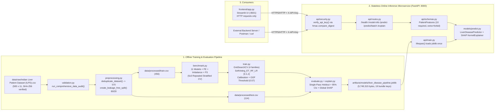

### 1.3 Verified Module Dependency Graph
Every component references `src/liver_disease/config.py` as its single source of truth for feature schemas, valid ranges, medical units, risk bands, target encoding, and artifact file paths:
- `config.py` → imported by `loader.py`, `validation.py`, `preprocessing.py`, `engineering.py`, `benchmark.py`, `evaluate.py`, `explain.py`, `predict.py`, `train.py`, `schemas.py`, `routes.py`, `main.py`, and all CLI scripts.
- `frontend/app.py` does **not** import `src/liver_disease` at all—it defines its own UI labels, validation ranges, `MEDICAL_DISCLAIMER`, and `SAMPLE_CSV_TEMPLATE` locally so the Streamlit container (`frontend/Dockerfile`) can run independently without copying `src/`.

---

## Phase 2 — Exact User Inputs, End-to-End Trace & Mismatches

### 2.1 Complete User Input Specification Table (`Tab 1: Individual Patient Prediction`)

Source code verified against `frontend/app.py:219-253`, `src/liver_disease/api/schemas.py:51-139`, `src/liver_disease/config.py:76-216`, and `artifacts/models/liver_disease_pipeline.joblib`.

| # | Application Field Name (Exact Streamlit Label) | Technical Feature Name (Raw / Model Feature) | Description | Input Type (UI Control & Schema Type) | Unit | Required / Optional | Validation Rules (UI & API Pydantic v2) |
| :-: | :--- | :--- | :--- | :--- | :--- | :--- | :--- |
| 1 | `Age (years)` | `Age` (`age` in JSON) | Patient's age in whole years (UCI ILPD capped patients `>89` at `90`). | UI: `st.number_input` (`step=1`, default `45`)<br>API: `int` | `years` | **Required** | **UI:** `min_value=1`, `max_value=120`, integer step `1`.<br>**API:** `1 <= age <= 120`, rejects `bool`, rejects non-integer floats (e.g. `45.5`), accepts exact integer floats (e.g. `45.0` → `45`). |
| 2 | `Gender` | `Gender` (`gender` in JSON; `Gender_Male` in model) | Patient biological sex / recorded gender. | UI: `st.selectbox` (`["Male", "Female"]`, default `"Male"`)<br>API: `Literal["Male", "Female"]` | categorical (`Male`/`Female`) | **Required** | **UI:** Restricted dropdown to `"Male"` or `"Female"`.<br>**API:** Strips leading/trailing whitespace, case-sensitive exact match to `"Male"` or `"Female"` (rejects `"male"`, `"Other"`, etc. with HTTP `422`). |
| 3 | `Total Bilirubin — TB (mg/dL) [Ref: 0.1–1.2]` | `TB` (`total_bilirubin` in JSON) | Total serum bilirubin concentration (conjugated + unconjugated). | UI: `st.number_input` (`step=0.1`, `%.2f`, default `1.20`)<br>API: `float` | `mg/dL` | **Required** | **UI:** `0.05` to `100.0`.<br>**API:** `0.05 <= val <= 100.0`, finite float, rejects `bool`, `NaN`, `Inf`. |
| 4 | `Direct Bilirubin — DB (mg/dL) [Ref: 0.0–0.3]` | `DB` (`direct_bilirubin` in JSON) | Conjugated (direct) serum bilirubin concentration. | UI: `st.number_input` (`step=0.1`, `%.2f`, default `0.40`)<br>API: `float` | `mg/dL` | **Required** | **UI:** `0.0` to `50.0`.<br>**API:** `0.0 <= val <= 50.0`, finite float, rejects `bool`, `NaN`, `Inf`. *(Note: does NOT check `DB <= TB`.)* |
| 5 | `Alkaline Phosphotase — ALP (IU/L) [Ref: 44–147]` | `Alkphos` (`alkaline_phosphotase` in JSON) | Serum alkaline phosphatase enzyme level. | UI: `st.number_input` (`step=1.0`, default `210.00`)<br>API: `float` | `IU/L` | **Required** | **UI:** `10.0` to `5000.0`.<br>**API:** `10.0 <= val <= 5000.0`, finite float, rejects `bool`, `NaN`, `Inf`. *(Note historical ILPD spelling `Phosphotase`.)* |
| 6 | `Alamine Aminotransferase — ALT/SGPT (IU/L) [Ref: 7–56]` | `Sgpt` (`alamine_aminotransferase` in JSON) | Serum alanine aminotransferase (ALT / SGPT) enzyme level. | UI: `st.number_input` (`step=1.0`, default `38.00`)<br>API: `float` | `IU/L` | **Required** | **UI:** `1.0` to `5000.0`.<br>**API:** `1.0 <= val <= 5000.0`, finite float, rejects `bool`, `NaN`, `Inf`. *(Note historical ILPD spelling `Alamine`.)* |
| 7 | `Aspartate Aminotransferase — AST/SGOT (IU/L) [Ref: 10–40]` | `Sgot` (`aspartate_aminotransferase` in JSON) | Serum aspartate aminotransferase (AST / SGOT) enzyme level. | UI: `st.number_input` (`step=1.0`, default `45.00`)<br>API: `float` | `IU/L` | **Required** | **UI:** `1.0` to `10000.0`.<br>**API:** `1.0 <= val <= 10000.0`, finite float, rejects `bool`, `NaN`, `Inf`. |
| 8 | `Total Proteins — TP (g/dL) [Ref: 6.0–8.3]` | `TP` (`total_proteins` in JSON) | Total serum protein concentration. | UI: `st.number_input` (`step=0.1`, `%.2f`, default `6.80`)<br>API: `float` | `g/dL` | **Required** | **UI:** `1.0` to `20.0`.<br>**API:** `1.0 <= val <= 20.0`, finite float, rejects `bool`, `NaN`, `Inf`. |
| 9 | `Albumin — ALB (g/dL) [Ref: 3.5–5.0]` | `ALB` (`albumin` in JSON) | Serum albumin protein concentration. | UI: `st.number_input` (`step=0.1`, `%.2f`, default `3.30`)<br>API: `float` | `g/dL` | **Required** | **UI:** `0.5` to `12.0`.<br>**API:** `0.5 <= val <= 12.0`, finite float, rejects `bool`, `NaN`, `Inf`. *(Note: does NOT check `ALB <= TP`.)* |
| 10 | `A/G Ratio (dimensionless) [Ref: 1.0–2.5]` | `A/G Ratio` (`albumin_and_globulin_ratio` in JSON) | Ratio of serum albumin to serum globulin. | UI: `st.number_input` (`step=0.05`, `%.2f`, default `0.95`)<br>API: `float` | `dimensionless` | **Required** | **UI:** `0.1` to `10.0`.<br>**API:** `0.1 <= val <= 10.0`, finite float, rejects `bool`, `NaN`, `Inf`. *(Not auto-computed; must be supplied.)* |

#### Non-Patient UI Inputs in Streamlit (`frontend/app.py:131-140, 235`)

| UI Control Location | Exact Label | Variable | Type | Purpose / Default | Required? |
| :--- | :--- | :--- | :--- | :--- | :--- |
| Sidebar | `FastAPI Base URL` | `api_url` | `st.text_input` | Target REST API base URL (default `os.getenv("API_BASE_URL", "http://localhost:8000")`) | Required to connect |
| Sidebar | `API Key (X-API-Key)` | `api_key` | `st.text_input(..., type="password")` | Secret matching server's `LIVER_API_KEY` (default `os.getenv("LIVER_API_KEY", "")`) | **Mandatory** for `/predict`, `/explain`, `/predict/batch`, `/model-info` |
| Tab 1 Form | `Include SHAP Feature Attribution Explanation` | `include_shap` | `st.checkbox` | Default `True`. Checked → `POST /explain`; Unchecked → `POST /predict` | Optional toggle |

---

### 2.2 Explicit Answers to the 10 Verification Questions

1. **How many fields must the user enter?**
   - **10 patient attribute fields** (`age`, `gender`, `total_bilirubin`, `direct_bilirubin`, `alkaline_phosphotase`, `alamine_aminotransferase`, `aspartate_aminotransferase`, `total_proteins`, `albumin`, `albumin_and_globulin_ratio`), plus the sidebar `API Key (X-API-Key)` if not already injected via the `LIVER_API_KEY` environment variable.
2. **What are the exact field labels displayed in the application?**
   - `Age (years)`
   - `Gender`
   - `Total Bilirubin — TB (mg/dL) [Ref: 0.1–1.2]`
   - `Direct Bilirubin — DB (mg/dL) [Ref: 0.0–0.3]`
   - `Alkaline Phosphotase — ALP (IU/L) [Ref: 44–147]`
   - `Alamine Aminotransferase — ALT/SGPT (IU/L) [Ref: 7–56]`
   - `Aspartate Aminotransferase — AST/SGOT (IU/L) [Ref: 10–40]`
   - `Total Proteins — TP (g/dL) [Ref: 6.0–8.3]`
   - `Albumin — ALB (g/dL) [Ref: 3.5–5.0]`
   - `A/G Ratio (dimensionless) [Ref: 1.0–2.5]`
3. **Which fields are mandatory?**
   - **All 10 patient fields** are strictly mandatory in both `PatientFeatures` (`Field(...)` with no defaults, `extra="forbid"`) and `validate_feature_dataframe(..., allow_missing=False)`.
4. **Which fields are optional?**
   - **Zero** of the 10 clinical/demographic patient fields are optional. Only the `Include SHAP Feature Attribution Explanation` checkbox (`value=True`) is an optional UI behavior toggle, and `FastAPI Base URL` has a pre-filled default.
5. **Which fields are calculated automatically?**
   - **None** in the user input layer, API, or production model (`v1.0.0`). Even though `A/G Ratio` is physiologically related to `ALB / (TP - ALB)` and `ClinicalFeatureEngineer` contains code for 4 derived ratios (`AST_ALT_Ratio`, `DB_TB_Ratio`, `Indirect_Bilirubin`, `Globulin`), the serialized production pipeline sets `add_clinical_ratios=False`, so **neither `A/G Ratio` nor any clinical ratio is computed automatically**.
6. **Does the user need to enter Gender?**
   - **Yes.** `Gender` (`"Male"` or `"Female"`) is a mandatory input in the UI (`st.selectbox`), API (`PatientFeatures.gender`), and model (`Gender_Male` binary feature after `OneHotEncoder`). Note: in the SHAP global ranking (`model_metadata.json`), `Gender_Male` ranks last (#10, `mean |SHAP| = 0.00742`), yet omitting it causes HTTP `422`.
7. **Does the user need to enter all liver function test results?**
   - **Yes.** All 8 LFT biomarkers (`TB`, `DB`, `Alkphos`, `Sgpt`, `Sgot`, `TP`, `ALB`, `A/G Ratio`) must be entered. If any single one is missing or `null`, the API rejects the request with HTTP `422 Unprocessable Content`.
8. **Are there features in the dataset that the user never needs to enter?**
   - **Only the target column `Selector`** (which is the ground-truth label `1 = Liver Disease`, `2 = No Liver Disease` predicted by the model, never an input). Every single one of the **10 predictor columns** in `Indian Liver Patient Dataset (ILPD).csv` must be entered by the user.
9. **What happens if the user leaves a field empty?**
   - **In Streamlit Tab 1 (`st.number_input`)**: Every widget is initialized with a non-null default (`p["age"]`, `p["tb"]`, etc.) and `st.selectbox` always holds `"Male"` or `"Female"`. If a user manually clears a `st.number_input` box and blurs/submits, Streamlit automatically reverts it to its prior value or `min_value`—it never sends `null`. However, if the sidebar `API Key (X-API-Key)` is empty, `frontend/app.py:239-240` blocks the request and renders: `"Please enter your API Key (X-API-Key) in the sidebar before submitting."`
   - **In FastAPI `POST /predict` or `/explain`**: Omitting a JSON key or sending `null` triggers Pydantic v2 `ValidationError` and returns **HTTP `422 Unprocessable Content`**.
   - **In Batch CSV `POST /predict/batch`**: An empty cell becomes `NaN` → `None` (`routes.py:264`), causing that row to fail `PatientFeatures` validation and appear in `invalid_records` (excluded from predictions; if all rows fail, HTTP `422` is returned).
10. **Are there dropdowns, numeric inputs, or other UI controls?**
    - **9 numeric steppers (`st.number_input`)**: `Age` (integer `step=1`), `Alkphos`/`Sgpt`/`Sgot` (float `step=1.0`), `TB`/`DB`/`TP`/`ALB` (float `step=0.1`, `format="%.2f"`), `A/G Ratio` (float `step=0.05`, `format="%.2f"`).
    - **1 dropdown (`st.selectbox`)**: `Gender` (`["Male", "Female"]`).
    - **2 preset buttons (`st.button`)**: *"Load Elevated LFT Sample"*, *"Load Normal-Range Sample"*.
    - **1 checkbox (`st.checkbox`)**: *"Include SHAP Feature Attribution Explanation"*.
    - **1 submit button (`st.form_submit_button`)**: *"Run Prediction"*.
    - **Sidebar controls**: 1 plain `st.text_input` (`FastAPI Base URL`), 1 masked password `st.text_input` (`API Key (X-API-Key)`).

---

### 2.3 Complete 6-Stage Input Flow Trace

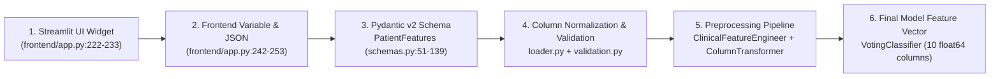

| # | 1. UI Field Label (`frontend/app.py`) | 2. Frontend Var → JSON Key (`payload`) | 3. Pydantic Schema (`PatientFeatures`) | 4. Normalized Column (`normalize_inference_columns`) | 5. Preprocessing Pipeline (`ClinicalFeatureEngineer` → `ColumnTransformer`) | 6. Final Model Feature Name & Fitted Params |
| :-: | :--- | :--- | :--- | :--- | :--- | :--- |
| 1 | `Age (years)` | `age` → `"age": int(age)` | `age: int` (`1..120`, no bool/frac) | `Age` | No `log1p` → Median Imputer → `RobustScaler` | `Age` (`center=45.0, IQR=25.0`) |
| 2 | `Gender` | `gender` → `"gender": gender` | `gender: Literal["Male","Female"]` (strip) | `Gender` | No `log1p` → `SimpleImputer("most_frequent")` (`"Male"`) → `OneHotEncoder([["Female","Male"]], drop="if_binary")` | `Gender_Male` (`Female -> 0.0`, `Male -> 1.0`) |
| 3 | `Total Bilirubin — TB (mg/dL) [Ref: 0.1–1.2]` | `tb` → `"total_bilirubin": float(tb)` | `total_bilirubin: float` (`0.05..100.0`) | `TB` | `np.log1p(max(TB, 0))` → Median Imputer → `RobustScaler` | `TB` (`center=0.693147, IQR=0.613599`) |
| 4 | `Direct Bilirubin — DB (mg/dL) [Ref: 0.0–0.3]` | `db` → `"direct_bilirubin": float(db)` | `direct_bilirubin: float` (`0.0..50.0`) | `DB` | `np.log1p(max(DB, 0))` → Median Imputer → `RobustScaler` | `DB` (`center=0.262364, IQR=0.606136`) |
| 5 | `Alkaline Phosphotase — ALP (IU/L) [Ref: 44–147]` | `alkphos` → `"alkaline_phosphotase": float(alkphos)` | `alkaline_phosphotase: float` (`10.0..5000.0`) | `Alkphos` | `np.log1p(max(Alkphos, 0))` → Median Imputer → `RobustScaler` | `Alkphos` (`center=5.337527, IQR=0.508537`) |
| 6 | `Alamine Aminotransferase — ALT/SGPT (IU/L) [Ref: 7–56]` | `sgpt` → `"alamine_aminotransferase": float(sgpt)` | `alamine_aminotransferase: float` (`1.0..5000.0`) | `Sgpt` | `np.log1p(max(Sgpt, 0))` → Median Imputer → `RobustScaler` | `Sgpt` (`center=3.583519, IQR=0.899484`) |
| 7 | `Aspartate Aminotransferase — AST/SGOT (IU/L) [Ref: 10–40]` | `sgot` → `"aspartate_aminotransferase": float(sgot)` | `aspartate_aminotransferase: float` (`1.0..10000.0`) | `Sgot` | `np.log1p(max(Sgot, 0))` → Median Imputer → `RobustScaler` | `Sgot` (`center=3.749435, IQR=1.207812`) |
| 8 | `Total Proteins — TP (g/dL) [Ref: 6.0–8.3]` | `tp` → `"total_proteins": float(tp)` | `total_proteins: float` (`1.0..20.0`) | `TP` | No `log1p` → Median Imputer → `RobustScaler` | `TP` (`center=6.600000, IQR=1.300000`) |
| 9 | `Albumin — ALB (g/dL) [Ref: 3.5–5.0]` | `alb` → `"albumin": float(alb)` | `albumin: float` (`0.5..12.0`) | `ALB` | No `log1p` → Median Imputer → `RobustScaler` | `ALB` (`center=3.100000, IQR=1.200000`) |
| 10 | `A/G Ratio (dimensionless) [Ref: 1.0–2.5]` | `ag` → `"albumin_and_globulin_ratio": float(ag)` | `albumin_and_globulin_ratio: float` (`0.1..10.0`) | `A/G Ratio` | No `log1p` → Median Imputer → `RobustScaler` | `A/G Ratio` (`center=0.965000, IQR=0.400000`) |

> **Important Ordering Shift in `ColumnTransformer`:**
> Raw input order places `Gender` at position 2 (`Age, Gender, TB, ...`), whereas `ColumnTransformer` runs the 9-column `"num"` block first followed by `"cat"` (`liver_disease/data/preprocessing.py:184-191`), placing `Gender_Male` at position 10:
> `['Age', 'TB', 'DB', 'Alkphos', 'Sgpt', 'Sgot', 'TP', 'ALB', 'A/G Ratio', 'Gender_Male']`.

---

### 2.4 Mismatches, Quirks & Implementation Findings Discovered in Source Inspection

All findings below were verified directly against source files and live artifact execution:

1. **All 10 Inputs Match 1-to-1 (No Missing Required Fields):** Unlike poorly synchronized prototypes, there are **zero missing fields** between `frontend/app.py`, `PatientFeatures` (`schemas.py`), `config.py`, and `liver_disease_pipeline.joblib`. Every min/max bound in Streamlit matches `FEATURE_SPECS` identically.
2. **Lack of Cross-Field Physiological Validation (`DB > TB`, `ALB > TP`, `A/G Ratio` consistency):** Confirmed by testing `PatientFeatures`: payloads with `direct_bilirubin=5.0 > total_bilirubin=1.0` or `albumin=5.0 > total_proteins=3.0` are **accepted** without error by both the UI and API. This mirrors raw ILPD containing 3 rows where `DB > TB`.
3. **Threshold (`0.57`) vs. Qualitative Risk-Band (`0.35 / 0.65`) UX Overlap:**
   - Binary classification uses `decision_threshold = 0.57` (`1 = Liver Disease` if `p >= 0.57`, `2 = No Liver Disease` if `p < 0.57`).
   - Risk bands (`config.py:220-224`) use `Low: [0.0, 0.35)`, `Moderate: [0.35, 0.65)`, `High: [0.65, 1.01)`.
   - Consequently, probabilities in `[0.35, 0.57)` return `prediction = 2 ("No Liver Disease")` with `risk_category = "Moderate"` (orange gauge), and probabilities in `[0.57, 0.65)` return `prediction = 1 ("Liver Disease")` with `risk_category = "Moderate"`. Indeed, Preset 2 (*"Load Normal-Range Sample"*) produces `probability = 0.4027`, displaying `2 — No Liver Disease` alongside `Moderate` risk!
4. **Initial Default Form Values Predict High Risk (`74.35%`):** On initial load (`frontend/app.py:203-217`), the form defaults (`Age=45, Male, TB=1.2, DB=0.4, Alkphos=210, Sgpt=38, Sgot=45, TP=6.8, ALB=3.3, A/G=0.95`) include slightly above-reference `DB (0.4)`, `Alkphos (210)`, `Sgot (45)`, `ALB (3.3)`, and `A/G (0.95)`, producing `probability = 0.7435` (`Liver Disease`, `High`).
5. **Non-Standard Historical Spellings Enforced Strictly:** The API uses `alkaline_phosphotase` (not `phosphatase`) and `alamine_aminotransferase` (not `alanine`), matching the 2012 UCI ILPD spelling. Because `ConfigDict(extra="forbid")` is enabled, standard medical spellings trigger `HTTP 422`.
6. **Case-Sensitive `Gender` Validation:** `PatientFeatures._strip_gender` trims whitespace, but does not title-case; `"male"` or `"FEMALE"` is rejected with `HTTP 422`.
7. **SHAP `KernelExplainer` Stochastic Variance & Duplicate Validation in `/explain`:**
   - `explain.py:153` calls `explainer.shap_values(X_trans, nsamples=100, silent=True)` without fixing a per-call random state, so repeated calls for the same patient show slight sampling jitter (e.g., `DB` SHAP observed at `0.06719`, `0.07774`, and `0.07813` across runs).
   - `predict.py:174-179` normalizes and validates the DataFrame inside `explain_one`, then calls `self.predict_one(features)` which re-normalizes and re-validates the same dictionary.
8. **Outdated Illustrative Values in `API_DOCUMENTATION.md`:** `API_DOCUMENTATION.md:154-160` shows an illustrative `/explain` snippet with `base_value: 0.70614` and `DB.transformed_value: 1.4481`, whereas the actual serialized `v1.0.0` model outputs `base_value: 0.71264` and `DB.transformed_value: 2.6552`.
9. **Feature Name Shift Between Input & SHAP Response:** API accepts snake_case (`direct_bilirubin`, `gender`), while `POST /explain` returns raw/encoded internal names (`DB`, `TB`, `Alkphos`, `Sgpt`, `Sgot`, `TP`, `ALB`, `A/G Ratio`, `Gender_Male`).
10. **Tuned Tree Estimators Wrapped with `RobustScaler` Inside Voting:** During GridSearchCV (`train.py:122,139`), `ExtraTrees_Tuned` and `RandomForest_Tuned` used `scaler="none"`, whereas `SoftVoting_ET_RF_LR` (`train.py:251`) passes all inputs through `scaler="robust"`. (Monotonic tree splits remain invariant under positive linear scaling, and the ensemble was directly evaluated via 5×3 CV with `scaler="robust"`.)
11. **Unused Code Paths in Production Inference:** `ClinicalFeatureEngineer` keeps `add_clinical_ratios=False` and `SimpleImputer` never activates via the API (`allow_missing=False`).
12. **Truncated Error Details on 100% Batch Failure (`routes.py:284`):** If every row in a CSV fails validation, `HTTP 422` caps `invalid_records` to the first `25` rows (`invalid_records[:25]`), whereas a batch with at least 1 valid row returns HTTP `200` with all invalid rows listed.
13. **Duplicate Raw CSV & Uncreated `.env`:** `Indian Liver Patient Dataset (ILPD).csv` exists identically in both project root and `data/raw/`. No `.env` file exists yet locally (only `.env.example`), and `Dockerfile` hardcodes `--port 8000` (needs `$PORT` or platform port mapping if deployed on platforms expecting dynamic `$PORT`).

---

### 2.5 Complete Realistic User Examples (End-to-End Live Execution Trace)

#### Example A — Elevated LFT Patient (`"Load Elevated LFT Sample"` Button in `frontend/app.py:176-188`)

1. **Values Entered in Streamlit UI:**
   - `Age (years)` = `62` | `Gender` = `"Male"` | `Total Bilirubin — TB` = `10.90` | `Direct Bilirubin — DB` = `5.50` | `Alkaline Phosphotase — ALP` = `699.0` | `Alamine Aminotransferase — ALT/SGPT` = `64.0` | `Aspartate Aminotransferase — AST/SGOT` = `100.0` | `Total Proteins — TP` = `7.50` | `Albumin — ALB` = `3.20` | `A/G Ratio` = `0.74` | `Include SHAP` = Checked (`True`).
2. **Exact JSON Payload Sent to `POST /explain`:**
   ```json
   {
     "age": 62,
     "gender": "Male",
     "total_bilirubin": 10.9,
     "direct_bilirubin": 5.5,
     "alkaline_phosphotase": 699.0,
     "alamine_aminotransferase": 64.0,
     "aspartate_aminotransferase": 100.0,
     "total_proteins": 7.5,
     "albumin": 3.2,
     "albumin_and_globulin_ratio": 0.74
   }
   ```
3. **Validated Pydantic Data (`PatientFeatures.model_dump()`):** Passes all bounds and type validators cleanly (`age` stays `int`, all 8 LFTs coerced to finite `float`, `gender="Male"`).
4. **Data After Preprocessing (Actual `liver_disease_pipeline.joblib` Transforms):**
   - **Step 4a (`ClinicalFeatureEngineer`, `log1p` on 5 skewed markers):**
     `Age=62.0`, `Gender="Male"`, `TB=ln(11.9)=2.47654`, `DB=ln(6.5)=1.87180`, `Alkphos=ln(700)=6.55108`, `Sgpt=ln(65)=4.17439`, `Sgot=ln(101)=4.61512`, `TP=7.5`, `ALB=3.2`, `A/G Ratio=0.74`.
   - **Step 4b (`ColumnTransformer` — Median Impute + `RobustScaler` + Binary OHE):**
     - `Age` = `(62.0 - 45.0) / 25.0 = +0.68000`
     - `TB` = `(2.47654 - 0.693147) / 0.613599 = +2.90644`
     - `DB` = `(1.87180 - 0.262364) / 0.606136 = +2.65524`
     - `Alkphos` = `(6.55108 - 5.337527) / 0.508537 = +2.38636`
     - `Sgpt` = `(4.17439 - 3.583519) / 0.899484 = +0.65690`
     - `Sgot` = `(4.61512 - 3.749435) / 1.207812 = +0.71674`
     - `TP` = `(7.5 - 6.6) / 1.3 = +0.69231`
     - `ALB` = `(3.2 - 3.1) / 1.2 = +0.08333`
     - `A/G Ratio` = `(0.74 - 0.965) / 0.4 = -0.56250`
     - `Gender_Male` = `1.0`
5. **Model Ensemble Scoring & Final Output:**
   - Base member probabilities: `P_ET = 0.989387`, `P_RF = 0.981433`, `P_LR = 0.968906`.
   - Weighted Soft Vote: `(2 × 0.989387 + 1 × 0.981433 + 1 × 0.968906) / 4 = 0.982278` → rounded `0.9823`.
   - Comparison against `decision_threshold = 0.57`: `0.9823 >= 0.57` → `prediction = 1` (`"Liver Disease"`), `risk_category = "High"` (`>= 0.65`).
   - SHAP (`KernelExplainer`, `base_value = 0.71264`): top 6 positive risk drivers in the traced run were `DB (+0.07774)`, `TB (+0.06317)`, `Alkphos (+0.04017)`, `TP (+0.01845)`, `Sgpt (+0.01685)`, `Age (+0.01550)`.
6. **How It Appears in Streamlit:**
   - 4 metric cards: **Predicted Class**: `1 — Liver Disease` | **Model Probability Score**: `98.23%` | **Risk Category**: `High` | **Decision Threshold**: `0.57`.
   - Left Plotly Gauge: Red bar (`#C62828`) at `98.23%` in the red `High` zone (`65–100%`), black threshold line at `57%`.
   - Right Plotly Horizontal Bar Chart: Red bars pointing right (`increases_risk`) for top 6 contributors (`DB (val=5.5)` through `Age (val=62)`), followed by the blue `st.info` SHAP limitations note.

#### Example B — Normal-Range Sample (`"Load Normal-Range Sample"` Button in `frontend/app.py:189-201`)
- **Inputs:** `Age=29, Female, TB=0.7, DB=0.1, Alkphos=162.0, Sgpt=20.0, Sgot=21.0, TP=7.0, ALB=3.8, A/G=1.18`.
- **Transformed Model Vector:** `Age=-0.64000, TB=-0.26486, DB=-0.27561, Alkphos=-0.47937, Sgpt=-0.59923, Sgot=-0.54511, TP=+0.30769, ALB=+0.58333, A/G Ratio=+0.53750, Gender_Male=0.0`.
- **Ensemble Output:** `P_ET=0.389325, P_RF=0.376843, P_LR=0.455330` → Soft Vote `= 0.4027` (`40.27%`).
- **UI Display:** **Predicted Class**: `2 — No Liver Disease` (since `0.4027 < 0.57`), **Model Probability Score**: `40.27%`, **Risk Category**: `Moderate` (orange gauge `#ED6C02` because `0.35 <= 0.4027 < 0.65`), with blue (`#1976D2`) SHAP bars decreasing risk (`Alkphos -0.06562`, `Sgot -0.05100`, `TB -0.04833`, `A/G Ratio -0.04828`, `Sgpt -0.03869`, `Age -0.03800`).

---

## Phase 3 — CSV Batch Prediction Pipeline

Inspected from `src/liver_disease/api/routes.py:177-304`, `src/liver_disease/data/loader.py:110-142`, and `frontend/app.py:303-364`.

### 3.1 Accepted File Format & Constraints
- **Endpoint**: `POST /predict/batch` (`multipart/form-data`, form field `file`).
- **Extension Check**: Filename must end with `.csv` (case-insensitive). Otherwise HTTP `400 Bad Request`.
- **Encoding & Structure**: Decoded using `utf-8-sig` (UTF-8 with optional BOM), parsed via `pd.read_csv(io.StringIO(text), keep_default_na=True)`. Empty files, non-UTF-8 files, malformed CSVs, and header-only CSVs (`0` data rows) return HTTP `400 Bad Request`.
- **Row Limit**: Controlled by `MAX_BATCH_ROWS` environment variable (default `5000`). If `len(df) > max_rows`, rejected with HTTP `413 Request Entity Too Large` (`HTTP_413_REQUEST_ENTITY_TOO_LARGE`).

### 3.2 Exact Required CSV Columns (Two Supported Schemas)
Header names are whitespace-stripped (`c.strip()`) and matched as an **exact set** (`routes.py:232-240`). **You cannot mix canonical and raw names, omit columns, or include extra columns.**

1. **Schema 1 — Canonical API `snake_case` Columns (exact 10 columns):**
   ```text
   age,gender,total_bilirubin,direct_bilirubin,alkaline_phosphotase,alamine_aminotransferase,aspartate_aminotransferase,total_proteins,albumin,albumin_and_globulin_ratio
   ```
2. **Schema 2 — Raw ILPD Columns (exact 10 columns):**
   ```text
   Age,Gender,TB,DB,Alkphos,Sgpt,Sgot,TP,ALB,A/G Ratio
   ```

### 3.3 Missing Value, Invalid Row & Extra Column Behavior
- **Missing Values (`NaN` / empty CSV cells)**: `routes.py:264` converts `pd.isna(v)` to Python `None`. Because `PatientFeatures` requires all 10 fields, **any row with a missing cell fails Pydantic validation**, is recorded in `invalid_records` with its 0-based `row_index` and field error messages, and is excluded from inference.
- **Invalid Input Rows (Partial vs. Total Failure)**:
  - Each row passes through `PatientFeatures(**raw_dict)` independently (`routes.py:262-276`).
  - If **at least 1 row is valid**, the API returns **HTTP `200 OK`** containing `predictions` for valid rows and `invalid_records` for failed rows.
  - If **all rows fail validation** (`len(valid_rows) == 0`), the API returns **HTTP `422 Unprocessable Content`** with `detail.invalid_count` and up to the first `25` invalid rows (`invalid_records[:25]`).
- **Extra Columns (e.g., `Selector`, `patient_id`, `notes`)**: **Strictly rejected** with **HTTP `422 Unprocessable Content`** because `col_set == raw_set` or `col_set == api_set` must match exactly (and `PatientFeatures` also sets `extra="forbid"`). Even uploading the raw training CSV directly without dropping `Selector` fails with HTTP `422` listing `Unexpected: ['Selector']`.

### 3.4 Output Format & Streamlit Export
The JSON response (`BatchPredictionResponse`) contains:
- `batch_id` (UUID v4), `model_version` (`"1.0.0"`), `total_rows`, `valid_count`, `invalid_count`, `predictions` (list of `BatchPredictionRecord` with `row_index`, `prediction_id`, `prediction`, `prediction_label`, `probability`, `risk_category`, `decision_threshold`, `model_version`), `invalid_records` (list of `{row_index, errors}`), and `disclaimer`.
- In Streamlit Tab 2 (`frontend/app.py:345-353`), the uploaded CSV is left-merged with `predictions` on `row_index` so the user can download `predictions_<batch_id[:8]>.csv` with original columns + prediction columns side-by-side (invalid rows show blank prediction cells).

### 3.5 Realistic CSV Example (Matches `POST /predict/batch`)
```csv
age,gender,total_bilirubin,direct_bilirubin,alkaline_phosphotase,alamine_aminotransferase,aspartate_aminotransferase,total_proteins,albumin,albumin_and_globulin_ratio
62,Male,10.9,5.5,699,64,100,7.5,3.2,0.74
29,Female,0.7,0.1,162,20,21,7.0,3.8,1.18
46,Male,1.8,0.7,208,19,14,7.6,4.4,1.30
```
*(Exact template downloadable inside Streamlit Tab 2 via `"Download Sample CSV Template"`.)*

---

## Phase 4 — Dataset Provenance, Data Audit & Exploratory Data Analysis (EDA)

All values below are verified from `artifacts/reports/data_audit_report.json` and `artifacts/reports/eda_summary.json`.

### 4.1 Dataset Provenance & Structure
- **Source**: UCI Machine Learning Repository — *ILPD (Indian Liver Patient Dataset)*, Dataset ID 225 (`https://archive.ics.uci.edu/dataset/225/ilpd+indian+liver+patient+dataset`).
- **Original Authors**: Bendi Venkata Ramana, M. Surendra Prasad Babu, N. B. Venkateswarlu (2012), collected in **North East of Andhra Pradesh, India**.
- **Canonical File**: `data/raw/Indian Liver Patient Dataset (ILPD).csv` (`23,817` bytes, SHA-256 `dbb065e6bf2b226b6d9c04f066ddc0b45173861dfb3a4df83f3710d3927ef5de`).
- **Dimensions**: **583 raw records × 11 columns** (10 predictors: 9 numeric + 1 categorical `Gender`; 1 binary target `Selector`). After deduplicating 13 exact duplicate rows: **570 unique records**.

### 4.2 Target Variable & Class Distribution
- **Target Column**: `Selector`
  - `1` = **Liver Disease** (mapped to internal binary positive class `y = 1`)
  - `2` = **No Liver Disease** (mapped to internal binary negative class `y = 0`)
- **Raw Cohort (`n = 583`)**: `416` Liver Disease (`71.36%`), `167` No Liver Disease (`28.64%`), Imbalance Ratio = `2.491 : 1`.
- **Deduplicated Cohort (`n = 570`)**: `406` Liver Disease (`71.23%`), `164` No Liver Disease (`28.77%`), Imbalance Ratio = `2.48 : 1`.
- **Gender Breakdown (Raw `n = 583`)**: `441` Male (`75.64%`, `324` disease / `117` no disease) and `142` Female (`24.36%`, `92` disease / `50` no disease). Post-dedup disease rate: Male `73.26%` vs. Female `65.00%` (Pearson $\chi^2 = 3.1212$, $p = 0.0773$, non-significant at $\alpha = 0.05$).

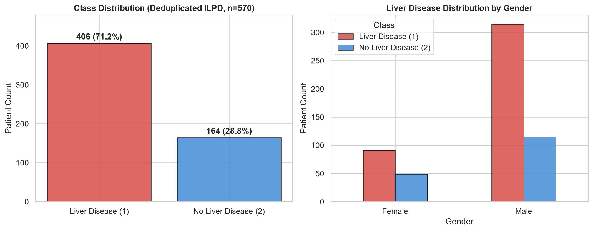

### 4.3 Complete ILPD Feature Dictionary (`n = 583` Raw Audit + `n = 570` EDA)

| Raw Column | API Snake-Case | Type | Unit | Normal Ref. | Raw Range | Median (Q25–Q75) | Skewness | IQR Outliers | Missing | Mann-Whitney $p$ (`n=570`) | Spearman $\rho$ (`n=570`) |
| :--- | :--- | :--- | :--- | :--- | :--- | :--- | :-: | :-: | :-: | :-: | :-: |
| `Age` | `age` | `int64` | years | `1–120` | `4 – 90` | `45.0 (33.0–58.0)` | `-0.03` | `0 (0.00%)` | `0` | `2.01e-03` | `+0.130` |
| `Gender` | `gender` | `object` | categorical | `Male`/`Female` | `441 M / 142 F` | Mode: `Male` | — | — | `0` | $\chi^2 p=0.0773$ | — |
| `TB` | `total_bilirubin` | `float64` | `mg/dL` | `0.1–1.2` | `0.4 – 75.0` | `1.0 (0.8–2.6)` | `4.91` | `84 (14.41%)` | `0` | `4.68e-14` | `+0.316` |
| `DB` | `direct_bilirubin` | `float64` | `mg/dL` | `0.0–0.3` | `0.1 – 19.7` | `0.3 (0.2–1.3)` | `3.21` | `81 (13.89%)` | `0` | `1.58e-13` | `+0.309` |
| `Alkphos` | `alkaline_phosphotase` | `int64` | `IU/L` | `44–147` | `63 – 2110` | `208.0 (175.5–298.0)` | `3.77` | `69 (11.84%)` | `0` | `6.23e-11` | `+0.274` |
| `Sgpt` | `alamine_aminotransferase` | `int64` | `IU/L` | `7–56` | `10 – 2000` | `35.0 (23.0–60.5)` | `6.55` | `73 (12.52%)` | `0` | `4.11e-12` | `+0.291` |
| `Sgot` | `aspartate_aminotransferase` | `int64` | `IU/L` | `10–40` | `10 – 4929` | `42.0 (25.0–87.0)` | `10.55` | `66 (11.32%)` | `0` | `1.30e-13` | `+0.311` |
| `TP` | `total_proteins` | `float64` | `g/dL` | `6.0–8.3` | `2.7 – 9.6` | `6.6 (5.8–7.2)` | `-0.29` | `8 (1.37%)` | `0` | `0.398` (NS) | `-0.036` |
| `ALB` | `albumin` | `float64` | `g/dL` | `3.5–5.0` | `0.9 – 5.5` | `3.1 (2.6–3.8)` | `-0.04` | `0 (0.00%)` | `0` | `3.47e-05` | `-0.174` |
| `A/G Ratio` | `albumin_and_globulin_ratio` | `float64` | ratio | `1.0–2.5` | `0.3 – 2.8` | `0.93 (0.7–1.1)` | `0.99` | `10 (1.73%)` | `4 (0.69%)` | `2.82e-06` | `-0.197` |

*(NS = Not statistically significant at $\alpha = 0.05$ on univariate Mann-Whitney U test. Target `Selector`: `int64`, `0` missing.)*

### 4.4 Data Quality Findings: Missing Values, Duplicates, Anomalies & Outliers
1. **Missing Values**: Exactly **4 missing cells** (`0.6861%`), all in `A/G Ratio` at 0-based raw indices `[209, 241, 253, 312]`. Two belong to `Selector=1` (`209`, `241`) and two to `Selector=2` (`253`, `312`).
2. **Exact Duplicates**: **13 exact duplicate extra rows** (`26` rows involved across `13` consecutive adjacent double-entry pairs at dropped indices `[19, 26, 34, 55, 62, 106, 108, 138, 143, 158, 164, 174, 201]`), with **0 target conflicts**. Removed via `drop_duplicates(keep="first")` before splitting (`583 -> 570`).
3. **Near-Duplicates**: **12 pairs** had standardized Euclidean distance `< 0.25` with matching `Gender`; **6 of those 12 pairs had opposite target labels** (`Selector=1` vs `2`), demonstrating genuine clinical overlap between mild liver disease and non-disease patients in routine LFT space. Preserved intact.
4. **Domain Consistency Anomalies (Preserved Intact)**:
   - **3 raw rows (`246, 261, 279`) have `DB > TB`** (e.g., row `246`: `TB=1.8, DB=9.0`; row `261`: `TB=1.5, DB=7.0`; row `279`: `TB=1.0, DB=1.4`), reflecting known historical measurement/entry discrepancies in ILPD.
   - **8 raw rows** (`[33, 34, 267, 415, 484, 491, 548, 575]`) show `|A/G Ratio - ALB/(TP - ALB)| > 0.25`.
   - Zero non-positive values exist across numeric columns; zero rows have `ALB > TP`.
5. **Outliers & Skewness**: Serum bilirubin (`TB`, `DB`) and enzymes (`Alkphos`, `Sgpt`, `Sgot`) are strongly right-skewed (skew `3.21` to `10.55`, kurtosis up to `150.92`) with `11.3%–14.4%` IQR outliers (e.g., `TB` up to `75.0 mg/dL`, `Sgot` up to `4929 IU/L`). These reflect acute hepatocyte/cholestatic pathology and are **never dropped**; `log1p` + `RobustScaler` are applied instead.

### 4.5 Key EDA Findings & Collinearity

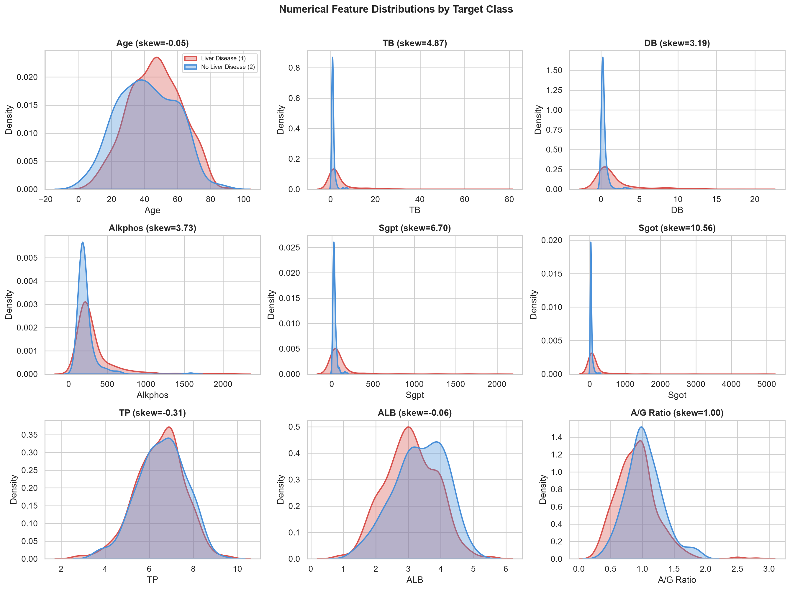

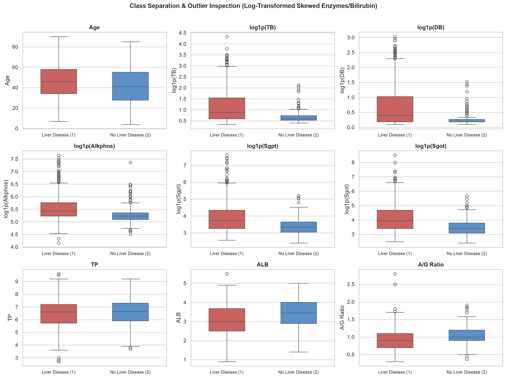

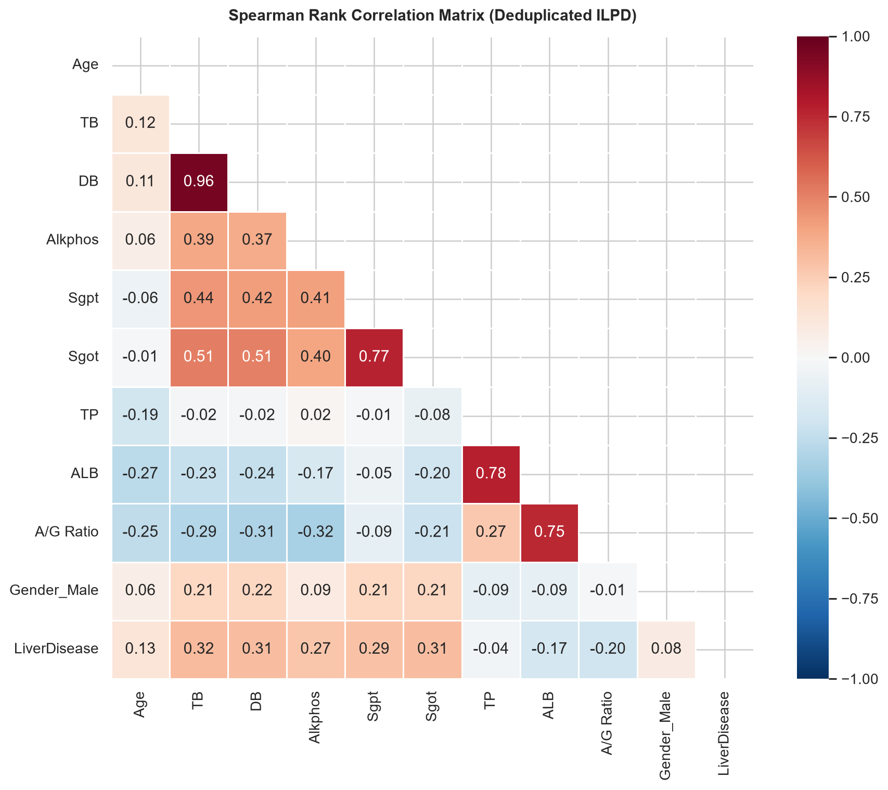

- **Strongest Univariate Discriminators**: `TB` ($\rho=+0.316, p=4.68\times 10^{-14}$), `Sgot` ($\rho=+0.311, p=1.30\times 10^{-13}$), `DB` ($\rho=+0.309, p=1.58\times 10^{-13}$), `Sgpt` ($\rho=+0.291, p=4.11\times 10^{-12}$), and `Alkphos` ($\rho=+0.274, p=6.23\times 10^{-11}$). Diseased patients show markedly higher median bilirubin (`1.4` vs `0.8`), AST (`51` vs `29`), ALT (`40.5` vs `27`), and ALP (`229` vs `186.5`), alongside lower albumin (`3.0` vs `3.45`) and A/G ratio (`0.90` vs `1.00`).
- **Four Strong Collinearity Clusters ($|\rho| \ge 0.70$)**:
  - `TB` ↔ `DB`: $\rho = +0.9584$
  - `TP` ↔ `ALB`: $\rho = +0.7782$
  - `Sgpt` ↔ `Sgot`: $\rho = +0.7719$
  - `ALB` ↔ `A/G Ratio`: $\rho = +0.7535$

### 4.6 Why ILPD Was Selected & Its Inherent Limitations
- **Why Selected**: Classic, reproducible UCI benchmark of routine blood-panel LFT biomarkers requiring no invasive biopsy or imaging, ideal for demonstrating medical tabular ML engineering (class imbalance, heavy skew, missing data, duplicate leakage, and SHAP explainability).
- **Dataset Limitations**: Small sample (`n=570` unique), 75.6% male bias, single 2012 regional hospital cohort (North East Andhra Pradesh, India), referral-clinic `71.3%` disease prevalence (non-representative of general population), binary collapse of all liver diseases (`Selector=1`), absence of etiology/lifestyle/serology features, and raw lab quirks (`DB > TB`).

---

## Phase 5 — Preprocessing Pipeline & Leakage Prevention

Every step below is verified in `src/liver_disease/data/preprocessing.py`, `src/liver_disease/features/engineering.py`, and `artifacts/models/liver_disease_pipeline.joblib`.

### 5.1 Step-by-Step Mapping to Source Code

| Step | Source File & Function / Class | Technique & Exact Parameters | Why Used |
| :--- | :--- | :--- | :--- |
| **1. Exact Deduplication** | `src/liver_disease/data/preprocessing.py`: `deduplicate_dataset(df)` | `df.duplicated(keep="first")` removes 13 consecutive duplicate rows (`583 -> 570`) | Prevents identical patient observations from landing in both train and test/CV splits (data leakage). |
| **2. Stratified 80/20 Split & Overlap Check** | `src/liver_disease/data/preprocessing.py`: `create_leakage_free_split(...)` | `train_test_split(..., test_size=0.20, stratify=y, random_state=42)` + `hash_pandas_object` overlap assertion (`overlap_count == 0`) | Locks `test.csv` (`n=114`, `71.05%` pos) away from CV/tuning/thresholding (`train.csv`, `n=456`, `71.27%` pos). |
| **3. Skewness Compression** | `src/liver_disease/features/engineering.py`: `ClinicalFeatureEngineer(add_clinical_ratios=False, log_transform_skewed=True)` | Stateless row-wise `np.log1p(np.maximum(col, 0.0))` on `["TB", "DB", "Alkphos", "Sgpt", "Sgot"]` | Compresses heavy right skew (`3.2–10.6`) monotonically without peeking across rows; `add_clinical_ratios=False` chosen via Phase 4 ablation. |
| **4. Missing Value Imputation** | `src/liver_disease/data/preprocessing.py`: `build_preprocessor(...)` | Numeric: `SimpleImputer(strategy="median")` (`A/G Ratio` median `0.965`); Categorical: `SimpleImputer(strategy="most_frequent")` (`"Male"`) | All 4 missing `A/G Ratio` cells reside in `train.csv`; fitted strictly inside CV folds so validation/test statistics never leak. |
| **5. Feature Scaling** | `src/liver_disease/data/preprocessing.py`: `build_preprocessor(scaler="robust")` | `RobustScaler()` ($x' = (x - Q_2) / (Q_3 - Q_1)$) on all 9 numeric columns | Resistant to clinical enzyme outliers (`Sgot` up to `4929`); essential for `LogisticRegression`, `KNN`, and `SVM_RBF`. |
| **6. Categorical Encoding** | `src/liver_disease/data/preprocessing.py`: `build_preprocessor(...)` | `OneHotEncoder(categories=[["Female", "Male"]], drop="if_binary", handle_unknown="ignore", sparse_output=False)` | Deterministic binary indicator `Gender_Male` (`Female -> 0.0`, `Male -> 1.0`). |
| **7. Feature Selection** | `src/liver_disease/models/benchmark.py` (Experiment 4) | Tested `SelectKBest(mutual_info_classif)` for `k in {6, 8, 10, all}` inside CV | **Retained all 10 features** (`SelectKBest` omitted in final pipeline) because routine LFT panels collect all 10 together and all 10 provide full SHAP coverage. |
| **8. In-Fold Resampling** | `src/liver_disease/data/preprocessing.py`: `build_training_pipeline(...)` | `imblearn.pipeline.Pipeline` with `RandomOverSampler` / `SMOTE(k_neighbors=5)` (or `class_weight="balanced"`) | Tested strictly inside training folds so synthetic minority samples never bleed into validation folds. |
| **9. Inference Preprocessing** | `src/liver_disease/models/predict.py`: `LiverDiseasePredictor.predict_dataframe(...)` | `normalize_inference_columns(df)` → `validate_feature_dataframe(allow_missing=False)` → `self.pipeline.predict_proba(normalized)` | Reuses the exact serialized `ClinicalFeatureEngineer` + `ColumnTransformer` fitted on `X_train` (no train-serving skew). |

### 5.2 Exact Fitted Pipeline Statistics (Extracted From `liver_disease_pipeline.joblib`)

| Feature | Transform Before Imputer | Fitted Training Median (`SimpleImputer`) | `RobustScaler` Center ($Q_2$) | `RobustScaler` IQR Scale ($Q_3 - Q_1$) | Final Feature Name |
| :--- | :--- | :---: | :---: | :---: | :--- |
| `Age` | Identity | `45.000000` | `45.000000` | `25.000000` | `Age` |
| `TB` | $\ln(1 + \max(\text{TB}, 0))$ | `0.693147` | `0.693147` | `0.613599` | `TB` |
| `DB` | $\ln(1 + \max(\text{DB}, 0))$ | `0.262364` | `0.262364` | `0.606136` | `DB` |
| `Alkphos` | $\ln(1 + \max(\text{Alkphos}, 0))$ | `5.337527` | `5.337527` | `0.508537` | `Alkphos` |
| `Sgpt` | $\ln(1 + \max(\text{Sgpt}, 0))$ | `3.583519` | `3.583519` | `0.899484` | `Sgpt` |
| `Sgot` | $\ln(1 + \max(\text{Sgot}, 0))$ | `3.749435` | `3.749435` | `1.207812` | `Sgot` |
| `TP` | Identity | `6.600000` | `6.600000` | `1.300000` | `TP` |
| `ALB` | Identity | `3.100000` | `3.100000` | `1.200000` | `ALB` |
| `A/G Ratio` | Identity | `0.965000` | `0.965000` | `0.400000` | `A/G Ratio` |
| `Gender` | Strip whitespace | Most frequent: `"Male"` | `OneHotEncoder(drop="if_binary")` | `Female -> 0.0`, `Male -> 1.0` | `Gender_Male` |

---

## Phase 6 — Model Development, Benchmarking & Ensemble Architecture

### 6.1 Validation Protocol (`src/liver_disease/models/benchmark.py` & `train.py`)
- **Cross-Validation**: `RepeatedStratifiedKFold(n_splits=5, n_repeats=3, random_state=42)` yielding **15 validation folds** strictly on `X_train` (`n=456`).
- **Pre-Registered Selection Criterion**: Composite discrimination score $S = 0.5 \cdot \text{ROC-AUC} + 0.5 \cdot \text{PR-AUC}$ with `Brier Score` as tie-breaker, avoiding accuracy bias under 71.3% / 28.7% class imbalance.

### 6.2 Experiment 1 — 11-Algorithm Baseline Benchmark (5×3 Repeated CV, Threshold = 0.50)

Source: `artifacts/reports/benchmark_11_models_baseline.csv`. All models used `log1p_only` (`add_clinical_ratios=False, log_transform_skewed=True`).

| Rank | Model | Scaler | ROC-AUC (Mean ± SD) | PR-AUC (Mean ± SD) | Accuracy | Balanced Acc. | Precision | Recall | Specificity | F1-Score | Brier |
| :-: | :--- | :---: | :---: | :---: | :---: | :---: | :---: | :---: | :---: | :---: | :---: |
| 1 | **ExtraTrees** | `none` | **0.7343 ± 0.0477** | **0.8876 ± 0.0201** | 0.7069 | 0.5414 | 0.7315 | 0.9303 | 0.1526 | 0.8186 | **0.1781** |
| 2 | **KNN** (`k=11`, distance) | `robust` | 0.7279 ± 0.0455 | 0.8780 ± 0.0295 | 0.6973 | 0.5787 | 0.7525 | 0.8574 | 0.3000 | 0.8008 | 0.1818 |
| 3 | **LogisticRegression** | `robust` | 0.7228 ± 0.0485 | 0.8791 ± 0.0261 | 0.7069 | 0.5611 | 0.7418 | 0.9036 | 0.2186 | 0.8143 | 0.1800 |
| 4 | **RandomForest** | `none` | 0.7211 ± 0.0454 | 0.8795 ± 0.0244 | 0.7003 | 0.5687 | 0.7462 | 0.8779 | 0.2595 | 0.8065 | 0.1816 |
| 5 | **CatBoost** | `none` | 0.7074 ± 0.0486 | 0.8710 ± 0.0256 | 0.6885 | 0.5717 | 0.7500 | 0.8462 | 0.2972 | 0.7945 | 0.1963 |
| 6 | **GradientBoosting** | `none` | 0.7046 ± 0.0569 | 0.8673 ± 0.0311 | 0.6981 | **0.5868** | 0.7573 | 0.8482 | 0.3255 | 0.7998 | 0.1961 |
| 7 | **XGBoost** | `none` | 0.7015 ± 0.0539 | 0.8685 ± 0.0266 | 0.6798 | 0.5738 | 0.7522 | 0.8226 | 0.3251 | 0.7854 | 0.2043 |
| 8 | **HistGradientBoosting** | `none` | 0.6991 ± 0.0528 | 0.8688 ± 0.0294 | 0.6718 | 0.5593 | 0.7434 | 0.8236 | 0.2951 | 0.7810 | 0.2008 |
| 9 | **LightGBM** | `none` | 0.6988 ± 0.0466 | 0.8697 ± 0.0197 | 0.6856 | 0.5826 | 0.7564 | 0.8246 | **0.3406** | 0.7888 | 0.2258 |
| 10 | **SVM_RBF** | `robust` | 0.6348 ± 0.0501 | 0.8119 ± 0.0296 | **0.7127** | 0.5000 | 0.7127 | **1.0000** | 0.0000 | **0.8322** | 0.2013 |
| 11 | **DecisionTree** | `none` | 0.6187 ± 0.0539 | 0.7973 ± 0.0344 | 0.6368 | 0.5227 | 0.7253 | 0.7908 | 0.2546 | 0.7545 | 0.2564 |

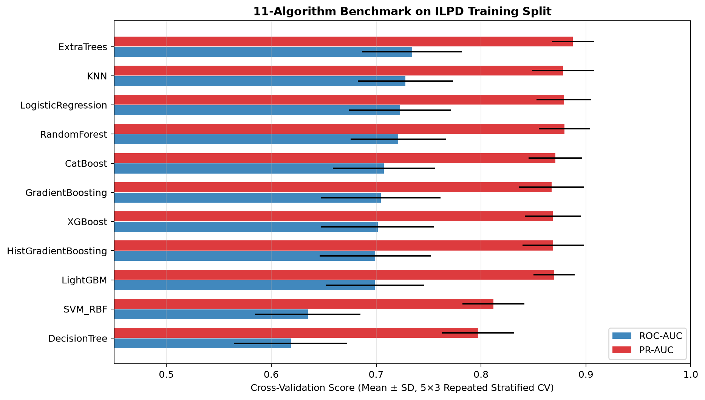

> **Critical Insight — Why Accuracy Trap Occurs:** Unweighted `SVM_RBF` achieves the highest raw Accuracy (`0.7127`) and F1 (`0.8322`) purely by predicting **every patient positive** (`Recall = 1.0000`, `Specificity = 0.0000`), yielding `Balanced Accuracy = 0.5000` (chance level) and the second-worst `ROC-AUC = 0.6348`.

### 6.3 Experiments 2–4 — Feature Engineering, Class Imbalance & Feature Selection Ablations

- **Feature Engineering Ablation (`benchmark_feature_engineering_ablation.csv`)**: Across 5 models (`LogisticRegression`, `RandomForest`, `ExtraTrees`, `CatBoost`, `SVM_RBF`), mean `(ROC-AUC, PR-AUC)` were: `raw_only` `(0.7011, 0.8678)`, **`log1p_only` `(0.7041, 0.8658)`** (highest composite `0.7850` and selected in `benchmark_summary.json`), and `log1p_plus_clinical_ratios` `(0.7048, 0.8636)`.
- **Class Imbalance Comparison (`benchmark_imbalance_strategies.csv`, 6 algorithms, in-fold only)**:
  - `class_weight="balanced"`: mean ROC-AUC **`0.7154`**, PR-AUC **`0.8762`**, Specificity **`0.5976`**, Balanced Accuracy **`0.6483`** (best overall without synthetic artifacts).
  - `none`: ROC-AUC `0.7143`, PR-AUC `0.8759`, Specificity `0.2656`, Balanced Accuracy `0.5666`.
  - `smote` (in-fold): ROC-AUC `0.7144`, PR-AUC `0.8731`, Specificity `0.5548`, Balanced Accuracy `0.6339`.
  - `random_oversampler` (in-fold): ROC-AUC `0.7124`, PR-AUC `0.8750`, Specificity `0.5517`, Balanced Accuracy `0.6354`.
- **Mutual Information Feature Selection (`benchmark_feature_selection.csv`)**: `k=8` slightly helped individual models (`RF 0.7294 vs 0.7211`, `LR 0.7259 vs 0.7228`, `CatBoost 0.7230 vs 0.7074`), while `k=6` degraded performance; all 10 features were kept for clinical panel completeness and SHAP coverage.

### 6.4 Hyperparameter Tuning (`GridSearchCV`, 5-Fold Stratified, Refit=`roc_auc`) & Ensemble Selection

Source: `artifacts/reports/tuned_candidates_cv_comparison.csv` & `src/liver_disease/models/train.py:118-297`.

| Rank | Candidate | Best Tuned Hyperparameters | Selection Score | ROC-AUC (5×3 CV) | PR-AUC (5×3 CV) | Brier Score |
| :-: | :--- | :--- | :-: | :-: | :-: | :-: |
| **1** | **`SoftVoting_ET_RF_LR`** | Soft Voting `weights=[2, 1, 1]` over tuned `et`, `rf`, `lr` | **0.8165** | **0.7417 ± 0.0469** | **0.8912 ± 0.0213** | **0.1765 ± 0.0116** |
| 2 | `ExtraTrees_Tuned` | `n_estimators=300, max_depth=14, min_samples_leaf=1, max_features='sqrt', class_weight='balanced'` | 0.8158 | 0.7408 ± 0.0502 | 0.8908 ± 0.0198 | 0.1797 |
| 3 | `LogisticRegression_Tuned` | `C=0.05, class_weight=None, solver='lbfgs', max_iter=2000` | 0.8079 | 0.7328 ± 0.0473 | 0.8830 ± 0.0263 | 0.1774 |
| 4 | `CatBoost_Tuned` | `iterations=200, depth=5, learning_rate=0.02, l2_leaf_reg=3.0, auto_class_weights='Balanced'` | 0.8048 | 0.7289 ± 0.0468 | 0.8807 ± 0.0256 | 0.2007 |
| 5 | `RandomForest_Tuned` | `n_estimators=500, max_depth=None, min_samples_leaf=2, max_features='sqrt', class_weight=None` | 0.8018 | 0.7228 ± 0.0423 | 0.8809 ± 0.0228 | 0.1820 |

### 6.5 Mathematical Architecture of the Final Ensemble (`SoftVoting_ET_RF_LR`)
Given a preprocessed 10-dimensional feature vector $\mathbf{x} \in \mathbb{R}^{10}$, the ensemble computes a weighted linear combination of the three diverse base estimators' predicted probabilities:

$$P_{\text{vote}}(y = 1 \mid \mathbf{x}) = \frac{2 \cdot P_{\text{ET}}(y=1 \mid \mathbf{x}) + 1 \cdot P_{\text{RF}}(y=1 \mid \mathbf{x}) + 1 \cdot P_{\text{LR}}(y=1 \mid \mathbf{x})}{2 + 1 + 1}$$

- **ExtraTrees (`et`, weight `2/4 = 50%`)**: 300 extremely randomized trees (`bootstrap=False`, `max_depth=14`, `min_samples_leaf=1`, `class_weight="balanced"`). Random threshold splits reduce correlation across trees and prevent overfitting on `n=456` noisy clinical points.
- **RandomForest (`rf`, weight `1/4 = 25%`)**: 500 bootstrap-aggregated trees (`max_depth=None`, `min_samples_leaf=2`, `class_weight=None`), contributing classic variance-reduced Gini split boundaries.
- **LogisticRegression (`lr`, weight `1/4 = 25%`)**: Strongly L2-regularized linear model (`C=0.05`), smoothing probability surfaces across continuous biomarker ranges:

$$P_{\text{LR}}(y = 1 \mid \mathbf{x}) = \sigma\!\left(w_0 + \sum_{j=1}^{10} w_j x_j\right), \quad \sigma(z) = \frac{1}{1 + e^{-z}}$$

  Exact learned weights extracted from `liver_disease_pipeline.joblib`:
  $w_0 = +0.66385$, `Age` $+0.28948$, `TB` $+0.27128$, `DB` $+0.27387$, `Alkphos` $+0.17962$, `Sgpt` $+0.33429$, `Sgot` $+0.25706$, `TP` $+0.14104$, `ALB` $-0.10301$, `A/G Ratio` $-0.12496$, `Gender_Male` $+0.07099$. Notice the medically coherent signs: higher bilirubin/enzymes/age increase risk, while higher albumin and A/G ratio decrease risk.

### 6.6 Calibration Study & Validation Threshold Selection
- **Probability Calibration (`5×3` Repeated CV)**:
  - `none` (unwrapped soft voting): **`Brier = 0.1765 ± 0.0116`**, `ROC-AUC = 0.7417`, `PR-AUC = 0.8912` → **Selected** (rule requires Brier reduction $\ge 0.002$; `sigmoid` gave `0.1783` and `isotonic` overfit to `0.1791`).
- **Out-of-Fold (OOF) Threshold Optimization (`train.py:357-381`, `evaluate.py:134-186`)**:
  - 5-fold OOF probabilities on `X_train` (`n=456`) swept thresholds $\tau \in [0.15, 0.85]$ (step `0.01`) maximizing screening utility $U(\tau) = 0.5 \cdot \text{Recall}(\tau) + 0.5 \cdot F_1(\tau)$ subject to $\text{Specificity}(\tau) \ge 0.50$.
  - At $\tau = 0.50$: OOF Recall `0.8738`, Specificity `0.2977` (fails guardrail).
  - At $\tau = 0.56$: OOF Specificity `0.4809` (just below `0.50`).
  - At **$\tau = 0.57$ (Selected)**: OOF Specificity **`0.5038`**, Recall **`0.7600`**, Precision **`0.7917`**, F1 **`0.7755`**, Balanced Accuracy **`0.6319`**, `utility = 0.7677` (`TP=247, FN=78, TN=66, FP=65`).

### 6.7 Serialization (`artifacts/models/liver_disease_pipeline.joblib`)
Persisted using `joblib.dump(..., compress=3)` (`5,749,315` bytes) as a 19-key dictionary containing `pipeline`, `explain_pipeline`, `decision_threshold` (`0.57`), `default_threshold` (`0.50`), `risk_thresholds`, `transformed_feature_names`, `shap_background` (`120 × 10` matrix), `global_feature_importance`, `training_config`, `dataset_info`, `evaluation_metrics`, `trained_at_utc` (`2026-11-23T00:00:55.548716+00:00`), and `dependency_versions`.

---

## Phase 7 — Holdout Model Evaluation & Clinical Context

### 7.1 Locked Holdout Test Results (`n = 114`: 81 Positive, 33 Negative — Single-Pass Evaluation)

Source: `artifacts/reports/final_evaluation_report.json` (`model_metadata.evaluation_metrics`).

| Metric | @ Default Threshold (`0.50`) | @ Production Threshold (`0.57`) | 95% Bootstrap CI (`@ 0.57`, 1000 resamples) | Mathematical Definition |
| :--- | :-: | :-: | :-: | :--- |
| **ROC-AUC** | `0.8066` | **`0.8066`** | `0.7233 – 0.8798` | Probability a random diseased patient ranks above a random non-diseased patient |
| **PR-AUC** | `0.9233` | **`0.9233`** | `0.8769 – 0.9582` | Area under Precision-Recall curve (prevalence baseline `= 0.7105`) |
| **Brier Score** | `0.1571` | **`0.1571`** | — | $\frac{1}{N}\sum_{i=1}^N (\hat{p}_i - y_i)^2$ (lower is better; `0.0` = perfect) |
| **Accuracy** | `0.7368` | **`0.7281`** | `0.6404 – 0.8070` | $(TP + TN) / N = (66 + 17) / 114$ |
| **Balanced Accuracy** | `0.5993` | **`0.6650`** | `0.5654 – 0.7567` | $(\text{Sensitivity} + \text{Specificity}) / 2$ |
| **Precision (PPV)** | `0.7576` | **`0.8049`** | `0.7142 – 0.8824` | $TP / (TP + FP) = 66 / 82$ |
| **Recall / Sensitivity (TPR)** | `0.9259` | **`0.8148`** | `0.7284 – 0.9024` | $TP / (TP + FN) = 66 / 81$ |
| **Specificity (TNR)** | `0.2727` | **`0.5152`** | `0.3427 – 0.6897` | $TN / (TN + FP) = 17 / 33$ |
| **Negative Predictive Value (NPV)** | `0.6000` | **`0.5312`** | — | $TN / (TN + FN) = 17 / 32$ |
| **F1-Score** | `0.8333` | **`0.8098`** | `0.7403 – 0.8715` | $2 \cdot \text{Prec} \cdot \text{Rec} / (\text{Prec} + \text{Rec})$ |
| **F2-Score** | `0.8865` | **`0.8128`** | — | Weights Recall $4\times$ Precision ($\beta=2$) |

### 7.2 Confusion Matrix Comparison (`n = 114`)

| Threshold | True Negatives (TN) | False Positives (FP) | False Negatives (FN) | True Positives (TP) | Interpretation |
| :---: | :-: | :-: | :-: | :-: | :--- |
| **`0.50` (Default)** | `9` | `24` | `6` | `75` | High sensitivity (`92.6%`) but `72.7%` of healthy cases (`24/33`) are flagged positive (`Spec=27.3%`). |
| **`0.57` (Production)** | **`17`** | **`16`** | **`15`** | **`66`** | Captures `81.5%` (`66/81`) of liver disease cases while nearly doubling specificity (`51.5%`, `FP` cut from `24` to `16`). |

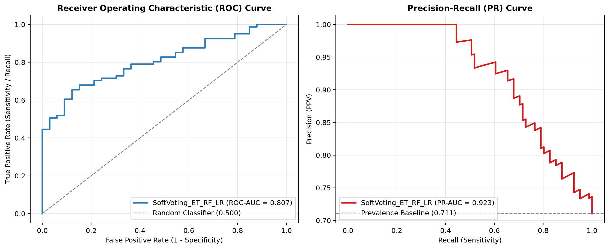

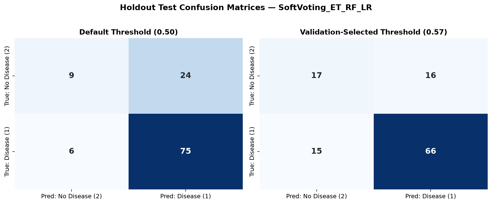

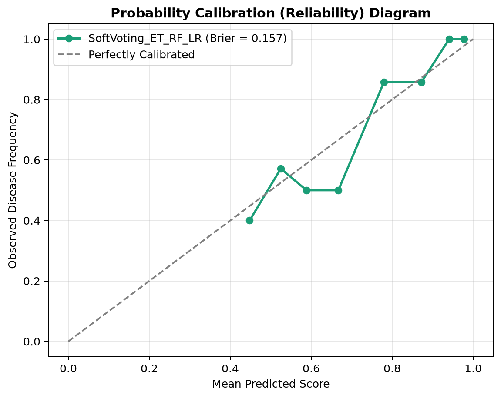

### 7.3 False Positives vs. False Negatives in Medical Context & Generalization Caution
- **False Negatives (`FN = 15/81` at `0.57`, `NPV = 53.1%`)**: Missed liver disease cases (`18.5%` of diseased patients in holdout). In medicine, false negatives risk delayed diagnosis, progression of cirrhosis/fibrosis/hepatitis, or delayed hepatology referral. Notice that nearly 1 in 2 negative predictions (`15/32`) in this high-prevalence cohort still had liver disease—confirming why the tool cannot "rule out" disease.
- **False Positives (`FP = 16/33` at `0.57`)**: Non-diseased patients flagged positive (`48.5%` false-alarm rate on healthy controls). Consequences include patient anxiety and unnecessary follow-up imaging/biopsy/repeat labs.
- **CV vs. Holdout Gap (`0.7417` vs `0.8066`)**: As explicitly documented in `MODEL_CARD.md`, holdout ROC-AUC (`0.8066`, CI `0.7233–0.8798`) lies at the upper end of expected small-sample (`n=114`) variation; the 5×3 Repeated CV estimate (`0.7417`) is the conservative baseline expectation for unseen data.
- **Why Not a Clinical Diagnostic Tool**: Trained on 570 records from one 2012 Indian clinic cohort (`71.3%` diseased, `75.6%` male), lacks clinical history/alcohol/viral serology/imaging, and has no prospective clinical validation or regulatory clearance (FDA/CE/SaMD).

---

## Phase 8 — SHAP Explainability (Global & Local Attribution)

Verified from `src/liver_disease/models/explain.py`, `src/liver_disease/models/train.py:428-435`, and `artifacts/models/model_metadata.json`.

### 8.1 What SHAP Is & Why It Is Used Here
**SHAP (SHapley Additive exPlanations)** decomposes an individual model prediction $f(\mathbf{x})$ into an additive sum of exact or approximated cooperative game-theoretic feature contributions relative to a background baseline $\phi_0 = \mathbb{E}[f(\mathbf{X})]$:

$$f(\mathbf{x}) = \phi_0 + \sum_{j=1}^{M} \phi_j(\mathbf{x})$$

- **Why `KernelExplainer` Is Used (`explain.py:107-134`)**: `SoftVoting_ET_RF_LR` is a heterogeneous `VotingClassifier` combining two tree ensembles (`ExtraTrees`, `RandomForest`) and a linear classifier (`LogisticRegression`). Because `VotingClassifier` is neither pure tree nor pure linear, `build_shap_explainer` falls through `_is_tree_estimator` and `_is_linear_estimator` to model-agnostic **`shap.KernelExplainer`** using a `shap.kmeans(X_bg, 30)` weighted summary over `120` transformed training samples (`shap_background` stored inside `.joblib`).
- **Base Value**: $\phi_0 = 0.71264$, matching the ILPD training prevalence (`71.27%`). For any patient, $\phi_0 + \sum \phi_j \approx P_{\text{vote}}(y=1 \mid \mathbf{x})$.

### 8.2 Actual Global Feature Importance Ranking (`model_metadata.json`)

| Rank | Transformed Feature | Mean `|SHAP|` | Clinical Axis | Observed Directionality on ILPD |
| :-: | :--- | :-: | :--- | :--- |
| **1** | `DB` (Direct Bilirubin) | **`0.05043`** | Bilirubin Clearance | Elevated conjugated bilirubin strongly raises risk score |
| **2** | `TB` (Total Bilirubin) | **`0.03957`** | Bilirubin Clearance | Elevated total bilirubin strongly raises risk score |
| **3** | `Sgpt` (ALT) | **`0.03688`** | Hepatocellular Injury | Elevated ALT raises risk score |
| **4** | `Alkphos` (ALP) | **`0.03562`** | Biliary / Cholestatic | Elevated ALP raises risk score |
| **5** | `Sgot` (AST) | **`0.03044`** | Hepatocellular Injury | Elevated AST raises risk score |
| **6** | `Age` | `0.02556` | Demographic | Older age shifts risk upward |
| **7** | `TP` (Total Proteins) | `0.01589` | Protein Balance | Secondary protein context |
| **8** | `A/G Ratio` | `0.01369` | Synthetic Function | Lower A/G ratio pushes risk upward |
| **9** | `ALB` (Albumin) | `0.01219` | Synthetic Function | Lower albumin pushes risk upward |
| **10** | `Gender_Male` | `0.00742` | Demographic | Minor demographic effect (`Male` slightly positive) |

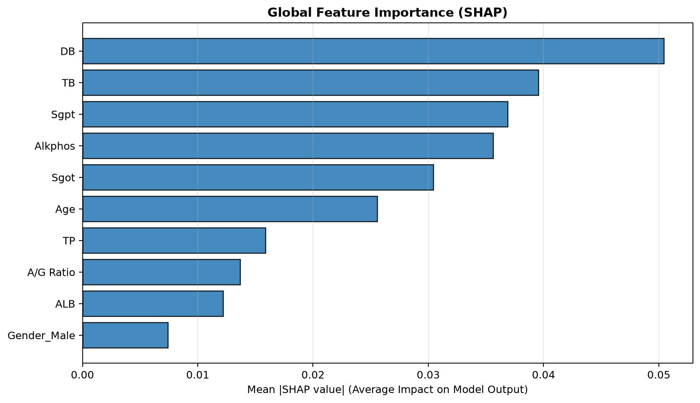

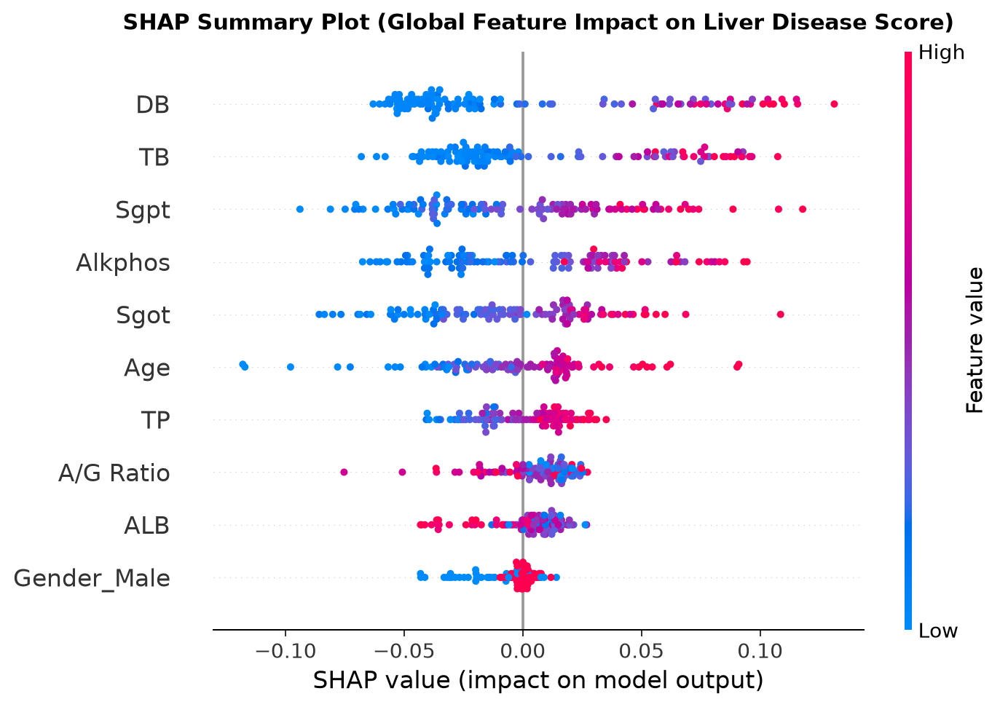

### 8.3 How to Read Global & Local Plots and Methodological Caveats
- **Global Bar Plot**: Ranks predictors by average magnitude $\frac{1}{N}\sum |\phi_j|$ (direction-agnostic overall influence).
- **Summary Beeswarm Plot**: Each dot is one holdout patient (`n=114`). Horizontal axis shows $\phi_j$ (pushing risk down `< 0` vs. up `> 0`); color encodes the standardized feature value (`blue = low`, `red = high`). Notice red dots for `DB`, `TB`, `Sgpt`, `Alkphos`, and `Sgot` sit firmly on the positive (right) side, whereas blue dots (low values) sit on the negative (left) side for `A/G Ratio` and `ALB` reversed.
- **Live Individual Chart (`POST /explain` → Streamlit Tab 1)**: Ranks the top `6` features by $|\phi_j|$, coloring `shap_value >= 0` (`increases_risk`) red (`#D32F2F`) and `< 0` (`decreases_risk`) blue (`#1976D2`), alongside raw input values.
- **Collinearity & Non-Causality Warning (`explain.py:29-34`)**: Because `TB`/`DB` ($\rho=0.958$), `Sgpt`/`Sgot` ($\rho=0.772$), and `TP`/`ALB` ($\rho=0.778$) are highly correlated, SHAP shares attribution weight across correlated biomarkers—SHAP explains **the model's statistical output**, never biological causation.

---

## Phase 9 — System Architecture & FastAPI REST API Reference

### 9.1 Runtime Architecture & Middleware (`src/liver_disease/api/main.py`, `security.py`, `routes.py`)
- **Application Factory**: `create_app(model_artifact_path=None)` loads `LiverDiseasePredictor` once in `@asynccontextmanager async def lifespan(app)` and binds it to `app.state.predictor`. If the `.joblib` file is missing or corrupt, startup logs an error and sets `app.state.predictor = None`, causing `/health` to return `"degraded"` and inference endpoints to return HTTP `503`.
- **Middleware**:
  1. `CORSMiddleware`: Allows `GET`, `POST`, `OPTIONS` and headers `["X-API-Key", "Content-Type", "Accept"]` for origins in `CORS_ALLOWED_ORIGINS` (default `http://localhost:8501,http://127.0.0.1:8501`).
  2. `request_logging_middleware`: Logs `<METHOD> <PATH> -> <STATUS> (<ms>)` on every request.
  3. Global exception handler catches unhandled exceptions as sanitized HTTP `500` JSON (`{"detail": "Internal server error while processing request."}`).
- **Authentication (`verify_api_key`)**:
  - Reads `LIVER_API_KEY` from environment (`get_configured_api_key()`).
  - **Fail-Closed**: If `LIVER_API_KEY` is unset/empty on the server, protected routes return **HTTP `503 Service Unavailable`** (never silently disable auth).
  - Compares stripped `X-API-Key` header against expected key via constant-time **`hmac.compare_digest`**. Missing or mismatched keys return **HTTP `401 Unauthorized`** with `WWW-Authenticate: ApiKey`.

### 9.2 Complete Endpoint Catalog

| Method & Path | Auth Required | Purpose | Success Code | Error Codes |
| :--- | :---: | :--- | :---: | :--- |
| `GET /health` | **No** | Docker/load-balancer readiness probe & loaded model check | `200` | — *(returns `"degraded"` with `model_loaded: false` if artifact failed)* |
| `GET /docs`, `/redoc`, `/openapi.json` | **No** | Built-in Swagger UI, ReDoc, and OpenAPI 3.x specification | `200` | — |
| `GET /model-info` | **Yes (`X-API-Key`)** | Full schema, units, bounds, threshold, metrics, global SHAP | `200` | `401`, `503` |
| `POST /predict` | **Yes (`X-API-Key`)** | Single-patient classification, probability score, and risk band | `200` | `401`, `422`, `503` |
| `POST /explain` | **Yes (`X-API-Key`)** | Single-patient prediction + SHAP top 6 & all 10 attributions | `200` | `401`, `422`, `501`, `503` |
| `POST /predict/batch` | **Yes (`X-API-Key`)** | CSV upload (`<=5000` rows), strict schema + row validation | `200` | `400`, `401`, `413`, `422`, `503` |

### 9.3 Detailed Endpoint Contracts & Verified Live Payloads

#### 1. `GET /health`
- **Headers**: None.
- **Example Response (`200 OK`)**:
  ```json
  {
    "status": "healthy",
    "api_version": "1.0.0",
    "model_loaded": true,
    "model_version": "1.0.0",
    "model_name": "SoftVoting_ET_RF_LR"
  }
  ```

#### 2. `GET /docs`
- Serves interactive FastAPI Swagger UI HTML (`200 OK`, unauthenticated) allowing backend engineers to inspect `PatientFeatures` and authorize with `X-API-Key` in-browser.

#### 3. `GET /model-info`
- **Headers**: `X-API-Key: <LIVER_API_KEY>`
- **Response Schema**: `ModelInfoResponse` containing `model_version`, `model_name`, `model_type`, `calibration_method`, `decision_threshold`, `default_threshold`, `risk_category_bands`, `target_encoding`, `supported_input_formats`, `required_features` (10 `FeatureMetadata` objects), `transformed_features`, `explainability_supported`, `explainer_type`, `trained_at_utc`, `dataset_info`, `evaluation_metrics`, `global_feature_importance`, and `disclaimer`.

#### 4. `POST /predict`
- **Headers**: `Content-Type: application/json`, `X-API-Key: <LIVER_API_KEY>`
- **Request Schema**: `PatientFeatures` (exact 10 keys, `extra="forbid"`).
- **Verified Example Request**:
  ```json
  {
    "age": 62,
    "gender": "Male",
    "total_bilirubin": 10.9,
    "direct_bilirubin": 5.5,
    "alkaline_phosphotase": 699.0,
    "alamine_aminotransferase": 64.0,
    "aspartate_aminotransferase": 100.0,
    "total_proteins": 7.5,
    "albumin": 3.2,
    "albumin_and_globulin_ratio": 0.74
  }
  ```
- **Verified Example Response (`200 OK`)**:
  ```json
  {
    "prediction_id": "b237d9cd-930f-4313-b6cb-5f6b26da9c1f",
    "prediction": 1,
    "prediction_label": "Liver Disease",
    "probability": 0.9823,
    "risk_category": "High",
    "decision_threshold": 0.57,
    "model_version": "1.0.0",
    "disclaimer": "ACADEMIC RESEARCH PROTOTYPE DISCLAIMER: This system is an academic machine learning prototype trained on the public Indian Liver Patient Dataset (ILPD). It is NOT a clinically validated medical device and MUST NOT be used to diagnose, treat, or make clinical decisions for patients. Predicted probabilities represent statistical model risk scores rather than clinically calibrated diagnostic probabilities."
  }
  ```
- **Errors**: `401` (bad/missing key), `422` (missing key, extra key, `gender` not `"Male"`/`"Female"`, out-of-range numeric, bool, `NaN`/`Inf`), `503` (artifact missing or `LIVER_API_KEY` unset).

#### 5. `POST /explain`
- **Headers**: `Content-Type: application/json`, `X-API-Key: <LIVER_API_KEY>`
- **Request Schema**: Identical to `POST /predict`.
- **Verified Example Response (`200 OK`, abbreviated)**:
  ```json
  {
    "prediction_id": "2c91a4d1-90a2-4c77-a1b8-6e8b9213c8a4",
    "prediction": 1,
    "prediction_label": "Liver Disease",
    "probability": 0.9823,
    "risk_category": "High",
    "decision_threshold": 0.57,
    "model_version": "1.0.0",
    "disclaimer": "ACADEMIC RESEARCH PROTOTYPE DISCLAIMER: ...",
    "explanation": {
      "explainer_type": "KernelExplainer",
      "base_value": 0.71264,
      "top_contributing_features": [
        {
          "feature": "DB",
          "raw_value": 5.5,
          "transformed_value": 2.6552,
          "shap_value": 0.07774,
          "abs_impact": 0.07774,
          "direction": "increases_risk"
        }
      ],
      "all_feature_contributions": ["... 10 items sorted by abs_impact descending ..."],
      "limitations_note": "Feature attributions (SHAP values) quantify each feature's statistical contribution to this model's output relative to the ILPD training baseline. Correlated biomarkers (e.g., Total vs Direct Bilirubin, AST vs ALT) share attribution weight, and feature importance is NOT evidence of biological causation or clinical diagnosis.",
      "disclaimer": "ACADEMIC RESEARCH PROTOTYPE DISCLAIMER: ..."
    }
  }
  ```
- **Errors**: Same as `/predict`, plus `501 Not Implemented` if `shap_background` is absent from the loaded `.joblib`.

#### 6. `POST /predict/batch`
- **Headers**: `X-API-Key: <LIVER_API_KEY>`, `Content-Type: multipart/form-data` (`file=@patients.csv`).
- **Errors**: `400` (not `.csv`, empty, bad UTF-8, malformed CSV, 0 data rows), `401` (auth), `413` (`rows > MAX_BATCH_ROWS`), `422` (invalid column headers or 100% invalid rows), `503` (unavailable).

### 9.4 Backend Developer Integration Pattern
External web/mobile backends act as **trusted server-side proxies**:
1. Never expose `LIVER_API_KEY` in React/Vue/mobile client bundles—store it in the backend's secret manager.
2. Backend receives user form input, attaches `X-API-Key` over HTTPS, calls `POST /predict` (or `/explain`), logs `prediction_id` + `model_version` for auditability, and passes the response + mandatory `disclaimer` back to the client.
3. Ready-to-use `LiverDiseaseAPIClient` Python wrapper and Postman setup are provided in `BACKEND_INTEGRATION_GUIDE.md`.

---

## Phase 10 — Complete Project Structure & File Inventory

### 10.1 Annotated Directory Tree
```text
Antigravity/
├── .dockerignore                         # Excludes .venv, .env, notebooks, tests, docs, Depi_Project from backend image
├── .env.example                          # Template env vars (LIVER_API_KEY, CORS, MAX_BATCH_ROWS)
├── .gitignore                            # Ignores .env, .venv, __pycache__, .pytest_cache, Depi_Project
├── README.md                             # Project overview, quick start & documentation index
├── Dockerfile                            # FastAPI production container (python:3.12-slim, port 8000)
├── docker-compose.yml                    # Orchestrates api (:8000) + frontend (:8501)
├── pyproject.toml                        # Packaging metadata + pytest config (testpaths=tests)
├── render.yaml                           # Render Docker Blueprint for API + optional UI
├── requirements.txt                      # Pinned dependency constraints
├── artifacts/
│   ├── models/
│   │   ├── liver_disease_pipeline.joblib # 5.75 MB serialized pipeline + SHAP background + metadata
│   │   └── model_metadata.json           # JSON snapshot of metrics, global SHAP, dependency versions
│   ├── preprocessing/
│   │   └── preprocessing_schema.json     # Snapshot of raw/transformed feature names & scaler config
│   └── reports/
│       ├── benchmark_11_models_baseline.csv
│       ├── benchmark_feature_engineering_ablation.csv
│       ├── benchmark_feature_selection.csv
│       ├── benchmark_imbalance_strategies.csv
│       ├── benchmark_summary.json
│       ├── data_audit_report.json
│       ├── eda_summary.json
│       ├── final_evaluation_report.json
│       ├── tuned_candidates_cv_comparison.csv
│       └── figures/                      # 10 PNG plots (EDA 01-04, benchmark 05, test eval x3, SHAP x2)
├── data/
│   ├── README.md                         # Provenance, quality audit & processed split documentation
│   ├── raw/Indian Liver Patient Dataset (ILPD).csv
│   └── processed/
│       ├── train.csv                     # 456 unique stratified rows (325 pos / 131 neg)
│       ├── test.csv                      # 114 unique stratified rows (81 pos / 33 neg)
│       └── split_metadata.json           # Deduplication indices & 0-overlap verification
├── docs/                                 # Consolidated technical & user documentation
│   ├── api/API_DOCUMENTATION.md
│   ├── architecture/
│   │   ├── Liver_Disease_ML_Project_Code_Verified_Audit.{md,pdf}
│   │   └── Liver_Disease_ML_Project_Complete_Explanation.{md,pdf}
│   ├── deployment/DEPLOYMENT_GUIDE.md
│   ├── integration/BACKEND_INTEGRATION_GUIDE.md
│   ├── reports/{DATA_DICTIONARY,EXPERIMENT_REPORT,MODEL_CARD}.md
│   └── user_guides/Liver_Disease_User_Input_Guide.{md,pdf}
├── frontend/
│   ├── app.py                            # 416-line Streamlit prototype (HTTP-only client)
│   └── Dockerfile                        # Lightweight Streamlit container (zero ML deps)
├── notebooks/
│   ├── 01_data_audit.ipynb               # Executed (3/3 code cells)
│   ├── 02_eda.ipynb                      # Executed (3/3 code cells)
│   ├── 03_preprocessing.ipynb            # Executed (2/2 code cells)
│   ├── 04_model_benchmarking.ipynb       # Executed (2/2 code cells)
│   └── 05_final_evaluation.ipynb         # Executed (4/4 code cells)
├── scripts/
│   ├── generate_notebooks.py             # Generates & executes all 5 notebooks via nbclient
│   ├── run_benchmark.py                  # Phase 4 CLI runner
│   ├── run_data_audit.py                 # Phase 2 CLI runner
│   ├── run_eda.py                        # Phase 3 CLI runner
│   ├── run_training.py                   # Phases 5-6 CLI runner
│   └── verify_live_api.py                # Live Uvicorn HTTP smoke verifier (port 8017)
├── src/liver_disease/
│   ├── __init__.py                       # Exports __version__ = "1.0.0"
│   ├── config.py                         # Central constants, FEATURE_SPECS, RISK_THRESHOLDS, paths
│   ├── api/{main,routes,schemas,security}.py
│   ├── data/{loader,preprocessing,validation}.py
│   ├── features/engineering.py           # ClinicalFeatureEngineer
│   ├── models/{benchmark,evaluate,explain,predict,train}.py
│   └── utils/{io,logging_config}.py
└── tests/
    ├── conftest.py                       # High/low-risk fixtures + FastAPI TestClient
    ├── test_api.py                       # Endpoint integration, schema 422s, batch CSV tests
    ├── test_data.py                      # Provenance, split mapping, audit counts, df validation
    ├── test_model.py                     # Artifact integrity, metadata parity, fail-no-retrain
    ├── test_predictions.py               # Consistency, clinical ordering, batch parity, SHAP, tiers
    ├── test_preprocessing.py             # Deduplication, 0-overlap split, ClinicalFeatureEngineer, SMOTE
    └── test_security.py                  # 401 missing/invalid key & 503 unset server key tests
```

---

## Phase 11 — Deployment, Operations & Project Handover Matrix

### 11.1 Environment Variables (`.env.example`)

| Variable | Default / Example | Required | Component | Purpose |
| :--- | :--- | :---: | :--- | :--- |
| `LIVER_API_KEY` | *(generate 32+ char token via `secrets.token_urlsafe(32)`)* | **Yes** | FastAPI & Streamlit | Secret required in `X-API-Key` HTTP header |
| `API_HOST` | `0.0.0.0` | No | FastAPI (`Dockerfile` / CLI) | Bind interface (`CMD` uses `0.0.0.0`) |
| `API_PORT` | `8000` | No | FastAPI | Listening port |
| `LOG_LEVEL` | `INFO` | No | FastAPI | Python logging verbosity |
| `CORS_ALLOWED_ORIGINS` | `http://localhost:8501,http://127.0.0.1:8501` | No | FastAPI | Comma-separated allowed CORS origins |
| `MODEL_ARTIFACT_PATH` | `artifacts/models/liver_disease_pipeline.joblib` | No | FastAPI | Override path to serialized `.joblib` bundle |
| `MAX_BATCH_ROWS` | `5000` | No | FastAPI | Maximum CSV rows permitted in `/predict/batch` |
| `API_BASE_URL` | `http://localhost:8000` (`http://api:8000` in Compose) | No | Streamlit | Target FastAPI service URL |

### 11.2 How to Run & Test Locally (PowerShell)
1. **Configure `.env`** (note: `.env` does not currently exist in the workspace):
   ```powershell
   Copy-Item .env.example .env
   .venv\Scripts\python.exe -c "import secrets; print(secrets.token_urlsafe(32))"
   # Paste output into LIVER_API_KEY inside .env
   ```
2. **Start FastAPI Service**:
   ```powershell
   $env:PYTHONPATH="src"
   $env:LIVER_API_KEY="your-strong-random-api-key"
   .venv\Scripts\uvicorn.exe liver_disease.api.main:app --host 0.0.0.0 --port 8000
   ```
3. **Start Streamlit Prototype (second terminal)**:
   ```powershell
   $env:API_BASE_URL="http://localhost:8000"
   $env:LIVER_API_KEY="your-strong-random-api-key"
   .venv\Scripts\streamlit.exe run frontend\app.py --server.port 8501
   ```
4. **Run Automated Tests & Live HTTP Smoke Script**:
   ```powershell
   .venv\Scripts\pytest.exe tests -v
   .venv\Scripts\python.exe scripts\verify_live_api.py
   ```
5. **Docker Compose**:
   - `docker compose up --build -d` launches `liver-disease-api` (`:8000`, non-root `appuser`, `HEALTHCHECK` on `/health`) and `liver-disease-frontend` (`:8501`, waits for `api` `service_healthy`).
   - Hosting requirements: `python:3.12-slim` + `libgomp1` + `curl` (handled in `Dockerfile`), ~500 MB–1 GB RAM recommended for `scikit-learn`/`shap`/FastAPI workers, TLS termination at reverse proxy/Render.

### 11.3 Project Completion vs. Pending Handover Status

| Workstream | Status | Evidence in Workspace | What Remains / Notes |
| :--- | :---: | :--- | :--- |
| **Data Audit & Leakage-Free Split** | **Completed** | `data_audit_report.json`, `train.csv` (456), `test.csv` (114), `split_metadata.json` | Zero pending ML data tasks. |
| **EDA & Statistical Tests** | **Completed** | `eda_summary.json`, Figures `01`–`04`, `02_eda.ipynb` | Executed & saved. |
| **11-Model Benchmark & Ablations** | **Completed** | 4 benchmark CSVs, `benchmark_summary.json`, Figure `05` | Executed & saved. |
| **Tuning, Soft Voting, Threshold, Eval & SHAP** | **Completed** | `liver_disease_pipeline.joblib`, `model_metadata.json`, `final_evaluation_report.json`, 5 evaluation/SHAP PNGs | Model `v1.0.0` trained `2026-11-23T00:00:55Z`. |
| **FastAPI Service & Auth & Batch & SHAP API** | **Completed** | `src/liver_disease/api/*`, `verify_live_api.py` | Ready for local/container execution. |
| **Streamlit Prototype UI** | **Completed** | `frontend/app.py`, `frontend/Dockerfile` | Optional UI enhancements (e.g. disabling default High-risk values, cross-field warnings `DB <= TB`) if desired. |
| **Automated QA Test Suite & Notebooks** | **Completed** | 29 tests in `tests/*.py`, 5 executed `.ipynb` files | Re-run full `pytest` after final handover check. |
| **Docker & Cloud Configs Written** | **Completed** | `Dockerfile`, `frontend/Dockerfile`, `docker-compose.yml`, `render.yaml` | Files authored, not yet built/deployed to cloud. |
| **Local `.env` & Secret Provisioning** | **Pending** | `.env` does not exist yet (only `.env.example`) | Copy `.env.example` to `.env` and set `LIVER_API_KEY`. |
| **Cloud Hosting Deployment (Render / Cloud)** | **Pending** | `render.yaml` present; no live cloud URL configured | Push repo to Git, connect Render Blueprint, set `LIVER_API_KEY` & restrict `CORS_ALLOWED_ORIGINS` (replace `"*"`), verify `$PORT` if PaaS overrides `8000`. |
| **External Backend Integration** | **Pending** | `BACKEND_INTEGRATION_GUIDE.md` delivered | External backend team must store `LIVER_API_KEY`, integrate REST calls, persist `prediction_id`, and render medical disclaimer. |
| **Git Repository Initialization** | **Pending** | Workspace is currently not a `.git` repository (`git status` fails) | Initialize Git before pushing to GitHub/Render. |

---

## Phase 12 — ML Engineer Interview & Graduation Defense Preparation (35 Q&As)

### Dataset & EDA (Q1–Q6)

**Q1. Why did you choose the Indian Liver Patient Dataset (ILPD), and what are its main limitations?**
ILPD (UCI ID 225) contains 10 standard routine blood-test LFT biomarkers and demographic features that are clinically non-invasive and directly actionable for tabular ML benchmarking. Its primary limitations are small cohort size (`583` raw / `570` deduplicated), severe class imbalance (`71.3%` diseased—reflecting clinic referral bias, not population prevalence), `75.6%` male skew, single-region 2012 Indian collection, binary aggregation of diverse liver pathologies, and absence of lifestyle/serological features (alcohol, BMI, hepatitis B/C markers).

**Q2. What data quality anomalies did your audit uncover in ILPD?**
We discovered four concrete issues (`data_audit_report.json`): (1) 4 missing values (`0.69%`), all in `A/G Ratio` at raw indices `[209, 241, 253, 312]`; (2) 13 consecutive exact duplicate pairs (`0` target conflicts); (3) 3 rows (`[246, 261, 279]`) where Direct Bilirubin exceeds Total Bilirubin (`DB > TB`), plus 8 rows where `A/G Ratio` deviates from `ALB / (TP - ALB)` by `> 0.25`; and (4) extreme right-skewed outliers (`11.3%–14.4%` IQR outliers in bilirubin and transaminases, up to `Sgot = 4929`).

**Q3. Why did you keep the 3 rows with `DB > TB` and the extreme enzyme outliers instead of deleting them?**
In medical ML, silent deletion or arbitrary clipping alters clinical ground truth and can introduce artificial distribution shifts. High enzyme values (`TB = 75`, `Sgpt = 2000`, `Sgot = 4929`) represent severe acute liver injury rather than sensor noise. Similarly, keeping the 3 `DB > TB` rows preserves original UCI benchmark integrity while transparently logging them in `DATA_DICTIONARY.md` and `data_audit_report.json`.

**Q4. Why did EDA use Spearman rank correlation and the Mann-Whitney U test instead of Pearson $r$ and Student's $t$-test?**
Pearson $r$ and $t$-tests assume approximate normality and linearity and are heavily distorted by outliers (`Sgot` skewness `= 10.55`, kurtosis `= 150.92`). Non-parametric Mann-Whitney U tests and Spearman rank correlations evaluate monotonic rank separation without normality assumptions and remain invariant under monotonic transforms like `log1p`.

**Q5. Which features showed the strongest univariate statistical separation in ILPD?**
Total Bilirubin (`TB`, $\rho=+0.316, p=4.68\times 10^{-14}$), Aspartate Aminotransferase (`Sgot`, $\rho=+0.311, p=1.30\times 10^{-13}$), Direct Bilirubin (`DB`, $\rho=+0.309, p=1.58\times 10^{-13}$), Alanine Aminotransferase (`Sgpt`, $\rho=+0.291$), and Alkaline Phosphotase (`Alkphos`, $\rho=+0.274$). Conversely, Total Proteins (`TP`) alone showed no significant univariate shift ($p=0.398$), though `ALB` and `A/G Ratio` were significantly lower in liver disease ($p < 10^{-4}$).

**Q6. What happened when you investigated near-duplicates in ILPD?**
Twelve non-identical patient pairs had standardized Euclidean distance `< 0.25` and identical gender, and **6 of those 12 pairs had opposite class labels**. This proved two things: (1) near-duplicates are distinct clinical individuals near the decision boundary, so deleting them would distort class boundaries; and (2) routine LFT panels have an inherent Bayes error ceiling where early disease overlaps normal ranges.

### Preprocessing, Leakage & Feature Engineering (Q7–Q13)

**Q7. How did removing 13 exact duplicates prevent data leakage?**
All 13 duplicates in ILPD were exact copies (identical 10 predictors and target) sitting in consecutive rows. If we split before deduplicating, some identical rows would fall into `train.csv` and their exact twins into `test.csv` or cross-validation validation folds, allowing models (especially `KNN` and deep trees) to memorize and artificially inflate test scores. Deduplicating first (`583 -> 570`) and verifying `train_test_feature_overlap == 0` via row hashes eliminates this leakage completely.

**Q8. How did you prevent preprocessing leakage during missing value imputation and scaling?**
We never called `.fit()` or computed medians/IQRs on the full dataset (`570` rows) or combined `X_train + X_test`. Instead, `SimpleImputer(strategy="median")` and `RobustScaler` sit inside a scikit-learn `Pipeline` (`build_preprocessor`) so they fit exclusively on the training split (or each inner CV training fold) and only call `.transform()` on validation/test folds.

**Q9. Why did you choose `RobustScaler` over `StandardScaler` or `MinMaxScaler`?**
`StandardScaler` uses mean and standard deviation, and `MinMaxScaler` uses min/max—all of which collapse normal-range patients into a tiny interval when `Sgot` reaches `4929` or `TB` reaches `75`. `RobustScaler` centers by the median ($Q_2$) and divides by the interquartile range ($Q_3 - Q_1$), keeping the bulk of clinical variation well-scaled for `LogisticRegression`, `KNN`, and `SVM`.

**Q10. Why did you apply `log1p` to `TB`, `DB`, `Alkphos`, `Sgpt`, and `Sgot`, and why is it leakage-free?**
Serum enzymes and bilirubin span multiple orders of magnitude with skewness between `3.21` and `10.55`. Applying `np.log1p(x) = ln(1 + x)` compresses extreme tails while remaining finite near `0` (safe for `DB = 0.0`). Because `log1p` operates element-wise per patient without estimating any dataset mean, median, or std across rows, it introduces zero cross-sample leakage.

**Q11. You engineered 4 hepatology features in `ClinicalFeatureEngineer` (`AST_ALT_Ratio`, `DB_TB_Ratio`, `Indirect_Bilirubin`, `Globulin`). Why are they disabled in production (`add_clinical_ratios=False`)?**
Scientific ablation (`benchmark_feature_engineering_ablation.csv`) proved that adding the 4 ratios slightly reduced aggregate PR-AUC (`0.8636` vs `0.8658` for `log1p_only` and `0.8678` for `raw_only`) while adding multicollinearity to variables already strongly correlated (`TB/DB` $\rho=0.958$, `Sgpt/Sgot` $\rho=0.772$). Following evidence-driven engineering, `benchmark.py` selected `log1p_only`, and `train.py` respected that choice.

**Q12. Why did you keep all 10 original features even though `SelectKBest(k=8)` slightly boosted CV ROC-AUC for individual models?**
In real clinical blood draws, all 10 LFT fields are collected together in one panel—dropping 2 columns does not meaningfully cut lab cost. Retaining all 10 features keeps full clinical interpretability in SHAP explanations while `SoftVoting_ET_RF_LR` on all 10 features (`0.7417` ROC-AUC) outperformed every single-model `k=8` run (`0.7294` max).

**Q13. Why is the missing-value imputer still inside the production `.joblib` pipeline if the API rejects missing values?**
During training (`train.csv`), 4 rows actually have missing `A/G Ratio`, so `SimpleImputer` is required to fit the pipeline without leaking medians across folds. At serving time, strict validation (`allow_missing=False`) prevents silent imputation of missing medical labs, yet having the imputer inside `.joblib` guarantees consistency if an internal research batch flag ever allows missing inputs.

### Benchmarking, Imbalance, Models & Ensembling (Q14–Q23)

**Q14. Why did you use 5×3 Repeated Stratified K-Fold CV instead of a single 5-fold CV or train/val/test split?**
With only `456` training records (`131` negatives), a single 5-fold CV puts ~`26` negative cases in each fold, creating high variance across split boundaries. Repeating 5-fold stratified CV 3 times with shuffled splits (`15` folds total) stabilizes mean and standard deviation estimates for reliable model ranking without ever touching the `114` holdout test rows.

**Q15. Explain the "accuracy trap" observed with `SVM_RBF` in Experiment 1.**
Because `71.27%` of `X_train` is positive (`Selector=1`), an unweighted `SVM_RBF` defaulted to classifying `100%` of samples as positive (`Recall = 1.000`, `Specificity = 0.000`). That yields `71.27%` Accuracy and `0.8322` F1-score—both the highest among all 11 baseline models—despite having zero discriminative utility for healthy patients (`Balanced Accuracy = 0.500`, `ROC-AUC = 0.6348`). That is why we selected models using `ROC-AUC` + `PR-AUC`, never raw Accuracy.

**Q16. Why did `ExtraTrees`, `RandomForest`, `KNN`, and `LogisticRegression` outperform `XGBoost`, `LightGBM`, and `CatBoost` in baseline CV?**
Gradient boosting sequentially fits residuals (`XGBoost`, `LightGBM`), which on small, noisy clinical datasets (`n=456`) with overlapping near-duplicates tends to memorize label noise and produce higher Brier scores (`0.196–0.226` vs `0.178–0.182`). Conversely, high-randomness bagging (`ExtraTrees`) and strong L2 linear shrinkage (`LogisticRegression C=0.05`) aggressively control variance.

**Q17. How does `ExtraTreesClassifier` differ algorithmically from `RandomForestClassifier`?**
Both build ensembles of decorrelated trees using random feature subsets (`max_features='sqrt'`). However, Random Forest uses bootstrap sampling (`bootstrap=True`) and searches for the **optimal split threshold** per feature at each node, whereas Extra Trees uses the entire training sample (`bootstrap=False`) and picks **split thresholds randomly** for each candidate feature, selecting the best among random cuts—further reducing variance on noisy tabular features.

**Q18. How does `LogisticRegression` work mathematically here, and why was `C=0.05` chosen?**
It models log-odds linearly ($\log \frac{p}{1-p} = w_0 + \mathbf{w}^T\mathbf{x}$) under L2 penalty $\frac{1}{2C}\|\mathbf{w}\|_2^2$. Smaller `C` (`0.05` vs default `1.0`) applies stronger shrinkage, suppressing wild weights across collinear biomarkers (`TB/DB`, `Sgpt/Sgot`) and achieving better CV ROC-AUC (`0.7328` vs `0.7228`) and lower Brier score (`0.1774`).

**Q19. Why did `class_weight="balanced"` outperform `SMOTE` and `RandomOverSampler` in Experiment 3?**
`SMOTE` interpolates synthetic points linearly between minority neighbors in 10D space; on noisy boundary regions where diseased and non-diseased patients overlap, synthetic points blur class boundaries and slightly degrade probability calibration (Brier rises from `0.1781` to `0.1923` on ExtraTrees). In-model `class_weight="balanced"` reweights the loss function analytically ($w_c = N / (2 N_c)$) without fabricating artificial patient lab profiles.

**Q20. How did you ensure `SMOTE` and `RandomOverSampler` did not cause data leakage in Experiment 3?**
We wrapped the pipeline in `imblearn.pipeline.Pipeline` (`build_training_pipeline`), which triggers `sampler.fit_resample()` **only inside `.fit()` on each training fold**, never on validation folds or during `.predict_proba()`. Resampling before CV would leak duplicated/synthetic validation points into training, wildly inflating CV scores.

**Q21. Explain how Soft Voting (`weights=[2, 1, 1]`) works vs. Hard Voting and why these three models complement each other.**
Hard Voting takes majority discrete labels (`argmax`), discarding probability confidence. Soft Voting averages continuous predicted probabilities: $P_{\text{vote}} = (2 P_{\text{ET}} + P_{\text{RF}} + P_{\text{LR}}) / 4$. Combining high-randomness balanced trees (`ET`, weight 2), bootstrap un-weighted trees (`RF`, weight 1), and smooth global linear log-odds (`LR`, weight 1) cancels individual inductive biases, achieving the highest CV ROC-AUC (`0.7417`), highest PR-AUC (`0.8912`), and lowest Brier score (`0.1765`).

**Q22. Why did you reject Platt (`sigmoid`) and `isotonic` calibration after testing them?**
Unwrapped `SoftVoting_ET_RF_LR` already achieved the lowest CV Brier score (`0.1765`). Applying 5-fold `sigmoid` scaling worsened Brier to `0.1783` (because `ET` uses balanced weights while `RF`/`LR` smooth it, and trees already average votes), while non-parametric `isotonic` regression overfit on `n=456` (`Brier = 0.1791`, `ROC-AUC` dropped from `0.7417` to `0.7363`).

**Q23. How was the production decision threshold `0.57` chosen, and why not optimize it on `test.csv`?**
Optimizing the threshold on `test.csv` would constitute **test leakage**. Instead, we generated 5-fold out-of-fold probabilities on `X_train`, swept `[0.15, 0.85]` in `0.01` steps, enforced `Specificity >= 0.50` so the model could not simply predict positive for nearly everyone, and maximized $0.5 \cdot \text{Recall} + 0.5 \cdot F_1$. Because liver disease is the `71.3%` prior and `ET` has `class_weight="balanced"`, shifting cutoff from `0.50` up to `0.57` raised OOF specificity from `29.8%` to `50.4%`.

### Evaluation Metrics, Explainability & Overfitting (Q24–Q29)

**Q24. Explain the difference between ROC-AUC and PR-AUC, and why PR-AUC (`0.9233`) looks much higher than ROC-AUC (`0.8066`).**
ROC-AUC plots TPR (`Recall`) vs. FPR (`1 - Specificity`) with a random baseline of `0.50` regardless of class prevalence. PR-AUC plots `Precision` vs. `Recall`, where the random no-skill baseline equals the positive class prevalence (`0.7105` in test). Because `71.1%` of patients are diseased, Precision starts high (`0.71+`), making `0.9233` PR-AUC meaningfully above `0.7105` (`+0.213` gain), consistent with `0.8066` ROC-AUC (`+0.307` above `0.50`).

**Q25. How do Recall (Sensitivity), Specificity, Precision, and NPV trade off when lowering vs. raising the threshold?**
Lowering the threshold (`0.57 -> 0.50`) flags more patients positive: **Recall increases** (`81.5% -> 92.6%`, `FN` drops `15 -> 6`) and **NPV improves** (`53.1% -> 60.0%`), but **Specificity plunges** (`51.5% -> 27.3%`, `FP` jumps `16 -> 24`) and **Precision drops** (`80.5% -> 75.8%`). Raising the threshold does the exact opposite.

**Q26. What does the Brier Score (`0.1571` holdout / `0.1765` CV) measure?**
Brier Score is the Mean Squared Error of predicted probabilities against binary outcomes: $\frac{1}{N}\sum (\hat{p}_i - y_i)^2$. Unlike ROC-AUC (which only measures ranking), Brier evaluates both **discrimination** and **probability calibration** simultaneously. A constant baseline predicting prevalence `0.7105` gets $0.7105 \times (1 - 0.7105) \approx 0.2057$, so `0.1571` beats the prevalence baseline substantially.

**Q27. Holdout ROC-AUC (`0.8066`) is higher than CV ROC-AUC (`0.7417`). Does this indicate overfitting or test leakage?**
Neither—test overlap was proven `0` via row hashing, and `test.csv` was evaluated once after freezing the pipeline. With only `114` holdout patients (`33` negatives), the 95% bootstrap CI spans `0.7233` to `0.8798`, comfortably encompassing the CV mean `0.7417`. Small-sample variance happens to make this particular 114-row split slightly easier; we conservatively report `~0.74` as the true expected generalization performance.

**Q28. How did you prevent overfitting across the entire project?**
(1) Deduplicated before splitting (`583 -> 570`); (2) locked 20% test set completely out of tuning/imputation/scaling/thresholding; (3) evaluated via 5×3 Repeated CV; (4) bounded tree depths/leaf sizes (`RF min_samples_leaf=2`, `ET max_depth=14`) and applied strong L2 penalty (`LR C=0.05`); (5) averaged three heterogeneous model families via Soft Voting; and (6) rejected `isotonic` calibration when it lowered CV AUC.

**Q29. Explain how SHAP works here and why `KernelExplainer` was chosen over `TreeExplainer`.**
`TreeExplainer` only accepts single tree models or homogeneous tree ensembles (`RF`, `XGB`, `LGBM`, `CatBoost`). Because our winning classifier is a `VotingClassifier` mixing `ExtraTrees`, `RandomForest`, and `LogisticRegression`, `explain.py` uses `shap.KernelExplainer`—a model-agnostic weighted local linear regression over perturbed feature coalitions using 30 `k`-means centroids from the training distribution (`nsamples=100`). Note that strongly correlated pairs (`TB`/`DB`, `Sgpt`/`Sgot`) share Shapley attribution, so SHAP reflects model mechanics rather than causal biology.

### Production Engineering, API, Security & Ethics (Q30–Q35)

**Q30. Why did you serialize the full scikit-learn `Pipeline` with `joblib` rather than saving only the classifier?**
Saving only the classifier creates **training-serving skew** if the API re-implements `log1p`, median values, `RobustScaler` centers/IQRs, or `OneHotEncoder` column ordering differently. Bundling `ClinicalFeatureEngineer + ColumnTransformer + VotingClassifier` inside one `Pipeline` ensures the exact training transformations run atomically on raw inputs during inference.

**Q31. Why does the FastAPI service refuse to retrain automatically at startup?**
Training at startup wastes CPU/RAM, delays container readiness checks, risks non-deterministic artifact drift if environment libraries change, and breaks horizontal auto-scaling consistency. Decoupling training (`scripts/run_training.py`) from serving (`api/main.py`) lets multiple API replicas boot in <2 seconds and return deterministic predictions tagged with `model_version="1.0.0"`.

**Q32. How does API authentication work and why use `hmac.compare_digest` and fail-closed HTTP `503`?**
Clients pass `X-API-Key` in HTTP headers. Standard `==` string comparison leaks key length/prefix bytes via timing side channels, so `security.py` uses constant-time `hmac.compare_digest`. Moreover, if the server boots without `LIVER_API_KEY` set, it **fails closed** with HTTP `503` rather than letting unauthenticated traffic slip through.

**Q33. Why use Pydantic v2 with `extra="forbid"` and custom validators on `/predict` and `/predict/batch`?**
Medical APIs must fail loudly on malformed payloads rather than silently coercing invalid inputs. `extra="forbid"` prevents typos (like `alkaline_phosphatase`) from being ignored; custom validators reject booleans (`True` == `1` in Python!), `NaN`/`Inf`, fractional ages, and out-of-range measurements (`TB = -1`), returning clear HTTP `422` field errors.

**Q34. Why is the Streamlit frontend isolated into its own container without `scikit-learn` or `.joblib` access?**
Decoupling UI from inference via REST (`frontend/app.py` → FastAPI) demonstrates real microservice architecture: the graduation project's backend team (Node.js/Django/Spring/Mobile) can consume the exact same ML REST service, scale API workers independently of UI sessions, and swap model versions without touching frontend code.

**Q35. If you had to evolve this prototype toward real clinical deployment, what would be required?**
(1) External multi-center prospective clinical validation beyond Andhra Pradesh; (2) collecting missing clinical confounders (BMI, alcohol use, viral hepatitis serology, comorbidities, imaging); (3) probability recalibration on real target-population prevalence (far lower than `71%`); (4) cross-field physiological validation (`DB <= TB`, `ALB <= TP`); (5) strict audit logging, drift monitoring, clinician-in-the-loop UX; and (6) regulatory approval (FDA/CE SaMD).

---

## Final Verification Checklist (Code & Report Audit)

- [x] Every single one of the **10 user input fields** verified directly against `frontend/app.py`, `src/liver_disease/api/schemas.py`, `src/liver_disease/config.py`, and `artifacts/models/liver_disease_pipeline.joblib`.
- [x] Batch CSV rules (`routes.py`, `loader.py`) verified for accepted schemas, `MAX_BATCH_ROWS=5000`, missing cells, extra columns, and partial vs. total failure responses.
- [x] All dataset counts (`583` raw, `570` deduplicated, `456` train, `114` test), 4 missing `A/G Ratio` indices, 13 duplicate pairs, 3 `DB > TB` anomalies, and Mann-Whitney/Spearman values verified against `data_audit_report.json` and `eda_summary.json`.
- [x] All 11 benchmark models, ablations, tuned hyperparameters, LR weights, calibration scores, OOF threshold `0.57`, and holdout metrics + 95% CIs verified against `benchmark_*.csv`, `tuned_candidates_cv_comparison.csv`, `model_metadata.json`, and `final_evaluation_report.json`.
- [x] End-to-end sample patient traces (`Elevated LFT` → `0.9823`, `Normal-Range` → `0.4027`, `Default Form` → `0.7435`) executed live against `liver_disease_pipeline.joblib`.
- [x] All mismatches and implementation findings explicitly documented without modifying any existing source code, datasets, artifacts, or configurations.
