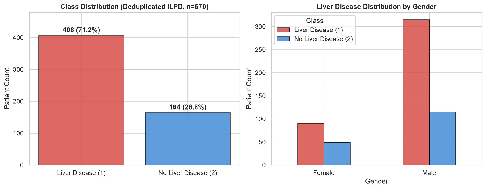
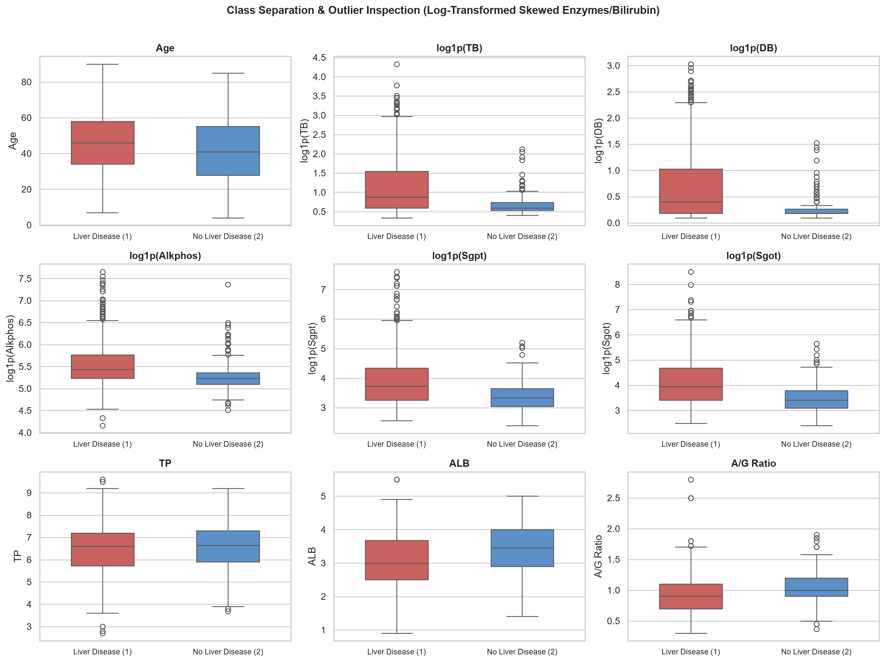
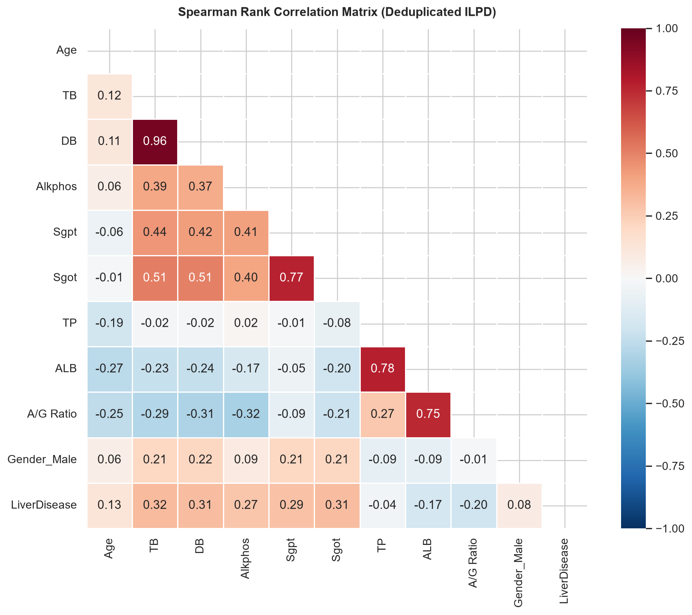
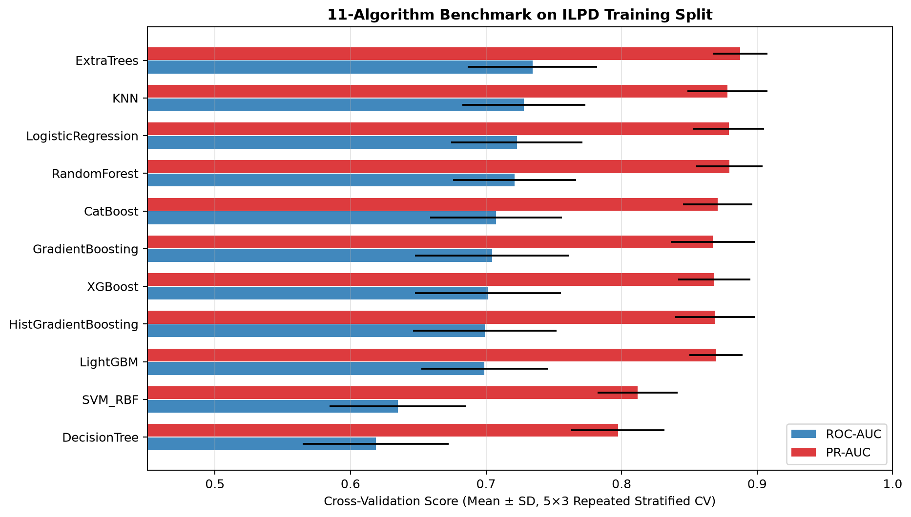
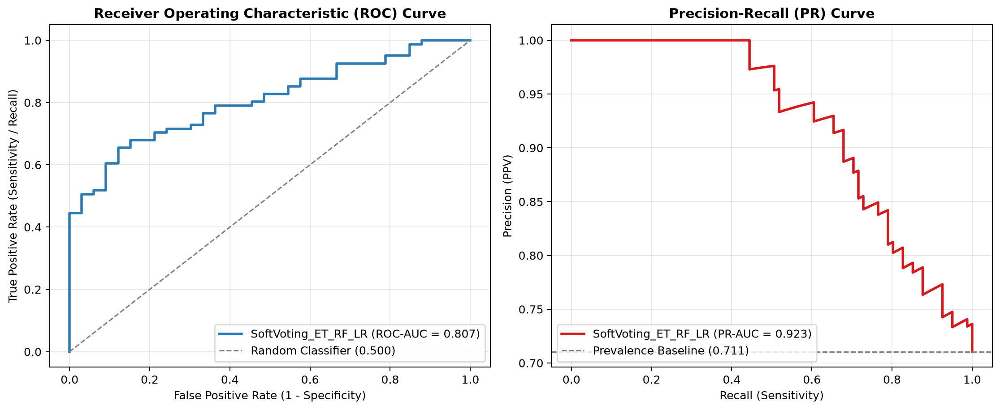
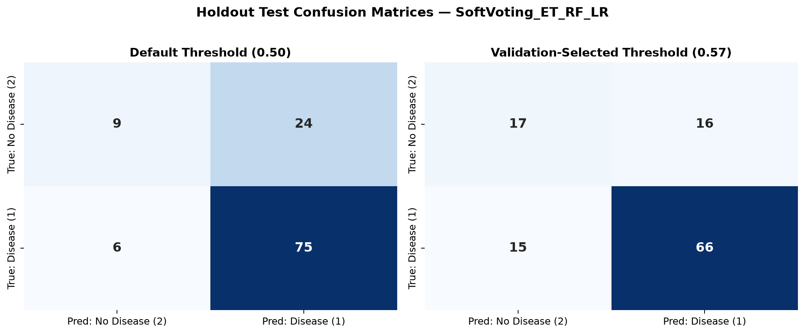
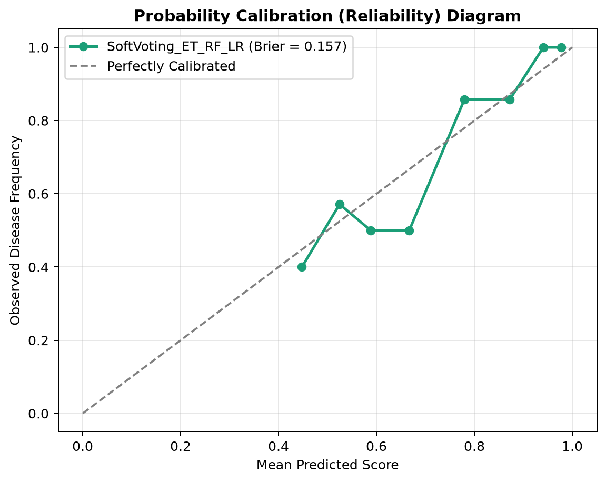
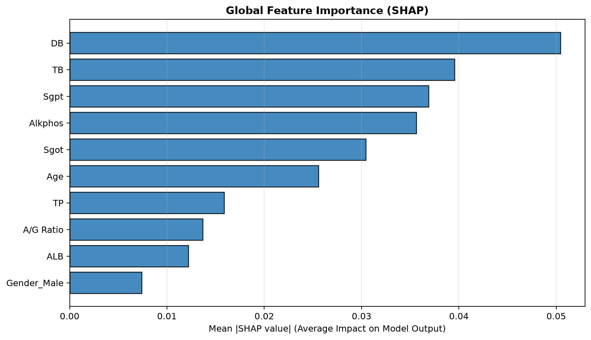
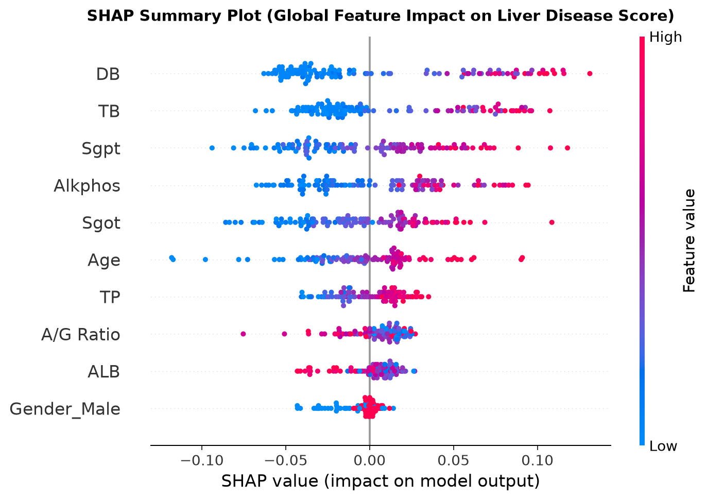

# Liver Disease Prediction System — Complete Technical & Machine Learning Documentation

**Document Version:** 1.0.0  
**System / Model Version:** `v1.0.0` (`SoftVoting_ET_RF_LR`)  
**Dataset:** UCI Indian Liver Patient Dataset (ILPD) — Verified SHA-256 `dbb065e6...27ef5de`  
**Trained Artifact Timestamp (UTC):** `2026-11-23T00:00:55+00:00`  
**Audience:** Computer Science / Data Science & Machine Learning Students, Graduation Project Reviewers, and Backend Integration Engineers  

> **ACADEMIC RESEARCH PROTOTYPE DISCLAIMER**  
> This system is an academic machine learning prototype trained on the public Indian Liver Patient Dataset (ILPD). It is **NOT** a clinically validated medical device and **MUST NOT** be used to diagnose, treat, or make clinical decisions for patients. Predicted probabilities represent statistical model risk scores rather than clinically calibrated diagnostic probabilities.

---

## Table of Contents

1. [Part 1 — Project Overview](#part-1--project-overview)
2. [Part 2 — Dataset Understanding](#part-2--dataset-understanding)
3. [Part 3 — Data Preprocessing](#part-3--data-preprocessing)
4. [Part 4 — Machine Learning Models](#part-4--machine-learning-models)
5. [Part 5 — Model Evaluation](#part-5--model-evaluation)
6. [Part 6 — VERY IMPORTANT: Application User Inputs](#part-6--very-important-application-user-inputs)
7. [Part 7 — Understanding the API](#part-7--understanding-the-api)
8. [Part 8 — SHAP and Model Explainability](#part-8--shap-and-model-explainability)
9. [Part 9 — Project Structure](#part-9--project-structure)
10. [Part 10 — Deployment and Backend Integration](#part-10--deployment-and-backend-integration)
11. [Part 11 — Important Questions for the ML Engineer](#part-11--important-questions-for-the-ml-engineer)

---

## Part 1 — Project Overview

### 1.1 What is the Liver Disease Prediction System?

The **Liver Disease Prediction System** is a modular, reproducible, backend-ready **Machine Learning Engineering** graduation project designed to estimate the statistical likelihood of liver disease from a patient's routine blood **Liver Function Test (LFT)** panel and basic demographic attributes.

Rather than stopping at a Jupyter notebook experiment, the project implements a complete software engineering lifecycle:

- **Audited & Leakage-Free Data Pipeline** (`src/liver_disease/data/`): Verifies dataset integrity via SHA-256 checksum, removes exact duplicate patient records before splitting, enforces strict stratified 80/20 splitting, and encapsulates all stateful preprocessing inside scikit-learn pipelines.
- **Rigorous 11-Algorithm Benchmarking & Model Selection** (`src/liver_disease/models/`): Evaluates 11 classification algorithms across 5×3 Repeated Stratified Cross-Validation, runs feature engineering, class imbalance, feature selection, hyperparameter tuning, ensemble, probability calibration, and validation threshold studies, and performs a single-pass evaluation on a locked holdout test set.
- **Versioned Model Serialization** (`artifacts/models/liver_disease_pipeline.joblib`): Bundles the fitted preprocessing pipeline, the winning `SoftVoting_ET_RF_LR` classifier, the validation-selected decision threshold (`0.57`), risk categorization bands, SHAP background data, and full evaluation metadata into a single immutable artifact (`5.75 MB`).
- **Explainable AI (SHAP)** (`src/liver_disease/models/explain.py`): Computes both global feature importance rankings and real-time individual patient feature attributions using `shap.KernelExplainer`.
- **Authenticated FastAPI Microservice** (`src/liver_disease/api/`): Exposes REST endpoints (`/health`, `/docs`, `/model-info`, `/predict`, `/predict/batch`, `/explain`) secured with constant-time `X-API-Key` validation and strict Pydantic v2 input schemas, with **zero retraining at startup**.
- **Decoupled Streamlit Prototype UI** (`frontend/app.py`): A lightweight web interface that communicates exclusively with the FastAPI service over HTTP and contains zero ML model code or dependencies.

### 1.2 What Problem Does It Attempt to Solve?

Liver diseases (including viral hepatitis, cirrhosis, alcoholic liver disease, cholestasis, and non-alcoholic fatty liver disease) often progress silently during early stages. Clinicians routinely order a standard **Liver Function Test (LFT)** blood panel measuring bilirubin fractions, liver enzymes (ALP, ALT/SGPT, AST/SGOT), and serum proteins (Total Proteins, Albumin, and A/G Ratio).

Interpreting combinations of 10 correlated biomarkers simultaneously is non-trivial because:
1. Individual biomarkers may lie near borderline reference intervals while their **joint pattern** indicates hepatic stress.
2. Serum enzymes and bilirubin exhibit extreme right-skewed distributions across acute vs. chronic presentations.
3. From an engineering perspective, academic ML prototypes frequently suffer from **data leakage**, **misleading accuracy metrics on imbalanced clinical cohorts**, **lack of explainability**, and **tight coupling** between notebooks and user interfaces that prevents real backend integration.

This project demonstrates how to solve both the **predictive modeling challenge** (learning nonlinear multivariate patterns from LFT markers) and the **ML systems engineering challenge** (packaging the model into a secure, validated, explainable, independently deployable REST API).

### 1.3 What Is the Role of Machine Learning in This Project?

Machine learning plays four specific roles in this system:

1. **Multivariate Pattern Recognition**: Learns statistical relationships across 10 patient attributes (8 serum biomarkers + Age + Gender) to produce a continuous risk score $P(\text{Liver Disease}) \in [0, 1]$.
2. **Decision-Boundary Optimization**: Combines a validation-selected binary classification threshold (`0.57`) with qualitative risk bands (`Low`, `Moderate`, `High`) so sensitivity and specificity are explicitly balanced rather than collapsing onto the majority class.
3. **Model Variance Reduction via Ensembling**: Combines three complementary tuned classifiers (Extra Trees, Random Forest, and L2-regularized Logistic Regression) via weighted soft voting to achieve higher discrimination and better probability quality (lower Brier score) than any single model.
4. **Post-Hoc Interpretability (SHAP)**: Quantifies how each input biomarker pushed an individual patient's risk score upward or downward relative to the ILPD training baseline.

> **Important Scope Boundary:** Machine learning in this project acts strictly as a **statistical pattern-scoring prototype for academic research**, never as an autonomous clinical decision-maker or medical diagnostic tool.

### 1.4 Overall System Architecture

A defining architectural principle of this project is **strict separation of concerns** between the presentation layer and the ML inference service:

- **Offline Experimentation & Training Layer** (`scripts/`, `notebooks/`, `src/liver_disease/models/benchmark.py`, `train.py`): Runs data auditing, EDA, 11-model CV benchmarking, hyperparameter tuning, holdout evaluation, and exports the frozen `liver_disease_pipeline.joblib` bundle.
- **Online Inference Microservice** (`src/liver_disease/api/`, port `8000`): Loads `liver_disease_pipeline.joblib` **once** during FastAPI's `lifespan` startup event (`main.py`), initializes the SHAP `KernelExplainer` once in memory (`LiverDiseasePredictor`), and serves stateless HTTP requests. If the artifact is missing, it fails explicitly with `FileNotFoundError` / HTTP 503 rather than silently retraining.
- **Presentation / Client Layer** (`frontend/app.py`, port `8501`, or any external Backend server): Communicates exclusively with FastAPI via JSON/multipart HTTP requests carrying the `X-API-Key` header. `frontend/Dockerfile` installs only `streamlit`, `requests`, `pandas`, and `plotly`—zero scikit-learn, XGBoost, or SHAP packages.

#### Actual End-to-End Architecture Diagram

Compared to a generic textbook diagram, the actual implementation adds **API Key authentication**, **dual-layer validation** (Pydantic v2 + DataFrame validator), **column schema normalization**, **decision threshold + risk band assignment**, and an **optional SHAP explainability branch** (`/explain`):

```mermaid
flowchart LR
    U["User / Researcher"] --> UI["Streamlit UI frontend/app.py :8501 (HTTP-only)"]
    EXT["External Backend"] --> API
    UI -->|"HTTP POST + X-API-Key"| API["FastAPI :8000"]
    API --> AUTH["X-API-Key Auth (hmac.compare_digest)"]
    AUTH --> VAL["Pydantic v2 (extra=forbid) + validation.py"]
    VAL --> NORM["Column Normalization (snake_case -> ILPD)"]
    NORM --> PREP["log1p -> Median Imputer -> RobustScaler + OHE"]
    PREP --> MODEL["SoftVoting_ET_RF_LR (2xET + 1xRF + 1xLR)"]
    MODEL --> POST["Threshold >= 0.57 + Risk Band"]
    PREP -.->|"If /explain"| SHAP["SHAP KernelExplainer"]
    POST --> RESP["JSON Response (prediction_id + disclaimer)"]
    SHAP -.-> RESP
    RESP --> DISP["UI KPIs, Gauge, SHAP Bar Chart"]
```



### 1.5 Technologies and Libraries Used (Verified Versions)

All runtime versions below were verified directly from `artifacts/models/model_metadata.json`, `requirements.txt`, and `pyproject.toml`:

| Category | Technology / Library | Verified Version | Why It Was Selected |
| :--- | :--- | :--- | :--- |
| **Language & Runtime** | Python | `3.12.13` | Modern type annotations (`from __future__ import annotations`), strong scientific and web ecosystem. |
| **Core Data & Math** | `numpy`, `pandas`, `scipy` | `2.5.5`, `2.3.3`, `1.18.1` | Vectorized tabular processing, Mann-Whitney U / Chi-square statistical tests, distance matrices. |
| **Classical ML & Pipelines** | `scikit-learn` | `1.9.1` | Leakage-free `Pipeline`, `ColumnTransformer`, `RobustScaler`, `GridSearchCV`, `VotingClassifier`, `CalibratedClassifierCV`, metrics. |
| **Imbalance Handling** | `imbalanced-learn` | `0.14.2` | Provides `imblearn.pipeline.Pipeline`, `SMOTE`, and `RandomOverSampler` so oversampling executes strictly inside training folds. |
| **Gradient Boosting** | `xgboost`, `lightgbm`, `catboost` | `3.4.1`, `4.7.0`, `1.2.10` | Industry-standard tabular GBDT libraries benchmarked against bagging and linear families. |
| **Explainability (XAI)** | `shap` | `0.54.1` | Game-theoretic local and global feature attributions (`KernelExplainer` for `VotingClassifier`). |
| **Model Serialization** | `joblib` | `1.6.0` | Fast compressed (`compress=3`) persistence of scikit-learn pipelines and NumPy arrays. |
| **REST API & Validation** | `fastapi`, `uvicorn`, `pydantic`, `python-dotenv`, `python-multipart` | `0.165.0`, `>=0.32`, `2.14.4` | Async REST microservice, automatic OpenAPI/Swagger UI (`/docs`), strict Pydantic v2 validation, `.env` loading, CSV file uploads. |
| **Prototype Frontend** | `streamlit`, `plotly`, `requests` | `>=1.39`, `>=5.24`, `>=2.32` | Rapid interactive UI with probability gauges, horizontal SHAP charts, batch CSV upload/export over HTTP. |
| **Visualization** | `matplotlib`, `seaborn` | `>=3.9`, `>=0.13.2` | Publication-quality EDA, benchmark, ROC/PR, confusion matrix, calibration, and SHAP plots (`180 DPI`). |
| **Testing & Packaging** | `pytest`, `httpx`, `Docker`, `Docker Compose`, `Render` | `>=8.3`, `>=0.27` | Automated unit/integration/security tests (`tests/`), reproducible containers (`Dockerfile`, `frontend/Dockerfile`), cloud blueprint (`render.yaml`). |

### 1.6 Complete End-to-End Workflow (User Input to Prediction Output)

1. **Input Entry**: A user enters 10 clinical LFT values in the Streamlit form (or uploads a CSV file, or an external Backend sends JSON).
2. **HTTP Request Construction**: Streamlit sends an HTTP `POST` request to `/explain` (if SHAP checkbox is checked) or `/predict` (if unchecked), or `/predict/batch` (for CSV), attaching `X-API-Key` in the HTTP header.
3. **Authentication (`api/security.py`)**: FastAPI verifies `X-API-Key` against the server's `LIVER_API_KEY` environment variable using constant-time `hmac.compare_digest()`. Missing/wrong keys return `401`; unset server key fails closed with `503`.
4. **Schema Validation (`api/schemas.py`)**: Pydantic v2 validates the payload against `PatientFeatures` (`extra="forbid"`), rejecting missing fields, unexpected fields, booleans, `NaN`/`Inf`, invalid `gender`, or out-of-range medical measurements with `422`.
5. **Normalization & Defensive Check (`loader.py`, `validation.py`)**: Canonical snake_case keys are mapped to the 10 raw ILPD column names in deterministic order, and `validate_feature_dataframe(..., allow_missing=False)` performs a second defensive verification.
6. **Preprocessing (`liver_disease_pipeline.joblib`)**: Inside the frozen scikit-learn `Pipeline`, `ClinicalFeatureEngineer(add_clinical_ratios=False, log_transform_skewed=True)` applies `np.log1p` to `TB`, `DB`, `Alkphos`, `Sgpt`, `Sgot`; `ColumnTransformer` then applies training-fitted median imputation and `RobustScaler` to all 9 numeric columns and binary `OneHotEncoder` to `Gender` → `Gender_Male`.
7. **Inference (`VotingClassifier`)**: The 10-element feature vector passes into `ExtraTrees_Tuned` (weight 2), `RandomForest_Tuned` (weight 1), and `LogisticRegression_Tuned` (weight 1). Their positive-class probabilities are combined via weighted averaging into a single score $p \in [0, 1]$.
8. **Thresholding, Risk Banding & Optional SHAP (`models/predict.py`, `explain.py`)**:
   - Binary decision: `prediction = 1 ("Liver Disease")` if $p \ge 0.57$, else `2 ("No Liver Disease")`.
   - Risk category: `"Low"` ($p < 0.35$), `"Moderate"` ($0.35 \le p < 0.65$), or `"High"` ($p \ge 0.65$).
   - If `/explain` was called, `shap.KernelExplainer` computes local SHAP attributions across all 10 transformed features and ranks the top 6 drivers.
9. **API Response & UI Rendering**: FastAPI returns structured JSON with a fresh UUID v4 `prediction_id`, `model_version`, results, and the mandatory academic disclaimer. Streamlit displays 4 KPI metric cards, a Plotly risk gauge with a vertical marker at `57%`, and a horizontal SHAP bar chart.

---

## Part 2 — Dataset Understanding

### 2.1 Dataset Provenance and Source

Every statistic in this section was verified directly against `data/raw/Indian Liver Patient Dataset (ILPD).csv`, `artifacts/reports/data_audit_report.json`, and `artifacts/reports/eda_summary.json`.

| Provenance Attribute | Verified Value |
| :--- | :--- |
| **Dataset Name** | Indian Liver Patient Dataset (ILPD) |
| **Original Source** | UCI Machine Learning Repository — Dataset ID 225 (`https://archive.ics.uci.edu/dataset/225/ilpd+indian+liver+patient+dataset`) |
| **Original Creators** | Bendi Venkata Ramana, M. Surendra Prasad Babu, N. B. Venkateswarlu (2012) |
| **Geographic Origin** | North East of Andhra Pradesh, India |
| **Canonical File Path** | `data/raw/Indian Liver Patient Dataset (ILPD).csv` |
| **File Size & SHA-256** | `23,817 bytes` · `dbb065e6bf2b226b6d9c04f066ddc0b45173861dfb3a4df83f3710d3927ef5de` |
| **External Data Added?** | None. Exclusively the original ILPD dataset is used. |

### 2.2 Dataset Dimensions and Target Variable

- **Raw Dimensions**: **583 rows × 11 columns** (10 predictor features + 1 target column `Selector`).
- **Deduplicated Dimensions**: **570 unique rows × 11 columns** after removing 13 consecutive exact duplicate records.
- **Target Variable (`Selector`)**:
  - `Selector = 1`: **Liver Disease** → mapped internally to binary positive class `y = 1` in `split_features_and_target()` (`src/liver_disease/data/loader.py`).
  - `Selector = 2`: **No Liver Disease** → mapped internally to binary negative class `y = 0`.
  - At API response time, `LiverDiseasePredictor` maps predictions back to the original ILPD convention (`1` = `"Liver Disease"`, `2` = `"No Liver Disease"`) so external consumers and datasets remain consistent.

### 2.3 Class and Demographic Distribution

| Cohort View | Total Rows | Liver Disease (`1`) | No Liver Disease (`2`) | Pos : Neg Ratio |
| :--- | :---: | :---: | :---: | :---: |
| **Raw ILPD** | `583` | `416` (`71.36%`) | `167` (`28.64%`) | `2.49 : 1` |
| **Deduplicated ILPD** | `570` | `406` (`71.23%`) | `164` (`28.77%`) | `2.48 : 1` |
| **Training Split (80%)** | `456` | `325` (`71.27%`) | `131` (`28.73%`) | `2.48 : 1` |
| **Holdout Test Split (20%)** | `114` | `81` (`71.05%`) | `33` (`28.95%`) | `2.45 : 1` |

- **Gender Breakdown (Raw `n = 583`)**:
  - **Male**: `441` patients (`75.64%`) — `324` Liver Disease, `117` No Liver Disease (deduplicated male disease rate: `73.26%`).
  - **Female**: `142` patients (`24.36%`) — `92` Liver Disease, `50` No Liver Disease (deduplicated female disease rate: `65.00%`).
  - **Chi-square test (`Gender` vs. `Selector`, deduplicated `n = 570`)**: $\chi^2 = 3.1212$, $\text{dof} = 1$, $p = 0.0773$ (borderline, not statistically significant at $\alpha = 0.05$).



### 2.4 Complete Dataset Feature Table

Note carefully which columns are user-entered predictors versus the target variable or experimental derived features:

| Feature | Meaning | Data Type | Unit | User Input Required? |
| :--- | :--- | :--- | :--- | :--- |
| `Age` | Age of the patient (patients >89 are recorded as 90 in UCI ILPD) | `int64` / `int` | years | **Yes** (`age`) |
| `Gender` | Biological sex / gender recorded in dataset (`Male` or `Female`) | `object` / `Literal["Male","Female"]` | categorical | **Yes** (`gender`) |
| `TB` | Total Bilirubin — combined conjugated + unconjugated serum bilirubin | `float64` / `float` | mg/dL | **Yes** (`total_bilirubin`) |
| `DB` | Direct (Conjugated) Bilirubin — water-soluble bilirubin processed by liver | `float64` / `float` | mg/dL | **Yes** (`direct_bilirubin`) |
| `Alkphos` | Alkaline Phosphotase (ALP) — cholestatic enzyme linked to bile ducts | `int64` / `float` | IU/L | **Yes** (`alkaline_phosphotase`) |
| `Sgpt` | Alamine Aminotransferase (ALT / SGPT) — hepatocellular injury enzyme | `int64` / `float` | IU/L | **Yes** (`alamine_aminotransferase`) |
| `Sgot` | Aspartate Aminotransferase (AST / SGOT) — hepatic/tissue injury enzyme | `int64` / `float` | IU/L | **Yes** (`aspartate_aminotransferase`) |
| `TP` | Total Serum Proteins (albumin + globulins) | `float64` / `float` | g/dL | **Yes** (`total_proteins`) |
| `ALB` | Serum Albumin — primary protein synthesized exclusively by the liver | `float64` / `float` | g/dL | **Yes** (`albumin`) |
| `A/G Ratio` | Albumin-to-Globulin Ratio (hepatic synthetic balance) | `float64` / `float` | dimensionless ratio | **Yes** (`albumin_and_globulin_ratio`) |
| `Selector` | Target label (`1` = Liver Disease, `2` = No Liver Disease) | `int64` (Target) | binary class | **No** (Predicted by the model) |

> **Verification Note on Derived Features:** Four clinical ratio features (`AST_ALT_Ratio`, `DB_TB_Ratio`, `Indirect_Bilirubin`, `Globulin`) exist in `src/liver_disease/features/engineering.py`, but they are **never entered by the user** and are **disabled** (`add_clinical_ratios=False`) in the final production model based on cross-validation ablation results.

### 2.5 Missing Values, Duplicates, and Data Quality Audit

The automated audit (`scripts/run_data_audit.py` → `artifacts/reports/data_audit_report.json`) uncovered five critical facts about the raw ILPD CSV:

1. **Missing Values (`4 cells`, `0.69%`)**:
   - Located **exclusively** in `A/G Ratio` at 0-based raw row indices `[209, 241, 253, 312]`.
   - All other 10 columns have `0` missing values.
   - **Handling**: Imputed via `SimpleImputer(strategy="median")` fitted strictly inside training folds (learned training median = `0.9650`). At REST API inference time, missing values are **not** imputed—all 10 fields are strictly required and missing entries return HTTP `422`.
2. **Exact Duplicate Records (`13 extra rows`, `26 rows involved`)**:
   - Thirteen pairs of completely identical rows appear as **consecutive adjacent entries** in the raw CSV: `[18,19]`, `[25,26]`, `[33,34]`, `[54,55]`, `[61,62]`, `[105,106]`, `[107,108]`, `[137,138]`, `[142,143]`, `[157,158]`, `[163,164]`, `[173,174]`, `[200,201]`.
   - Zero feature-duplicate target conflicts (`feature_duplicate_target_conflicts = []`).
   - **Handling**: Removed via `drop_duplicates(keep="first")` in `deduplicate_dataset()` **before** train/test splitting (`583 → 570` rows), preventing identical patient records from leaking across train and test sets.
3. **Near-Duplicates (`12 pairs` with standardized Euclidean distance `< 0.25`)**:
   - Six of those 12 pairs have **opposite** target labels (`same_target = false`). They represent distinct patients with similar routine lab results and were **preserved intact**.
4. **Domain Consistency Anomalies (Documented & Preserved)**:
   - `3` raw rows (`[246, 261, 279]`) record `DB > TB` (minor measurement/recording discrepancy in the public UCI dataset).
   - `8` raw rows (`[33, 34, 267, 415, 484, 491, 548, 575]`) have reported `A/G Ratio` differing from `ALB / (TP - ALB)` by `> 0.25`.
   - `0` rows have `ALB > TP`, and `0` rows have non-positive (`<= 0`) numerical values.
   - **Handling**: Preserved intact without silent editing or deletion, following transparent medical data-integrity rules.
5. **Extreme Right-Skewed Biomarkers**:
   - `11.3%` to `14.4%` of values in `TB`, `DB`, `Alkphos`, `Sgpt`, and `Sgot` exceed standard `1.5×IQR` upper fences (e.g., `Sgot` up to `4,929 IU/L`, `TB` up to `75.0 mg/dL`).
   - **Handling**: Never dropped as "errors"—in hepatology, extreme enzyme/bilirubin spikes represent acute or severe liver injury. Instead, `np.log1p` compresses heavy right tails while preserving clinical rank ordering.

### 2.6 Key Exploratory Data Analysis (EDA) Observations

Verified from `artifacts/reports/data_audit_report.json` (raw `n=583` summary) and `artifacts/reports/eda_summary.json` (deduplicated `n=570` Mann-Whitney U and Spearman tests):

| Feature | Observed Min–Max | Median (Q25–Q75) | Skewness | IQR Outliers (%) | Disease Med. vs. No-Dis. Med. | Spearman $\rho$ with Disease | Mann-Whitney $p$-value |
| :--- | :---: | :---: | :---: | :---: | :---: | :---: | :---: |
| `Age` | `4 – 90` | `45.0 (33.0–58.0)` | `-0.03` | `0 (0.0%)` | `46.0` vs. `41.0` | `+0.130` | `2.01e-03` |
| `TB` | `0.4 – 75.0` | `1.0 (0.8–2.6)` | `+4.91` | `84 (14.4%)` | `1.4` vs. `0.8` | **`+0.316`** | **`4.68e-14`** |
| `DB` | `0.1 – 19.7` | `0.3 (0.2–1.3)` | `+3.21` | `81 (13.9%)` | `0.5` vs. `0.2` | **`+0.309`** | **`1.58e-13`** |
| `Alkphos` | `63 – 2110` | `208.0 (175.5–298.0)` | `+3.77` | `69 (11.8%)` | `229.0` vs. `186.5` | `+0.274` | `6.23e-11` |
| `Sgpt` | `10 – 2000` | `35.0 (23.0–60.5)` | `+6.55` | `73 (12.5%)` | `40.5` vs. `27.0` | `+0.291` | `4.11e-12` |
| `Sgot` | `10 – 4929` | `42.0 (25.0–87.0)` | `+10.55` | `66 (11.3%)` | `51.0` vs. `29.0` | **`+0.311`** | **`1.30e-13`** |
| `TP` | `2.7 – 9.6` | `6.6 (5.8–7.2)` | `-0.29` | `8 (1.4%)` | `6.6` vs. `6.65` | `-0.036` | `3.98e-01` (n.s.) |
| `ALB` | `0.9 – 5.5` | `3.1 (2.6–3.8)` | `-0.04` | `0 (0.0%)` | `3.0` vs. `3.45` | `-0.174` | `3.47e-05` |
| `A/G Ratio` | `0.3 – 2.8` | `0.93 (0.7–1.1)` | `+0.99` | `10 (1.7%)` | `0.9` vs. `1.0` | `-0.197` | `2.82e-06` |

**Major Clinical & Statistical Takeaways from EDA:**
1. **Strongest Positive Disease Separators**: Bilirubin (`TB` $\rho = +0.316$, `DB` $\rho = +0.309$) and hepatic enzymes (`Sgot` $\rho = +0.311$, `Sgpt` $\rho = +0.291$, `Alkphos` $\rho = +0.274$) show highly significant elevations in liver disease patients ($p < 10^{-10}$).
2. **Protective / Inverse Synthetic Markers**: Lower `ALB` ($\rho = -0.174$) and lower `A/G Ratio` ($\rho = -0.197$) correlate with liver disease, reflecting reduced hepatic albumin synthesis.
3. **Weak Univariate Signal in `TP`**: Total Proteins alone does not significantly separate classes ($p = 0.398$), because albumin may drop while globulins rise in chronic liver inflammation, leaving total protein nearly unchanged.
4. **High Inter-Feature Collinearity ($|\rho| \ge 0.70$)**: Four strongly correlated pairs were identified:
   - `TB` ↔ `DB`: $\rho = +0.9584$
   - `TP` ↔ `ALB`: $\rho = +0.7782$
   - `Sgpt` ↔ `Sgot`: $\rho = +0.7719$
   - `ALB` ↔ `A/G Ratio`: $\rho = +0.7535$
   This collinearity directly explains why adding extra hand-crafted ratios did not improve CV performance and why SHAP shares attribution weight across correlated biomarker pairs.





---

## Part 3 — Data Preprocessing

### 3.1 Step-by-Step Preprocessing Pipeline

Below is the exact preprocessing architecture verified from `src/liver_disease/data/loader.py`, `src/liver_disease/data/preprocessing.py`, `src/liver_disease/features/engineering.py`, and `artifacts/preprocessing/preprocessing_schema.json`.

| Step | Preprocessing Stage | Why Necessary | Actual Technique Used | Code File & Function / Class | Runs During |
| :---: | :--- | :--- | :--- | :--- | :--- |
| **1** | **Data Cleaning & Normalization** | Prevent whitespace mismatches (`"Male "` vs `"Male"`) and unify API snake_case vs. raw ILPD CSV column names. Preserve authentic clinical outliers. | `.str.strip()` on `Gender`; `normalize_inference_columns()` maps API keys → `RAW_FEATURE_COLUMNS`. No outlier deletion. | `data/loader.py`: `load_raw_dataset()`, `normalize_inference_columns()`; `models/predict.py`: `predict_dataframe()` | **Both** (Training & Inference) |
| **2** | **Duplicate Removal** | 13 consecutive exact duplicate pairs in raw ILPD would leak identical patients across train/test splits and inflate validation metrics. | `df.duplicated(keep="first")` + target-conflict check (`0` conflicts). Reduces `583 → 570` rows. | `data/preprocessing.py`: `deduplicate_dataset()` | **Training / Splitting Only** |
| **3** | **Train / Test Splitting** | Create an untouched holdout test set with matching class balance and mathematically verified zero overlap. | Stratified 80/20 `train_test_split(..., stratify=y, random_state=42)` + row-hash overlap assertion (`overlap == 0`). Saves `train.csv` (456) and `test.csv` (114). | `data/preprocessing.py`: `create_leakage_free_split()` | **Training / Offline Only** |
| **4** | **Numerical Log Transformation (`log1p`)** | Stabilize heavy right skewness (up to `10.55` in `Sgot`) for linear and distance-based models without discarding acute clinical spikes. | `np.log1p(np.maximum(df[col], 0.0))` applied row-wise to `["TB", "DB", "Alkphos", "Sgpt", "Sgot"]`. | `features/engineering.py`: `ClinicalFeatureEngineer(log_transform_skewed=True)` | **Both** (Training & Inference) |
| **5** | **Feature Engineering (Clinical Ratios)** | Tested domain ratios (`AST_ALT_Ratio`, `DB_TB_Ratio`, `Indirect_Bilirubin`, `Globulin`) in CV ablation to check if explicit ratios improve discrimination. | Implemented in `ClinicalFeatureEngineer`, **disabled (`add_clinical_ratios=False`)** in final model because `log1p_only` outperformed ratios in Experiment 2 CV ablation without increasing collinearity. | `features/engineering.py`: `ClinicalFeatureEngineer(add_clinical_ratios=False)` | **Benchmarked Only** (Off in Final Model) |
| **6** | **Missing Value Imputation** | Handle the 4 missing `A/G Ratio` values in ILPD strictly without test-set leakage; provide a defensive fallback inside the pipeline. | Numeric: `SimpleImputer(strategy="median")` fitted on `X_train`. Categorical: `SimpleImputer(strategy="most_frequent")`. *(API rejects NaNs before this step via Pydantic v2.)* | `data/preprocessing.py`: `build_preprocessor()` (`ColumnTransformer`) | **Both** (Fit on Train; Transform on Train & Inference) |
| **7** | **Numerical Scaling** | `SoftVoting_ET_RF_LR` includes `LogisticRegression`, which requires comparable feature scales and resists extreme clinical outliers. | `RobustScaler()` computes `(x - median) / IQR` using Q25/Q50/Q75 learned exclusively on `X_train`. | `data/preprocessing.py`: `build_preprocessor(scaler="robust")` | **Both** (Fit on Train; Transform on Train & Inference) |
| **8** | **Categorical Encoding** | Convert string `Gender` (`"Male"` / `"Female"`) to numeric representation without dummy-variable multicollinearity. | `OneHotEncoder(categories=[["Female", "Male"]], drop="if_binary", handle_unknown="ignore", sparse_output=False)` → single column `Gender_Male` (`Female = 0.0`, `Male = 1.0`). | `data/preprocessing.py`: `build_preprocessor()` (`cat_pipeline`) | **Both** (Fit on Train; Transform on Train & Inference) |
| **9** | **Feature Selection** | Evaluated whether pruning lower-mutual-information features reduces noise on `n = 456`. | In-fold `SelectKBest(mutual_info_classif, k ∈ {6, 8, 10, all})` tested in Experiment 4 (`benchmark.py`). **Not enabled in final model** — all 10 features retained. | `models/benchmark.py`: Experiment 4 | **Benchmarked Only** (Not in Final Model) |
| **10** | **Class Imbalance Handling** | Mitigate `71.3% / 28.7%` class skew without synthetic test-fold leakage. | Benchmarked `none`, `class_weight`, in-fold `RandomOverSampler`, and in-fold `SMOTE` (`imblearn.pipeline.Pipeline`). Final ensemble uses `imbalance_strategy="none"` with `class_weight="balanced"` on `ExtraTrees_Tuned` + validation threshold `0.57`. | `data/preprocessing.py`: `build_training_pipeline()`; `models/train.py` | **Training Only** (`class_weight` inside `ExtraTrees` fit) |

### 3.2 Exact Learned Parameters in the Serialized Production Preprocessor

Inspecting the actual fitted `ColumnTransformer` inside `artifacts/models/liver_disease_pipeline.joblib` (fitted exclusively on `X_train`, `n = 456`) confirms the exact transformation parameters applied to every new patient:

| Transformed Feature | Step 1: `log1p` Applied? | Step 2: Imputer Median (`X_train`) | Step 3: `RobustScaler` Center | Step 3: `RobustScaler` Scale (IQR) | Exact Inference Formula |
| :--- | :---: | :---: | :---: | :---: | :--- |
| `Age` | No | `45.0000` | `45.0000` | `25.0000` | $(x - 45.0) / 25.0$ |
| `TB` | **Yes** (`ln(1 + TB)`) | `0.6931` | `0.6931` | `0.6136` | $(\ln(1 + x) - 0.6931) / 0.6136$ |
| `DB` | **Yes** (`ln(1 + DB)`) | `0.2624` | `0.2624` | `0.6061` | $(\ln(1 + x) - 0.2624) / 0.6061$ |
| `Alkphos` | **Yes** (`ln(1 + Alkphos)`) | `5.3375` | `5.3375` | `0.5085` | $(\ln(1 + x) - 5.3375) / 0.5085$ |
| `Sgpt` | **Yes** (`ln(1 + Sgpt)`) | `3.5835` | `3.5835` | `0.8995` | $(\ln(1 + x) - 3.5835) / 0.8995$ |
| `Sgot` | **Yes** (`ln(1 + Sgot)`) | `3.7494` | `3.7494` | `1.2078` | $(\ln(1 + x) - 3.7494) / 1.2078$ |
| `TP` | No | `6.6000` | `6.6000` | `1.3000` | $(x - 6.6) / 1.3$ |
| `ALB` | No | `3.1000` | `3.1000` | `1.2000` | $(x - 3.1) / 1.2$ |
| `A/G Ratio` | No | `0.9650` | `0.9650` | `0.4000` | $(x - 0.965) / 0.4$ |
| `Gender_Male` | No | Mode (`"Male"`) | N/A (OHE) | N/A (OHE) | `1.0` if `"Male"`, `0.0` if `"Female"` |

### 3.3 How Training-Serving Consistency Is Guaranteed

A classic production ML bug is **training-serving skew**—writing preprocessing logic in a training notebook and re-implementing it manually in the API. This project eliminates that risk completely:

1. `build_training_pipeline()` wraps both `preprocessor` (`ClinicalFeatureEngineer` + `ColumnTransformer`) and `classifier` (`VotingClassifier`) inside a **single scikit-learn `Pipeline` object**.
2. During training (`src/liver_disease/models/train.py`), `final_pipeline.fit(X_train, y_train)` fits the imputer medians, `RobustScaler` centers/IQRs, `OneHotEncoder`, and all 3 ensemble classifiers together.
3. The entire fitted `Pipeline` is serialized into `artifacts/models/liver_disease_pipeline.joblib` via `joblib.dump(..., compress=3)`.
4. At inference time (`LiverDiseasePredictor.predict_dataframe()`), the API passes a raw 10-column DataFrame directly into `self.pipeline.predict_proba(normalized)`. Scikit-learn automatically executes `ClinicalFeatureEngineer.transform()` → `ColumnTransformer.transform()` (using the frozen `X_train` medians and IQR scales) → `VotingClassifier.predict_proba()` in the exact same order.

**Worked Example Verification (Elevated LFT Patient):**
- Raw input: `DB = 5.5 mg/dL`
- Step 1 (`log1p`): $\ln(1 + 5.5) = \ln(6.5) = 1.871802$
- Step 2 (`RobustScaler`): $(1.871802 - 0.262364) / 0.606136 = \mathbf{2.6552}$ (matches `transformed_value: 2.6552` returned live by `POST /explain`!).

---

## Part 4 — Machine Learning Models

### 4.1 Benchmarking Protocol

All model comparisons were executed in `src/liver_disease/models/benchmark.py` (`scripts/run_benchmark.py`) **exclusively on the 80% training split (`n = 456`)** using **`RepeatedStratifiedKFold(n_splits=5, n_repeats=3, random_state=42)`** (15 validation folds per model). Every preprocessing step ran strictly inside each training fold. The locked holdout test set (`n = 114`) was never touched during benchmarking, ablation, tuning, or threshold selection.

### 4.2 The 11 Benchmarked Algorithms (Conceptual Guide & Actual CV Results)

Below are all 11 candidate models benchmarked in Experiment 1 (`artifacts/reports/benchmark_11_models_baseline.csv`, `log1p_only`, default threshold `0.50`, no class weighting), ranked by CV ROC-AUC:

| Rank | Model | Scaler | ROC-AUC (Mean ± SD) | PR-AUC (Mean ± SD) | F1-Score | Recall (Sens.) | Specificity | Bal. Acc. | Accuracy | Brier |
| ---: | :--- | :---: | :---: | :---: | :---: | :---: | :---: | :---: | :---: | :---: |
| **1** | **ExtraTrees** | `none` | **0.7343 ± 0.0477** | **0.8876 ± 0.0201** | 0.8186 | 0.9303 | 0.1526 | 0.5414 | 0.7069 | **0.1781** |
| **2** | **KNN** (`k=11`) | `robust` | 0.7279 ± 0.0455 | 0.8780 ± 0.0295 | 0.8008 | 0.8574 | 0.3000 | 0.5787 | 0.6973 | 0.1818 |
| **3** | **LogisticRegression** | `robust` | 0.7228 ± 0.0485 | 0.8791 ± 0.0261 | 0.8143 | 0.9036 | 0.2186 | 0.5611 | 0.7069 | 0.1800 |
| **4** | **RandomForest** | `none` | 0.7211 ± 0.0454 | 0.8795 ± 0.0244 | 0.8065 | 0.8779 | 0.2595 | 0.5687 | 0.7003 | 0.1816 |
| **5** | **CatBoost** | `none` | 0.7074 ± 0.0486 | 0.8710 ± 0.0256 | 0.7945 | 0.8462 | 0.2972 | 0.5717 | 0.6885 | 0.1963 |
| **6** | **GradientBoosting** | `none` | 0.7046 ± 0.0569 | 0.8673 ± 0.0311 | 0.7998 | 0.8482 | 0.3255 | **0.5868** | 0.6981 | 0.1961 |
| **7** | **XGBoost** | `none` | 0.7015 ± 0.0539 | 0.8685 ± 0.0266 | 0.7854 | 0.8226 | 0.3251 | 0.5738 | 0.6798 | 0.2043 |
| **8** | **HistGradientBoosting** | `none` | 0.6991 ± 0.0528 | 0.8688 ± 0.0294 | 0.7810 | 0.8236 | 0.2951 | 0.5593 | 0.6718 | 0.2008 |
| **9** | **LightGBM** | `none` | 0.6988 ± 0.0466 | 0.8697 ± 0.0197 | 0.7888 | 0.8246 | **0.3406** | 0.5826 | 0.6856 | 0.2258 |
| **10** | **SVM (RBF)** | `robust` | 0.6348 ± 0.0501 | 0.8119 ± 0.0296 | 0.8322 | 1.0000 | **0.0000** | 0.5000 | 0.7127 | 0.2013 |
| **11** | **DecisionTree** | `none` | 0.6187 ± 0.0539 | 0.7973 ± 0.0344 | 0.7545 | 0.7908 | 0.2546 | 0.5227 | 0.6368 | 0.2564 |



#### Model-by-Model Conceptual Breakdown

1. **Extra Trees (`ExtraTreesClassifier`)** — *Baseline #1 (ROC-AUC 0.7343, PR-AUC 0.8876, Brier 0.1781)*
   - **How it works**: Builds an ensemble of many decision trees (`n_estimators=300`), choosing both random feature subsets **and random split thresholds** at every node.
   - **Strengths**: Extreme variance reduction on small, noisy tabular datasets; naturally handles nonlinear interactions and collinearity (`TB`/`DB`, `Sgpt`/`Sgot`); produces smooth averaged probabilities.
   - **Weaknesses**: Slightly higher bias than standard trees; less directly interpretable without SHAP.
   - **Why included**: Classic low-variance randomized bagging family ideally suited to `n = 456` clinical data.

2. **K-Nearest Neighbors (`KNeighborsClassifier`, `k=11`, distance-weighted)** — *Baseline #2 (ROC-AUC 0.7279, PR-AUC 0.8780)*
   - **How it works**: Classifies a patient based on the inverse-distance-weighted class votes of the 11 closest training patients in scaled 10-D feature space.
   - **Strengths**: Zero parametric assumptions; captures local neighborhoods well after `log1p` + `RobustScaler`.
   - **Weaknesses**: Sensitive to feature scaling, irrelevant/collinear dimensions, and boundary noise; not selected for tuning because tree ensembles and logistic regression generalize more cleanly and smoothly.
   - **Why included**: Non-parametric distance-based benchmark family.

3. **Logistic Regression (`LogisticRegression`, L2 regularized, `lbfgs`)** — *Baseline #3 (ROC-AUC 0.7228, PR-AUC 0.8791, Brier 0.1800)*
   - **How it works**: Models the log-odds of liver disease as a linear combination of scaled features passed through the sigmoid function: $P(y=1 \mid x) = \frac{1}{1 + e^{-(\beta_0 + \beta^\top x)}}$.
   - **Strengths**: Strong regularization prevents overfitting on small datasets; smooth, well-calibrated probabilities; fast and transparent.
   - **Weaknesses**: Cannot capture complex nonlinear interactions or threshold effects without manual feature engineering.
   - **Why included**: Essential linear clinical baseline and strong probability-stabilizing ensemble partner.

4. **Random Forest (`RandomForestClassifier`)** — *Baseline #4 (ROC-AUC 0.7211, PR-AUC 0.8795, Brier 0.1816)*
   - **How it works**: Trains `300` trees on bootstrap resamples of the training data, searching for the best split across a random subset of features at each node, and averages predicted probabilities.
   - **Strengths**: Robust to outliers and collinearity; captures nonlinear biomarker thresholds with low variance.
   - **Weaknesses**: Trees are more correlated with each other than Extra Trees; can slightly overfit deep splits on small cohorts if leaves are unconstrained.
   - **Why included**: Gold-standard bagging benchmark for tabular clinical data.

5. **CatBoost (`CatBoostClassifier`)** — *Baseline #5 (ROC-AUC 0.7074, PR-AUC 0.8710, Brier 0.1963)*
   - **How it works**: Gradient boosting over symmetric ("oblivious") decision trees with ordered boosting that helps limit target leakage and overfitting on small tabular datasets.
   - **Strengths**: Strong regularization via symmetric trees; competitive after tuning (`ROC-AUC 0.7289`).
   - **Weaknesses**: Higher Brier score (`0.1963–0.2007`) and slightly higher variance than bagging ensembles on `n = 456`.
   - **Why included**: Leading modern gradient boosting family optimized for small-to-medium tabular data.

6. **Gradient Boosting (`GradientBoostingClassifier`)** — *Baseline #6 (ROC-AUC 0.7046, PR-AUC 0.8673, Balanced Acc. 0.5868)*
   - **How it works**: Sequentially builds shallow regression trees (`max_depth=3`, `lr=0.05`, `subsample=0.85`), each fitting the negative gradient (residuals) of the log-loss from previous trees.
   - **Strengths**: Captures subtle additive interactions; achieved the highest baseline balanced accuracy (`0.5868`).
   - **Weaknesses**: Sequential residual fitting can memorize noise on small clinical datasets (`ROC-AUC SD = ±0.0569`).
   - **Why included**: Classic scikit-learn boosting baseline.

7. **XGBoost (`XGBClassifier`)** — *Baseline #7 (ROC-AUC 0.7015, PR-AUC 0.8685, Brier 0.2043)*
   - **How it works**: Regularized second-order gradient boosting (uses both first and second derivatives of log-loss plus L1/L2 leaf penalties and column subsampling).
   - **Strengths**: Extremely powerful on medium-to-large tabular datasets; native handling of missing values and class weighting (`scale_pos_weight`).
   - **Weaknesses**: Prone to overconfident probability estimates (Brier `0.2043`) and variance when training folds have only ~365 rows.
   - **Why included**: Standard competitive tabular ML benchmark.

8. **Histogram-Based Gradient Boosting (`HistGradientBoostingClassifier`)** — *Baseline #8 (ROC-AUC 0.6991, PR-AUC 0.8688)*
   - **How it works**: Bins continuous features into discrete integer histograms before finding splits (inspired by LightGBM), built natively into scikit-learn.
   - **Strengths**: Fast training, native missing-value support.
   - **Weaknesses**: Histogram discretization can lose split precision on very small datasets (`n = 456`).
   - **Why included**: Modern native scikit-learn boosting baseline.

9. **LightGBM (`LGBMClassifier`)** — *Baseline #9 (ROC-AUC 0.6988, PR-AUC 0.8697, Specificity 0.3406)*
   - **How it works**: Leaf-wise gradient boosting that expands the leaf giving the largest loss reduction rather than growing level-by-level.
   - **Strengths**: Very fast; achieved highest baseline specificity (`0.3406`).
   - **Weaknesses**: Leaf-wise growth easily overfits small datasets (`n = 456`), producing the worst Brier score among ensembles (`0.2258`).
   - **Why included**: Major GBDT family benchmark.

10. **Support Vector Machine — RBF Kernel (`SVC(kernel="rbf", probability=True)`)** — *Baseline #10 (ROC-AUC 0.6348, PR-AUC 0.8119)*
    - **How it works**: Maps scaled inputs into a high-dimensional space via the Radial Basis Function kernel and finds a maximum-margin hyperplane, using internal Platt scaling for probabilities.
    - **Strengths**: Effective on clean, well-separated nonlinear boundaries.
    - **Weaknesses**: Under `71/29` imbalance without weighting, collapsed completely onto predicting **100% positive** (`Recall = 1.000`, `Specificity = 0.000`, `Balanced Accuracy = 0.500`), proving why raw accuracy (`71.27%`) is a dangerous trap!
    - **Why included**: Kernel-margin benchmark family.

11. **Decision Tree (`DecisionTreeClassifier`, `max_depth=6`, `min_samples_leaf=5`)** — *Baseline #11 (ROC-AUC 0.6187, PR-AUC 0.7973, Brier 0.2564)*
    - **How it works**: Recursively partitions the feature space using axis-aligned threshold rules to minimize Gini impurity.
    - **Strengths**: Fully human-readable if-then rules.
    - **Weaknesses**: High variance, unstable splits on small datasets, coarse step-function probabilities (worst Brier score `0.2564`).
    - **Why included**: Interpretable single-tree baseline to quantify the gain from ensembling.

### 4.3 Systematic Model Selection & Ablation Process

Model selection followed a strict, pre-registered multi-stage protocol (`src/liver_disease/models/benchmark.py` and `train.py`):

1. **Feature Engineering Ablation (Experiment 2, 5 models)**:
   - `log1p_only`: Mean ROC-AUC `0.7041`, Mean PR-AUC `0.8658` → **Selected** (highest aggregate score `0.7850`).
   - `raw_only`: Mean ROC-AUC `0.7011`, Mean PR-AUC `0.8678` (aggregate `0.7845`).
   - `log1p_plus_clinical_ratios`: Mean ROC-AUC `0.7048`, Mean PR-AUC `0.8636` (aggregate `0.7842`) — rejected because adding 4 derived ratios increased collinearity without consistent gain.
2. **Class Imbalance Comparison (Experiment 3, 6 models, strictly in-fold)**:
   - `class_weight="balanced"` achieved the best mean ROC-AUC (`0.7154`), PR-AUC (`0.8762`), Specificity (`0.5976`), and Balanced Accuracy (`0.6483`), outperforming `none` (`BalAcc 0.5666`), `SMOTE` (`0.6339`), and `RandomOverSampler` (`0.6354`) without generating synthetic medical records. Therefore, `class_weight` was included in Phase 5 hyperparameter tuning grids rather than oversampling.
3. **Feature Selection Ablation (Experiment 4)**:
   - In-fold `SelectKBest(mutual_info_classif)` for `k ∈ {6, 8, 10, all}` showed `k=6` hurt performance and `k=8` gave only marginal gains on single models. Because all 10 LFT markers are measured together in a single blood test, all 10 features were retained for complete clinical and SHAP transparency.
4. **Hyperparameter Tuning (`GridSearchCV`, 5-fold Stratified CV, refit on `roc_auc`)**:
   The top 4 diverse model families were tuned on `X_train` (`n = 456`) and re-evaluated with 5×3 Repeated Stratified CV:

| Rank | Tuned Candidate | Selection Score (`0.5×ROC + 0.5×PR`) | ROC-AUC (Mean ± SD) | PR-AUC (Mean ± SD) | Brier Score | Best Hyperparameters Found |
| ---: | :--- | :---: | :---: | :---: | :---: | :--- |
| **1** | **`SoftVoting_ET_RF_LR`** | **0.8165** | **0.7417 ± 0.0469** | **0.8912 ± 0.0213** | **0.1765** | Soft voting weights `[2, 1, 1]` over tuned ET, RF, LR |
| 2 | `ExtraTrees_Tuned` | 0.8158 | 0.7408 ± 0.0502 | 0.8908 ± 0.0198 | 0.1797 | `n_estimators=300, max_depth=14, min_samples_leaf=1, max_features='sqrt', class_weight='balanced'` |
| 3 | `LogisticRegression_Tuned` | 0.8079 | 0.7328 ± 0.0473 | 0.8830 ± 0.0263 | 0.1774 | `C=0.05, class_weight=None, solver='lbfgs'` |
| 4 | `CatBoost_Tuned` | 0.8048 | 0.7289 ± 0.0468 | 0.8807 ± 0.0256 | 0.2007 | `iterations=200, depth=5, lr=0.02, l2_leaf_reg=3.0, auto_class_weights='Balanced'` |
| 5 | `RandomForest_Tuned` | 0.8018 | 0.7228 ± 0.0423 | 0.8809 ± 0.0228 | 0.1820 | `n_estimators=500, max_depth=None, min_samples_leaf=2, max_features='sqrt', class_weight=None` |

5. **Probability Calibration Study (Phase 5.3)**:
   - Unwrapped `SoftVoting_ET_RF_LR` (`none`): Brier = **`0.1765 ± 0.0116`**, ROC-AUC = `0.7417` → **Selected**.
   - 5-fold `sigmoid` (Platt scaling): Brier = `0.1783 ± 0.0093`, ROC-AUC = `0.7418` (slightly worse Brier).
   - 5-fold `isotonic`: Brier = `0.1791 ± 0.0129`, ROC-AUC = `0.7363` (overfits small `n = 456` folds).
6. **Out-of-Fold Decision Threshold Selection (Phase 5.4)**:
   - Using 5-fold out-of-fold probabilities on `X_train`, thresholds from `0.15` to `0.85` (step `0.01`) were swept to maximize screening utility $0.5 \times \text{Recall} + 0.5 \times F_1$ subject to $\text{Specificity} \ge 0.50$.
   - Selected threshold: **`0.57`** (raising OOF specificity from `29.8%` at `0.50` to `50.4%` while preserving `76.0%` OOF recall).

### 4.4 Deep Dive: The Soft Voting Ensemble (`SoftVoting_ET_RF_LR`)

#### What Is Ensemble Learning?
Ensemble learning combines multiple distinct machine learning models so their combined prediction is more accurate, better calibrated, and lower in variance than any individual model. Just as seeking opinions from multiple specialists with different training backgrounds reduces individual blind spots, combining diverse ML model families reduces prediction error when individual errors are not perfectly correlated.

#### Hard Voting vs. Soft Voting
- **Hard Voting** takes each model's final binary class label (`0` or `1`) and picks the majority vote—throwing away confidence information (a 51% guess counts the same as a 99% certainty).
- **Soft Voting** takes each model's **predicted probability** $P_m(y=1 \mid x) \in [0, 1]$ and computes a weighted average before applying the decision threshold. This preserves confidence levels and produces smoother, better-calibrated risk scores.

#### Final Ensemble Composition and Mathematical Formula

In `src/liver_disease/models/train.py` (lines 240–248), the final classifier is:

```python
VotingClassifier(
    estimators=[
        ("et", ExtraTreesClassifier(n_estimators=300, max_depth=14, min_samples_leaf=1,
                                    max_features="sqrt", class_weight="balanced", random_state=42)),
        ("rf", RandomForestClassifier(n_estimators=500, max_depth=None, min_samples_leaf=2,
                                      max_features="sqrt", class_weight=None, random_state=42)),
        ("lr", LogisticRegression(C=0.05, class_weight=None, max_iter=2000,
                                  solver="lbfgs", random_state=42)),
    ],
    voting="soft",
    weights=[2, 1, 1],
)
```

For any preprocessed patient feature vector $x \in \mathbb{R}^{10}$, the ensemble risk score is computed as:

$$P_{\text{ensemble}}(y = 1 \mid x) = \frac{w_{\text{ET}} \cdot P_{\text{ET}}(y=1 \mid x) + w_{\text{RF}} \cdot P_{\text{RF}}(y=1 \mid x) + w_{\text{LR}} \cdot P_{\text{LR}}(y=1 \mid x)}{w_{\text{ET}} + w_{\text{RF}} + w_{\text{LR}}}$$

Substituting the actual weights $(w_{\text{ET}} = 2,\; w_{\text{RF}} = 1,\; w_{\text{LR}} = 1)$:

$$P_{\text{ensemble}}(y = 1 \mid x) = 0.50 \cdot P_{\text{ET}}(y=1 \mid x) + 0.25 \cdot P_{\text{RF}}(y=1 \mid x) + 0.25 \cdot P_{\text{LR}}(y=1 \mid x)$$

**Beginner-Friendly Example**: Suppose for a borderline patient, `ExtraTrees` predicts `0.62`, `RandomForest` predicts `0.58`, and `LogisticRegression` predicts `0.48`:
- Ensemble probability $= (2 \times 0.62 + 1 \times 0.58 + 1 \times 0.48) / 4 = 2.30 / 4 = \mathbf{0.575}$.
- Since $0.575 \ge 0.57$ (the validation-selected threshold), the final class is `1` (`"Liver Disease"`) and the risk band is `"Moderate"` ($0.35 \le 0.575 < 0.65$).

#### Why Soft Voting Was Selected Over Any Single Model
1. **Model Diversity**: `ExtraTrees` and `RandomForest` capture nonlinear step thresholds and feature interactions (e.g., high ALP + high DB), while heavily L2-regularized `LogisticRegression` (`C=0.05`) enforces smooth global monotonic trends across `log1p`-scaled biomarkers.
2. **Simultaneous Improvement Across All Primary CV Metrics**: Compared to the strongest single model (`ExtraTrees_Tuned`), `SoftVoting_ET_RF_LR` achieved higher CV ROC-AUC (`0.7417` vs `0.7408`), lower CV ROC-AUC variance (`±0.0469` vs `±0.0502`), higher CV PR-AUC (`0.8912` vs `0.8908`), higher composite Selection Score (`0.8165` vs `0.8158`), and a lower (better) Brier Score (`0.1765` vs `0.1797`).
3. **Built-in Probability Stabilization**: Blending `LogisticRegression` (`Brier 0.1774`) with tree ensembles eliminated the need for post-hoc Platt or isotonic calibration, which degraded Brier score on `n = 456`.

---

## Part 5 — Model Evaluation

### 5.1 Explanation of Evaluation Metrics in Liver Disease Prediction

All evaluation metrics below are implemented in `src/liver_disease/models/evaluate.py` (`compute_classification_metrics()` and `compute_bootstrap_confidence_intervals()`). Here, the **Positive Class (`1`)** is **Liver Disease**, and the **Negative Class (`0`, raw `2`)** is **No Liver Disease**.

| Metric | Formula | What It Means in Liver Disease Prediction |
| :--- | :--- | :--- |
| **Confusion Matrix** | `TN, FP, FN, TP` | Breaks predictions into 4 counts: **TP** (sick predicted sick), **TN** (healthy predicted healthy), **FP** (healthy wrongly flagged sick), **FN** (sick patient missed). |
| **Accuracy** | $\frac{TP + TN}{TP + TN + FP + FN}$ | Overall fraction of correct predictions. **Warning:** Because `71.3%` of ILPD records have liver disease, a trivial classifier that always predicts "Disease" gets `71.3%` accuracy while missing 100% of healthy patients! |
| **Balanced Accuracy** | $\frac{\text{Sensitivity} + \text{Specificity}}{2}$ | Unweighted average of Recall (positive class) and Specificity (negative class). Reveals majority-class collapse immediately (`0.50` for an always-positive classifier). |
| **Precision (PPV)** | $\frac{TP}{TP + FP}$ | Positive Predictive Value: among patients the model flags as having liver disease, what fraction truly have it? High precision limits unnecessary follow-up anxiety and testing. |
| **Recall / Sensitivity (TPR)** | $\frac{TP}{TP + FN}$ | True Positive Rate: among patients who genuinely have liver disease, what fraction did the model successfully catch? Critical in screening because missed cases (`FN`) delay follow-up. |
| **Specificity (TNR)** | $\frac{TN}{TN + FP}$ | True Negative Rate: among patients without liver disease, what fraction did the model correctly clear? Prevents the model from crying wolf on every healthy patient. |
| **Negative Predictive Value (NPV)** | $\frac{TN}{TN + FN}$ | Among patients predicted as "No Liver Disease", what fraction truly do not have liver disease? |
| **F1-Score** | $2 \cdot \frac{\text{Precision} \cdot \text{Recall}}{\text{Precision} + \text{Recall}}$ | Harmonic mean balancing Precision and Recall for the positive class. (`F2-Score` weights Recall 2× higher than Precision and is also logged in `evaluate.py`.) |
| **ROC-AUC** | Area under TPR vs. FPR curve | Threshold-independent ranking metric: probability that a randomly chosen liver-disease patient receives a higher risk score than a randomly chosen non-disease patient (`0.50` = random, `1.00` = perfect). |
| **PR-AUC** | Area under Precision vs. Recall curve | Average Precision across all thresholds. Especially informative on imbalanced datasets (random baseline equals positive prevalence `0.7105` on the holdout test set). |
| **Brier Score** | $\frac{1}{N}\sum_{i=1}^{N}(p_i - y_i)^2$ | Mean squared error of predicted probabilities ($0.0$ = perfect calibration & accuracy; lower is better). Penalizes both wrong rankings and overconfident probability estimates. |

### 5.2 Final Single-Pass Holdout Test Evaluation (`n = 114`)

After locking the model architecture (`SoftVoting_ET_RF_LR`), preprocessing (`log1p_only` + `RobustScaler`), calibration (`none`), and decision threshold (`0.57`) strictly on `X_train`, the frozen pipeline was evaluated **once** on the untouched holdout test set (`data/processed/test.csv`: `114` patients — `81` Liver Disease, `33` No Liver Disease). Source: `artifacts/reports/final_evaluation_report.json`.

| Metric | Default Threshold (`0.50`) | Validation-Selected Threshold (`0.57`) | 95% Bootstrap CI @ `0.57` (1,000 Resamples) | 5×3 Repeated CV (`n = 456`, @ `0.50`) |
| :--- | :---: | :---: | :---: | :---: |
| **ROC-AUC** | `0.8066` | **`0.8066`** | `0.7233 – 0.8798` | `0.7417 ± 0.0469` |
| **PR-AUC** | `0.9233` | **`0.9233`** | `0.8769 – 0.9582` | `0.8912 ± 0.0213` |
| **Brier Score** | `0.1571` | **`0.1571`** | — | `0.1765 ± 0.0116` |
| **Accuracy** | `0.7368` | **`0.7281`** | `0.6404 – 0.8070` | `0.7025 ± 0.0330` |
| **Balanced Accuracy** | `0.5993` | **`0.6650`** | `0.5654 – 0.7567` | `0.5867 ± 0.0374` |
| **Precision (PPV)** | `0.7576` | **`0.8049`** | `0.7142 – 0.8824` | `0.7571 ± 0.0196` |
| **Recall / Sensitivity** | `0.9259` | **`0.8148`** | `0.7284 – 0.9024` | `0.8585 ± 0.0507` |
| **Specificity (TNR)** | `0.2727` | **`0.5152`** | `0.3427 – 0.6897` | `0.3150 ± 0.0816` |
| **NPV** | `0.6000` | **`0.5312`** | — | — |
| **F1-Score** | `0.8333` | **`0.8098`** | `0.7403 – 0.8715` | `0.8039 ± 0.0258` |
| **F2-Score** | `0.8865` | **`0.8128`** | — | — |
| **Confusion Matrix (`TN, FP, FN, TP`)** | `9, 24, 6, 75` | **`17, 16, 15, 66`** | — | — |







### 5.3 False Positives vs. False Negatives in a Medical Prototype

Inspecting the holdout confusion matrix (`n = 114`) reveals the real clinical trade-off controlled by the decision threshold:

- **At Validation-Selected Threshold (`0.57`)**:
  - **True Positives (`TP = 66`)** & **False Negatives (`FN = 15`)**: Captures `66 / 81` (`81.5%`) of liver disease cases, while `15` disease cases (`18.5%`) scored below `0.57`.
  - **True Negatives (`TN = 17`)** & **False Positives (`FP = 16`)**: Correctly identifies `17 / 33` (`51.5%`) of non-disease cases while falsely flagging `16` (`48.5%`).
- **At Default Threshold (`0.50`)**:
  - **FN drops from `15` to `6`** (`Recall = 92.6%`), **but FP surges from `16` to `24`** (`Specificity` collapses to `27.3%`, meaning nearly 3 out of 4 healthy people get falsely flagged!).
- **Why Both Error Types Matter**:
  - **False Negatives (Missed Disease)** carry the highest clinical risk: a patient with early or compensated liver disease who receives a reassuring "No Liver Disease" label might delay physician evaluation, imaging, or viral hepatitis testing.
  - **False Positives (False Alarms)** cause psychological distress, unnecessary repeat lab tests, specialist referrals, and alert fatigue if specificity is too low.
  - Because the API always returns the continuous `probability` score alongside `prediction`, researchers can analyze both the `0.57` balanced screening cutoff and the raw score distribution.

### 5.4 Model Limitations & Why Predictions Are Not a Medical Diagnosis

Verified against `MODEL_CARD.md` and `artifacts/reports/final_evaluation_report.json`:

1. **Small Sample Size & Statistical Uncertainty**: Only `570` unique records exist (`114` in the holdout test set). Bootstrap 95% confidence intervals are wide (e.g., Specificity spans `34.3%–69.0%`, ROC-AUC spans `0.723–0.880`). Notice that holdout ROC-AUC (`0.8066`) is higher than Repeated-CV ROC-AUC (`0.7417`) due to natural small-sample split variance; **`~0.74` CV ROC-AUC is the more conservative generalization expectation**.
2. **Demographic & Geographic Selection Bias**: `75.6%` of patients are male, and 100% come from a single region in North East Andhra Pradesh, India (2012). Performance may degrade across different ethnicities, female patients, pediatric/geriatric cohorts, or modern laboratory assay calibration standards.
3. **High Referral-Clinic Prevalence Prior (`71.3%`)**: ILPD comes from a hospital/clinic referral setting where most tested patients already had liver disease. In a general population screening setting (where true prevalence is far lower), the model's `probability` scores would be systematically inflated and false positives would dominate.
4. **Residual False Negatives (`18.5%` at `0.57`)**: Early-stage fatty liver disease, compensated cirrhosis, or chronic viral hepatitis can present with normal or near-normal LFT enzymes, making blood tests alone insufficient to rule out disease.
5. **Missing Clinical Context & Collapsed Labels**: ILPD collapses all hepatic pathologies (viral hepatitis, alcoholic liver disease, NAFLD, cirrhosis, cholestasis, malignancies) into one binary label (`1` vs `2`) and lacks symptoms, physical exam findings, alcohol/medication history, BMI, viral serology, and ultrasound/imaging data.
6. **No Regulatory Clearance**: The model has undergone zero prospective clinical trials and has no FDA/CE/medical-device validation. It must **never** be used for diagnosis or patient management.

---

## Part 6 — VERY IMPORTANT: Application User Inputs

Every single field, widget label, range, unit, and validation rule below was verified directly against:
- Streamlit frontend: `frontend/app.py` (lines 131–364)
- API Pydantic v2 schema: `src/liver_disease/api/schemas.py` (`PatientFeatures`, lines 26–140)
- Central configuration: `src/liver_disease/config.py` (`FEATURE_SPECS`, lines 107–216)
- API routes & CSV validator: `src/liver_disease/api/routes.py` (lines 137–304)
- Inference & DataFrame validator: `src/liver_disease/data/loader.py`, `validation.py`, `models/predict.py`

### 6.1 Complete Application User Input Specification Table

In Tab 1 (**"Individual Patient Prediction"**) of `frontend/app.py`, the user enters **exactly 10 clinical patient attributes** inside `st.form("single_patient_form")`:

| Input Field in Application | Technical Feature Name | Description | Expected Type | Allowed Values / Range | Required? | Unit |
| :--- | :--- | :--- | :---: | :---: | :---: | :---: |
| `Age (years)` | `age` / `Age` | Patient's age in whole years | `int` (`number_input`, step `1`, default `45`) | `1` to `120` | **Yes** | years |
| `Gender` | `gender` / `Gender` | Biological sex / gender | `str` (`selectbox`, default `"Male"`) | `"Male"` or `"Female"` *(exact case)* | **Yes** | categorical |
| `Total Bilirubin — TB (mg/dL) [Ref: 0.1–1.2]` | `total_bilirubin` / `TB` | Total serum bilirubin concentration | `float` (`number_input`, step `0.1`, default `1.20`) | `0.05` to `100.0` | **Yes** | mg/dL |
| `Direct Bilirubin — DB (mg/dL) [Ref: 0.0–0.3]` | `direct_bilirubin` / `DB` | Conjugated (direct) serum bilirubin | `float` (`number_input`, step `0.1`, default `0.40`) | `0.0` to `50.0` | **Yes** | mg/dL |
| `Alkaline Phosphotase — ALP (IU/L) [Ref: 44–147]` | `alkaline_phosphotase` / `Alkphos` | Serum alkaline phosphatase enzyme | `float` (`number_input`, step `1.0`, default `210.0`) | `10.0` to `5000.0` | **Yes** | IU/L |
| `Alamine Aminotransferase — ALT/SGPT (IU/L) [Ref: 7–56]` | `alamine_aminotransferase` / `Sgpt` | Serum alanine aminotransferase enzyme | `float` (`number_input`, step `1.0`, default `38.0`) | `1.0` to `5000.0` | **Yes** | IU/L |
| `Aspartate Aminotransferase — AST/SGOT (IU/L) [Ref: 10–40]` | `aspartate_aminotransferase` / `Sgot` | Serum aspartate aminotransferase enzyme | `float` (`number_input`, step `1.0`, default `45.0`) | `1.0` to `10000.0` | **Yes** | IU/L |
| `Total Proteins — TP (g/dL) [Ref: 6.0–8.3]` | `total_proteins` / `TP` | Total serum protein concentration | `float` (`number_input`, step `0.1`, default `6.80`) | `1.0` to `20.0` | **Yes** | g/dL |
| `Albumin — ALB (g/dL) [Ref: 3.5–5.0]` | `albumin` / `ALB` | Serum albumin protein concentration | `float` (`number_input`, step `0.1`, default `3.30`) | `0.5` to `12.0` | **Yes** | g/dL |
| `A/G Ratio (dimensionless) [Ref: 1.0–2.5]` | `albumin_and_globulin_ratio` / `A/G Ratio` | Ratio of serum albumin to globulin | `float` (`number_input`, step `0.05`, default `0.95`) | `0.1` to `10.0` | **Yes** | ratio (dimensionless) |

#### Additional Non-Clinical Controls in the Streamlit Interface
In addition to the 10 clinical patient inputs, `frontend/app.py` includes:
- **Sidebar — `FastAPI Base URL`**: Text input defaulting to `API_BASE_URL` env var or `"http://localhost:8000"`.
- **Sidebar — `API Key (X-API-Key)`**: Password-masked input defaulting to `LIVER_API_KEY` env var (must be non-empty before submitting any prediction or viewing `/model-info`).
- **Tab 1 Preset Buttons**: `"Load Elevated LFT Sample"` and `"Load Normal-Range Sample"` (convenience shortcuts populating the 10 form fields via `st.session_state["preset"]`).
- **Tab 1 Checkbox — `Include SHAP Feature Attribution Explanation`**: Boolean toggle defaulting to `True`. When checked, Streamlit calls `POST /explain`; when unchecked, it calls `POST /predict`.

### 6.2 Explicit Verification Checklist of All User Input Questions

| Question | Verified Answer (from Actual Code) |
| :--- | :--- |
| **How many fields does the user need to fill in?** | **10 clinical patient fields** (all strictly required). Plus the sidebar `API Key (X-API-Key)` if not already pre-populated by the `LIVER_API_KEY` environment variable. |
| **What are the exact field names displayed in the application?** | 1) `Age (years)`, 2) `Gender`, 3) `Total Bilirubin — TB (mg/dL) [Ref: 0.1–1.2]`, 4) `Direct Bilirubin — DB (mg/dL) [Ref: 0.0–0.3]`, 5) `Alkaline Phosphotase — ALP (IU/L) [Ref: 44–147]`, 6) `Alamine Aminotransferase — ALT/SGPT (IU/L) [Ref: 7–56]`, 7) `Aspartate Aminotransferase — AST/SGOT (IU/L) [Ref: 10–40]`, 8) `Total Proteins — TP (g/dL) [Ref: 6.0–8.3]`, 9) `Albumin — ALB (g/dL) [Ref: 3.5–5.0]`, 10) `A/G Ratio (dimensionless) [Ref: 1.0–2.5]`. |
| **Does the user enter Gender? Accepted values?** | **Yes.** Dropdown in Streamlit with `options=["Male", "Female"]`. In the API (`schemas.py`), whitespace is stripped (`_strip_gender`) and then exact case-sensitive `Literal["Male", "Female"]` is enforced (`"male"` or `"Other"` returns HTTP `422`). |
| **Does the user enter Age?** | **Yes.** Whole integer `1–120` years. Fractional floats (e.g., `45.5`) and booleans (`True`/`False`) are explicitly rejected by `_validate_age_not_bool`. |
| **Does the user enter Total Bilirubin (TB)?** | **Yes.** `total_bilirubin`, float `0.05–100.0 mg/dL`. |
| **Does the user enter Direct Bilirubin (DB)?** | **Yes.** `direct_bilirubin`, float `0.0–50.0 mg/dL`. |
| **Does the user enter Alkaline Phosphotase (Alkphos)?** | **Yes.** `alkaline_phosphotase` *(note exact UCI/API spelling with "phosphotase")*, float `10.0–5000.0 IU/L`. |
| **Does the user enter SGPT (ALT)?** | **Yes.** `alamine_aminotransferase` *(note exact UCI/API spelling "alamine")*, float `1.0–5000.0 IU/L`. |
| **Does the user enter SGOT (AST)?** | **Yes.** `aspartate_aminotransferase`, float `1.0–10000.0 IU/L`. |
| **Does the user enter Total Proteins (TP)?** | **Yes.** `total_proteins`, float `1.0–20.0 g/dL`. |
| **Does the user enter Albumin (ALB)?** | **Yes.** `albumin`, float `0.5–12.0 g/dL`. |
| **Does the user enter A/G Ratio?** | **Yes.** `albumin_and_globulin_ratio`, float `0.1–10.0` (dimensionless). It is **NOT** auto-calculated from TP and ALB; the user must provide it directly. |
| **Are there any other required fields?** | **No other clinical fields.** Extra/unexpected JSON keys are forbidden (`extra="forbid"`, HTTP `422`). Authentication requires `X-API-Key` in the HTTP header. |

### 6.3 Detailed Breakdown of Each Input: Validation Rules & Model Transformation

**Global Validation Rules Applied to All Numeric Inputs (`src/liver_disease/api/schemas.py`):**
- `model_config = ConfigDict(extra="forbid")`: Any unknown key returns HTTP `422`.
- `_reject_bool_and_nonfinite()`: Explicitly rejects Python booleans (`True`/`False`), non-numeric strings, `NaN`, `+Inf`, and `-Inf`.
- **Important Code-Verified Note on Cross-Field Rules**: Neither `schemas.py` nor `validation.py` enforces cross-field physiological inequalities (such as `direct_bilirubin <= total_bilirubin` or `albumin <= total_proteins`). Validation checks each field independently against `FEATURE_SPECS` bounds.

**Per-Feature Detail:**
1. **`age` (`Age`)**: Patient age in whole years (`1–120`). Entered via integer `st.number_input`. Validation rejects booleans and non-integer floats (`45.5`). **Transformation**: Median imputer (`45.0`) → `RobustScaler` `(age - 45.0) / 25.0`.
2. **`gender` (`Gender`)**: Biological sex (`"Male"` or `"Female"`). Entered via `st.selectbox`. Validation strips leading/trailing spaces then enforces exact `"Male"` or `"Female"`. **Transformation**: Mode imputer (`"Male"`) → `OneHotEncoder(categories=[["Female", "Male"]], drop="if_binary")` producing `Gender_Male` (`1.0` for Male, `0.0` for Female).
3. **`total_bilirubin` (`TB`)**: Total serum bilirubin (`mg/dL`, Ref `0.1–1.2`, allowed `0.05–100.0`). Entered via decimal `st.number_input` (`%.2f`). **Transformation**: `np.log1p(max(TB, 0))` → Median imputer (`0.6931`) → `RobustScaler` `(val - 0.6931) / 0.6136`.
4. **`direct_bilirubin` (`DB`)**: Conjugated serum bilirubin (`mg/dL`, Ref `0.0–0.3`, allowed `0.0–50.0`). Entered via decimal `st.number_input` (`%.2f`). **Transformation**: `np.log1p(max(DB, 0))` → Median imputer (`0.2624`) → `RobustScaler` `(val - 0.2624) / 0.6061`.
5. **`alkaline_phosphotase` (`Alkphos`)**: Alkaline phosphatase (`IU/L`, Ref `44–147`, allowed `10.0–5000.0`). Entered via `st.number_input` (step `1.0`). **Transformation**: `np.log1p(max(Alkphos, 0))` → Median imputer (`5.3375`) → `RobustScaler` `(val - 5.3375) / 0.5085`.
6. **`alamine_aminotransferase` (`Sgpt`)**: ALT / SGPT enzyme (`IU/L`, Ref `7–56`, allowed `1.0–5000.0`). Entered via `st.number_input` (step `1.0`). **Transformation**: `np.log1p(max(Sgpt, 0))` → Median imputer (`3.5835`) → `RobustScaler` `(val - 3.5835) / 0.8995`.
7. **`aspartate_aminotransferase` (`Sgot`)**: AST / SGOT enzyme (`IU/L`, Ref `10–40`, allowed `1.0–10000.0`). Entered via `st.number_input` (step `1.0`). **Transformation**: `np.log1p(max(Sgot, 0))` → Median imputer (`3.7494`) → `RobustScaler` `(val - 3.7494) / 1.2078`.
8. **`total_proteins` (`TP`)**: Total serum proteins (`g/dL`, Ref `6.0–8.3`, allowed `1.0–20.0`). Entered via `st.number_input` (`%.2f`). **Transformation**: No `log1p` → Median imputer (`6.6000`) → `RobustScaler` `(TP - 6.6000) / 1.3000`.
9. **`albumin` (`ALB`)**: Serum albumin (`g/dL`, Ref `3.5–5.0`, allowed `0.5–12.0`). Entered via `st.number_input` (`%.2f`). **Transformation**: No `log1p` → Median imputer (`3.1000`) → `RobustScaler` `(ALB - 3.1000) / 1.2000`.
10. **`albumin_and_globulin_ratio` (`A/G Ratio`)**: Albumin-to-globulin ratio (dimensionless, Ref `1.0–2.5`, allowed `0.1–10.0`). Entered via `st.number_input` (step `0.05`, `%.2f`). **Transformation**: No `log1p` → Median imputer (`0.9650`) → `RobustScaler` `(AG - 0.9650) / 0.4000`.

### 6.4 Manual Prediction Workflow (Complete Worked Walkthrough)

Let us trace a real verified patient input (**Elevated LFT Sample** from `frontend/app.py` lines 176–188):

| Field | Sample Value | After `log1p` | After `RobustScaler` / OHE (`transformed_value`) |
| :--- | :---: | :---: | :---: |
| `age` (`Age`) | `62` | `62.0` (no log) | `+0.6800` |
| `gender` (`Gender`) | `"Male"` | — | `1.0` (`Gender_Male`) |
| `total_bilirubin` (`TB`) | `10.9` | `2.4765` | `+2.9064` |
| `direct_bilirubin` (`DB`) | `5.5` | `1.8718` | `+2.6552` |
| `alkaline_phosphotase` (`Alkphos`) | `699.0` | `6.5511` | `+2.3864` |
| `alamine_aminotransferase` (`Sgpt`) | `64.0` | `4.1744` | `+0.6569` |
| `aspartate_aminotransferase` (`Sgot`) | `100.0` | `4.6151` | `+0.7167` |
| `total_proteins` (`TP`) | `7.5` | `7.5` (no log) | `+0.6923` |
| `albumin` (`ALB`) | `3.2` | `3.2` (no log) | `+0.0833` |
| `albumin_and_globulin_ratio` (`A/G Ratio`) | `0.74` | `0.74` (no log) | `-0.5625` |

**7-Step Execution Trace:**
1. **Collection (`frontend/app.py`)**: User fills the 10 form widgets, keeps `"Include SHAP Feature Attribution Explanation"` checked (`True`), and clicks **"Run Prediction"**. Streamlit checks that sidebar `api_key` is non-empty.
2. **HTTP Request Construction**: Streamlit packs the 10 values into a JSON dictionary using canonical snake_case keys and calls `requests.post(f"{api_url}/explain", json=payload, headers={"X-API-Key": api_key}, timeout=20)`. (If SHAP is unchecked, it posts to `/predict` instead.)
3. **API Authentication & Validation**: FastAPI executes `verify_api_key` (`security.py`), then parses the JSON body into `PatientFeatures` (`schemas.py`). All 10 fields pass type, finiteness, and range checks.
4. **Preprocessing**: `predictor.explain_one()` calls `normalize_inference_columns()` (renaming keys to `RAW_FEATURE_COLUMNS`), verifies via `validate_feature_dataframe(..., allow_missing=False)`, and passes the 1-row DataFrame to the frozen scikit-learn `Pipeline`. The preprocessor computes the exact 10 transformed values shown in the table above.
5. **Model Inference & SHAP**: `SoftVoting_ET_RF_LR` computes the weighted average probability across `ExtraTrees` (weight 2), `RandomForest` (weight 1), and `LogisticRegression` (weight 1), yielding **`probability = 0.9823`**. Because `0.9823 >= 0.57` (decision threshold), `prediction = 1 ("Liver Disease")`. Because `0.9823 >= 0.65`, `risk_category = "High"`. Simultaneously, `KernelExplainer` computes local SHAP values (`base_value = 0.71264`, top driver `DB` with `SHAP = +0.07897`).
6. **API Response**: FastAPI serializes `ExplainResponse` (HTTP `200 OK`) containing `prediction_id` (UUID v4), `prediction: 1`, `prediction_label: "Liver Disease"`, `probability: 0.9823`, `risk_category: "High"`, `decision_threshold: 0.57`, `model_version: "1.0.0"`, `disclaimer`, and `explanation`.
7. **UI Display (`frontend/app.py`)**: Streamlit renders 4 metric cards (`Predicted Class`, `Model Probability Score: 98.23%`, `Risk Category: High`, `Decision Threshold: 0.57`), a Plotly gauge (`0–100%` with green `<35%`, orange `35–65%`, red `65–100%` bands and a black vertical threshold line at `57%`), a horizontal SHAP bar chart (red = increases risk, blue = decreases risk), and the SHAP attribution limitation banner.

> **Illustrative Contrast — Normal-Range Sample (`age=29, Female, TB=0.7, DB=0.1, Alkphos=162, Sgpt=20, Sgot=21, TP=7.0, ALB=3.8, A/G=1.18`):**  
> Verified live output: `probability = 0.4027`, `prediction = 2 ("No Liver Disease")` (since `0.4027 < 0.57`), `risk_category = "Moderate"` (since `0.35 <= 0.4027 < 0.65`). This clearly illustrates why `decision_threshold` (`0.57`) and `risk_category` bands (`<0.35 / 0.35–0.65 / >=0.65`) serve distinct roles: the threshold makes the binary decision, while the risk band signals where the score sits along the continuous probability scale (reflecting ILPD's `71.3%` baseline prevalence).

### 6.5 CSV Batch Prediction Workflow (`POST /predict/batch`)

Verified directly from `src/liver_disease/api/routes.py` (lines 177–304) and `frontend/app.py` (lines 303–364):

- **Accepted File Format**:
  - Filename MUST end with `.csv` (case-insensitive check `filename.lower().endswith(".csv")`, else HTTP `400`).
  - Must be non-empty, valid **UTF-8** (BOM-safe `utf-8-sig`), valid CSV syntax with header + at least 1 data row (else HTTP `400`).
  - Maximum rows per upload: **`MAX_BATCH_ROWS`** environment variable, defaulting to **`5000`** rows (exceeding returns HTTP `413 Payload Too Large`).
- **Required CSV Columns (2 Exact Schemas Accepted)**:
  1. **Canonical API `snake_case` schema**:
     `age,gender,total_bilirubin,direct_bilirubin,alkaline_phosphotase,alamine_aminotransferase,aspartate_aminotransferase,total_proteins,albumin,albumin_and_globulin_ratio`
  2. **Raw ILPD schema**:
     `Age,Gender,TB,DB,Alkphos,Sgpt,Sgot,TP,ALB,A/G Ratio`
  *(Column order may vary because set equality is checked, and surrounding header whitespace is stripped via `str(c).strip()`.)*
- **Are Column Names Case-Sensitive?**: **YES.** `col_set == raw_set` or `col_set == api_set` performs exact case-sensitive matching (e.g., `AGE` or `total_Bilirubin` will be rejected with HTTP `422`).
- **Are Extra Columns Accepted?**: **NO.** Both `routes.py` and `normalize_inference_columns()` strictly reject any extra columns (such as `patient_id` or `Selector`) with HTTP `422`, listing both `Missing` and `Unexpected` columns in the error detail.
- **How Missing Values Are Handled**: `pd.read_csv(..., keep_default_na=True)` parses empty cells / `NA` / `NaN` as missing, which are converted to `None` before row-level validation with `PatientFeatures(**raw_dict)`. Because all 10 fields are strictly required, **rows with any missing value fail validation and are placed in `invalid_records`** (they are NOT silently imputed).
- **What Happens When CSV Contains Invalid Data**:
  - **Partial Invalid Rows (Mixed Valid + Invalid)**: Returns HTTP **`200 OK`**. Valid rows are predicted in batch (`predictor.predict_dataframe(valid_df, allow_missing=False)`) and returned in `predictions` with their original 0-based `row_index`. Every invalid row is listed in `invalid_records` with its `row_index` and exact field-level Pydantic error messages.
  - **100% Invalid Rows**: Returns HTTP **`422 Unprocessable Content`** with `message`, `invalid_count`, and the first 25 `invalid_records`.
- **How Batch Predictions Are Returned**:
  - FastAPI returns `BatchPredictionResponse` JSON (`batch_id`, `model_version`, `total_rows`, `valid_count`, `invalid_count`, `predictions`, `invalid_records`, `disclaimer`).
  - In Streamlit Tab 2 (**"Batch CSV Prediction"**), the UI displays 4 summary KPIs (`Total Rows`, `Valid Predictions`, `Invalid Rows`, `High Risk Count`), renders the predictions table, merges predictions back onto the uploaded CSV by `row_index` for one-click **"Download Batch Predictions CSV"** (`predictions_<batch_id[:8]>.csv`), and shows a warning table for any `invalid_records`.

#### Sample Valid CSV Structures (Verified from `SAMPLE_CSV_TEMPLATE` in `frontend/app.py`)

**Option A — Canonical API Column Names:**
```csv
age,gender,total_bilirubin,direct_bilirubin,alkaline_phosphotase,alamine_aminotransferase,aspartate_aminotransferase,total_proteins,albumin,albumin_and_globulin_ratio
62,Male,10.9,5.5,699,64,100,7.5,3.2,0.74
29,Female,0.7,0.1,162,20,21,7.0,3.8,1.18
46,Male,1.8,0.7,208,19,14,7.6,4.4,1.30
```

**Option B — Raw ILPD Column Names:**
```csv
Age,Gender,TB,DB,Alkphos,Sgpt,Sgot,TP,ALB,A/G Ratio
62,Male,10.9,5.5,699,64,100,7.5,3.2,0.74
29,Female,0.7,0.1,162,20,21,7.0,3.8,1.18
```

---

## Part 7 — Understanding the API

### 7.1 FastAPI Application Architecture (`src/liver_disease/api/`)

The REST API is built with **FastAPI** (`0.165.0`) using the `create_app()` application factory pattern (`src/liver_disease/api/main.py`):

- **Startup Lifespan Loading**: On startup, FastAPI instantiates `LiverDiseasePredictor(artifact_path)` once and stores it in `app.state.predictor`. If the `.joblib` bundle is missing or corrupted, `app.state.predictor` is set to `None` (no silent retraining), `/health` reports `"degraded"`, and inference endpoints return HTTP `503`.
- **CORS Middleware**: Reads comma-separated origins from `CORS_ALLOWED_ORIGINS` (default `http://localhost:8501,http://127.0.0.1:8501`), allowing methods `GET, POST, OPTIONS` and headers `X-API-Key, Content-Type, Accept` (`allow_credentials=False`).
- **Request Timing Middleware**: Logs `METHOD /path -> STATUS (elapsed_ms)` for every request.
- **Global Exception Handler**: Catches unexpected unhandled exceptions and returns clean JSON `{"detail": "Internal server error while processing request."}` (HTTP `500`) without leaking stack traces.

### 7.2 API Key Authentication (`X-API-Key`)

Implemented in `src/liver_disease/api/security.py`:
- Uses FastAPI's `APIKeyHeader(name="X-API-Key", auto_error=False)`.
- Reads the expected secret strictly from the `LIVER_API_KEY` environment variable (loaded from `.env` via `python-dotenv` or container env; **never hardcoded**).
- **Fail-Closed Design**: If `LIVER_API_KEY` is unset or blank on the server, `verify_api_key` returns **HTTP `503 Service Unavailable`** rather than allowing unauthenticated access.
- **Constant-Time Verification**: Compares `provided_key.strip()` against `expected_key` using **`hmac.compare_digest()`** to prevent timing side-channel attacks. Missing or mismatched keys return **HTTP `401 Unauthorized`** with header `WWW-Authenticate: ApiKey`.
- **Unauthenticated Endpoints**: `GET /health`, `GET /docs`, `GET /redoc`, and `GET /openapi.json` (allowing Docker/cloud health probes and developer OpenAPI inspection).
- **Authenticated Endpoints**: `GET /model-info`, `POST /predict`, `POST /predict/batch`, and `POST /explain`.

### 7.3 Complete Endpoint Reference

#### 1. `GET /health`
- **Purpose**: Liveness and model-readiness probe for Docker `HEALTHCHECK`, Render, load balancers, and the Streamlit sidebar status indicator.
- **Method & Headers**: `GET` · No authentication headers required.
- **Request Body**: None.
- **Example Response (`200 OK`)**:
```json
{
  "status": "healthy",
  "api_version": "1.0.0",
  "model_loaded": true,
  "model_version": "1.0.0",
  "model_name": "SoftVoting_ET_RF_LR"
}
```
- **Degraded State (`200 OK`)**: If artifact failed to load at startup: `{"status": "degraded", "api_version": "1.0.0", "model_loaded": false, "model_version": null, "model_name": null}`.

#### 2. `GET /docs` *(plus `GET /redoc` & `GET /openapi.json`)*
- **Purpose**: Serves interactive Swagger UI (`/docs`), ReDoc documentation (`/redoc`), and the machine-readable OpenAPI 3.x JSON schema (`/openapi.json`) automatically generated from FastAPI routes and Pydantic v2 models.
- **Method & Headers**: `GET` · No authentication required to view docs (users click **"Authorize"** in Swagger UI to enter `X-API-Key` for live endpoint execution).
- **Request Body**: None.
- **Response**: `200 OK` (`text/html` for `/docs` and `/redoc`; `application/json` for `/openapi.json`).

#### 3. `GET /model-info`
- **Purpose**: Allows Backend Engineers and Streamlit Tab 3 to dynamically inspect loaded model metadata, version, threshold, risk bands, all 10 required features (with medical units & bounds), transformed features, SHAP availability, dataset provenance, evaluation metrics, and global SHAP rankings.
- **Method & Headers**: `GET` · Required header: `X-API-Key: <LIVER_API_KEY>`.
- **Request Body**: None.
- **Example Response (`200 OK`, abbreviated)**:
```json
{
  "model_version": "1.0.0",
  "model_name": "SoftVoting_ET_RF_LR",
  "model_type": "VotingClassifier",
  "calibration_method": "none",
  "decision_threshold": 0.57,
  "default_threshold": 0.5,
  "risk_category_bands": {
    "Low": "< 0.35",
    "Moderate": "0.35 – < 0.65",
    "High": ">= 0.65"
  },
  "target_encoding": {
    "1": "Liver Disease",
    "2": "No Liver Disease"
  },
  "supported_input_formats": {
    "single_prediction_json": "application/json with canonical snake_case feature keys",
    "batch_prediction_csv": {
      "content_type": "multipart/form-data (CSV file upload)",
      "max_batch_rows": 5000
    }
  },
  "transformed_features": ["Age", "TB", "DB", "Alkphos", "Sgpt", "Sgot", "TP", "ALB", "A/G Ratio", "Gender_Male"],
  "explainability_supported": true,
  "explainer_type": "KernelExplainer",
  "trained_at_utc": "2026-11-23T00:00:55.548716+00:00"
}
```
- **Possible Errors**: `401` (missing/invalid `X-API-Key`), `503` (`LIVER_API_KEY` unset or model not loaded).

#### 4. `POST /predict`
- **Purpose**: Generate a single-patient liver disease classification, probability risk score, and qualitative risk band.
- **Method & Headers**: `POST` · `Content-Type: application/json`, `X-API-Key: <LIVER_API_KEY>`.
- **Real Example Request Body**:
```json
{
  "age": 62,
  "gender": "Male",
  "total_bilirubin": 10.9,
  "direct_bilirubin": 5.5,
  "alkaline_phosphotase": 699.0,
  "alamine_aminotransferase": 64.0,
  "aspartate_aminotransferase": 100.0,
  "total_proteins": 7.5,
  "albumin": 3.2,
  "albumin_and_globulin_ratio": 0.74
}
```
- **Real Verified Response (`200 OK`)**:
```json
{
  "prediction_id": "97e07429-8d85-4a3a-9179-5e80db8e70da",
  "prediction": 1,
  "prediction_label": "Liver Disease",
  "probability": 0.9823,
  "risk_category": "High",
  "decision_threshold": 0.57,
  "model_version": "1.0.0",
  "disclaimer": "ACADEMIC RESEARCH PROTOTYPE DISCLAIMER: This system is an academic machine learning prototype trained on the public Indian Liver Patient Dataset (ILPD). It is NOT a clinically validated medical device and MUST NOT be used to diagnose, treat, or make clinical decisions for patients. Predicted probabilities represent statistical model risk scores rather than clinically calibrated diagnostic probabilities."
}
```
- **Possible Errors**: `401` (auth failed), `422` (missing field, extra field, invalid gender, boolean, NaN/Inf, out-of-range value), `503` (server key unset or model unavailable).

#### 5. `POST /predict/batch`
- **Purpose**: Run validated batch inference on an uploaded `.csv` file containing up to `MAX_BATCH_ROWS` (`5000`) patients.
- **Method & Headers**: `POST` · `Content-Type: multipart/form-data`, `X-API-Key: <LIVER_API_KEY>`.
- **Request Body**: Multipart form field `file` containing a UTF-8 `.csv` file with either exact canonical API columns or exact raw ILPD columns.
- **Example Response (`200 OK`)**:
```json
{
  "batch_id": "b62f12d4-3c98-4027-9d4e-01d23b6f4f9c",
  "model_version": "1.0.0",
  "total_rows": 3,
  "valid_count": 2,
  "invalid_count": 1,
  "predictions": [
    {
      "row_index": 0,
      "prediction_id": "a1b2c3d4-5e6f-47a8-9b0c-1234567890ab",
      "prediction": 1,
      "prediction_label": "Liver Disease",
      "probability": 0.9823,
      "risk_category": "High",
      "decision_threshold": 0.57,
      "model_version": "1.0.0"
    },
    {
      "row_index": 1,
      "prediction_id": "f9e8d7c6-5b4a-4321-8765-abcdef123456",
      "prediction": 2,
      "prediction_label": "No Liver Disease",
      "probability": 0.4027,
      "risk_category": "Moderate",
      "decision_threshold": 0.57,
      "model_version": "1.0.0"
    }
  ],
  "invalid_records": [
    {
      "row_index": 2,
      "errors": ["total_bilirubin: Input should be greater than or equal to 0.05"]
    }
  ],
  "disclaimer": "ACADEMIC RESEARCH PROTOTYPE DISCLAIMER: ..."
}
```
- **Possible Errors**: `400` (non-`.csv`, empty file, zero data rows, non-UTF-8, malformed CSV), `401` (auth failed), `413` (exceeds `MAX_BATCH_ROWS`), `422` (wrong/missing/extra CSV columns, or 100% of rows failed validation), `503` (server misconfigured or model unavailable).

#### 6. `POST /explain`
- **Purpose**: Return the complete single-patient prediction **plus** local SHAP feature attributions (`top_contributing_features` — top `6` by `abs_impact` — and `all_feature_contributions` across all 10 transformed features).
- **Method & Headers**: `POST` · `Content-Type: application/json`, `X-API-Key: <LIVER_API_KEY>`.
- **Request Body**: Identical `PatientFeatures` JSON schema as `POST /predict`.
- **Real Verified Response (`200 OK`, executed directly against `liver_disease_pipeline.joblib`)**:
```json
{
  "prediction_id": "97e07429-8d85-4a3a-9179-5e80db8e70da",
  "prediction": 1,
  "prediction_label": "Liver Disease",
  "probability": 0.9823,
  "risk_category": "High",
  "decision_threshold": 0.57,
  "model_version": "1.0.0",
  "disclaimer": "ACADEMIC RESEARCH PROTOTYPE DISCLAIMER: ...",
  "explanation": {
    "explainer_type": "KernelExplainer",
    "base_value": 0.71264,
    "top_contributing_features": [
      {"feature": "DB",      "raw_value": 5.5,   "transformed_value": 2.6552, "shap_value": 0.07897, "abs_impact": 0.07897, "direction": "increases_risk"},
      {"feature": "TB",      "raw_value": 10.9,  "transformed_value": 2.9064, "shap_value": 0.05960, "abs_impact": 0.05960, "direction": "increases_risk"},
      {"feature": "Alkphos", "raw_value": 699.0, "transformed_value": 2.3864, "shap_value": 0.03981, "abs_impact": 0.03981, "direction": "increases_risk"},
      {"feature": "Sgpt",    "raw_value": 64.0,  "transformed_value": 0.6569, "shap_value": 0.01830, "abs_impact": 0.01830, "direction": "increases_risk"},
      {"feature": "Sgot",    "raw_value": 100.0, "transformed_value": 0.7167, "shap_value": 0.01811, "abs_impact": 0.01811, "direction": "increases_risk"},
      {"feature": "TP",      "raw_value": 7.5,   "transformed_value": 0.6923, "shap_value": 0.01639, "abs_impact": 0.01639, "direction": "increases_risk"}
    ],
    "all_feature_contributions": [
      "... (all 10 features sorted descending by abs_impact) ..."
    ],
    "limitations_note": "Feature attributions (SHAP values) quantify each feature's statistical contribution to this model's output relative to the ILPD training baseline. Correlated biomarkers (e.g., Total vs Direct Bilirubin, AST vs ALT) share attribution weight, and feature importance is NOT evidence of biological causation or clinical diagnosis.",
    "disclaimer": "ACADEMIC RESEARCH PROTOTYPE DISCLAIMER: ..."
  }
}
```
- **Possible Errors**: `401` (auth failed), `422` (validation failed), `501 Not Implemented` (if artifact lacked `shap_background`), `503` (server misconfigured or model not loaded).

---

## Part 8 — SHAP and Model Explainability

### 8.1 What Is SHAP and Why Was It Used?

**SHAP (SHapley Additive exPlanations)** is a model explainability framework grounded in cooperative game theory (Shapley values). Imagine the 10 clinical features as "players" cooperating to produce a patient's predicted probability $f(x)$. SHAP fairly assigns each feature $i$ an additive contribution $\phi_i$ such that:

$$\text{base\_value} + \sum_{i=1}^{10} \phi_i = f(x)$$

where `base_value` is the model's average predicted probability over the training background distribution (`~0.7126`, close to ILPD's `71.27%` training disease rate).

**Why SHAP was essential in this project:**
1. **Transparency for Ensemble Models**: `SoftVoting_ET_RF_LR` combines 300 Extra Trees + 500 Random Forest trees + Logistic Regression—impossible to inspect manually without post-hoc attribution.
2. **Clinical Sanity Checking**: Confirms that the model relies heavily on medically meaningful hepatology markers (`DB`, `TB`, `Sgpt`, `Alkphos`, `Sgot`) rather than spurious artifacts.
3. **Patient-Level Explanations**: Powers the live `POST /explain` endpoint and Streamlit's horizontal SHAP bar chart so users can see *which* markers pushed a specific patient's score up or down.

### 8.2 How SHAP Is Implemented in This Project (`src/liver_disease/models/explain.py`)

In `build_shap_explainer()`, the codebase automatically selects the fastest exact explainer available:
1. `shap.TreeExplainer` for single tree/GBDT estimators.
2. `shap.LinearExplainer` for linear models.
3. **`shap.KernelExplainer`** (model-agnostic fallback) for composite models like `VotingClassifier` or `CalibratedClassifierCV`.

Because the final winning model is `VotingClassifier` (`SoftVoting_ET_RF_LR`), the production system uses **`KernelExplainer`**:
- During training (`train.py`), `120` rows are sampled from `X_train` (`random_state=42`), transformed by the fitted preprocessor, and saved inside `liver_disease_pipeline.joblib` as `shap_background`.
- At API startup (`LiverDiseasePredictor.__init__`), `build_shap_explainer()` summarizes those 120 background rows into **`30` cluster centroids** using `shap.kmeans(X_background_transformed, 30)` and initializes `shap.KernelExplainer(lambda x: estimator.predict_proba(x)[:, 1], bg_summary)` **once in memory**.
- On each `POST /explain` call, `compute_shap_values()` runs `explainer.shap_values(X_trans, nsamples=100, silent=True)` for fast real-time latency.

### 8.3 Most Important Features Globally (`artifacts/models/model_metadata.json`)

Global SHAP importance was computed as $\text{mean}(|\text{SHAP}_i|)$ across the holdout test set (`X_test`, `n = 114`):

| Rank | Feature | Mean Absolute SHAP | Clinical Interpretation |
| ---: | :--- | :---: | :--- |
| **1** | **`DB`** (Direct Bilirubin) | **`0.05043`** | Strongest single driver; elevated conjugated bilirubin markedly raises predicted risk. |
| **2** | **`TB`** (Total Bilirubin) | **`0.03957`** | Elevated total bilirubin strongly elevates risk score (shares credit with collinear `DB`). |
| **3** | **`Sgpt`** (ALT) | **`0.03688`** | Elevated hepatocellular injury enzyme pushes score upward. |
| **4** | **`Alkphos`** (ALP) | **`0.03562`** | Elevated cholestatic/biliary enzyme increases risk score. |
| **5** | **`Sgot`** (AST) | **`0.03044`** | Elevated AST transaminase pushes risk upward. |
| **6** | **`Age`** | **`0.02556`** | Older patient age modestly increases predicted risk score. |
| **7** | **`TP`** (Total Proteins) | `0.01589` | Secondary protein context signal interacting with albumin. |
| **8** | **`A/G Ratio`** | `0.01369` | Lower albumin-to-globulin ratio pushes risk upward. |
| **9** | **`ALB`** (Albumin) | `0.01219` | Lower serum albumin increases predicted risk. |
| **10** | **`Gender_Male`** | `0.00742` | Smallest demographic contribution in the ensemble. |





### 8.4 How to Interpret an Individual SHAP Result

Using the real verified `POST /explain` output for the **Elevated LFT Sample** (`62-year-old Male`):

1. **Start at the baseline (`base_value`)**: `0.71264` (`71.26%`) — the model's average risk score across the ILPD training background.
2. **Read each feature's SHAP push (`shap_value` and `direction`)**:
   - Positive `shap_value` (`"increases_risk"`, red bar in Streamlit): pushes the score **higher** toward Liver Disease.
   - Negative `shap_value` (`"decreases_risk"`, blue bar in Streamlit): pushes the score **lower** toward No Liver Disease.
3. **Verify Exact Additivity**: Summing all 10 individual SHAP values (`+0.07897 DB + 0.05960 TB + 0.03981 Alkphos + 0.01830 Sgpt + 0.01811 Sgot + 0.01639 TP + 0.01624 Age + 0.01302 A/G + 0.00752 ALB + 0.00168 Gender = +0.26964`) and adding the training baseline reproduces the exact API prediction:
4. **Understand Correlation & Non-Causation Caveats**: Because `TB` and `DB` have Spearman $\rho = 0.958$, `KernelExplainer` splits their shared signal across both features (`+0.079` and `+0.060`). Every `/explain` response explicitly includes `limitations_note` reminding users that SHAP explains **model statistics on ILPD, not biological causation**.

$$\text{Final Prediction} = 0.71264\text{ (base\_value)} + 0.26964\text{ (sum of 10 SHAP values)} = \mathbf{0.98228 \approx 0.9823}$$

---

## Part 9 — Project Structure

### 9.1 Project Structure Diagram

```text
Antigravity/                                      # Project Root
├── data/                                         # Immutable raw data & locked processed splits
│   ├── raw/
│   │   └── Indian Liver Patient Dataset (ILPD).csv   # Canonical raw ILPD CSV (583 rows, SHA-256 verified)
│   ├── processed/
│   │   ├── train.csv                             # Locked 80% stratified training set (456 unique rows)
│   │   ├── test.csv                              # Locked 20% holdout test set (114 unique rows)
│   │   └── split_metadata.json                   # Deduplication indices, class rates, 0 overlap verification
│   └── README.md                                 # Dataset provenance and audit summary
│
├── notebooks/                                    # Executed experimentation notebooks (reproducible)
│   ├── 01_data_audit.ipynb                       # Provenance, missing values, duplicates, anomaly audit
│   ├── 02_eda.ipynb                              # Distributions, Mann-Whitney U, Spearman correlations
│   ├── 03_preprocessing.ipynb                    # Leakage-free splitting, log1p, RobustScaler, OHE checks
│   ├── 04_model_benchmarking.ipynb               # 11-model CV benchmark + FE, imbalance, FS ablations
│   └── 05_final_evaluation.ipynb                 # Tuning, Soft Voting, calibration, holdout test & SHAP
│
├── src/liver_disease/                            # Production Python package (modular & testable)
│   ├── __init__.py                               # Package version (__version__ = "1.0.0")
│   ├── config.py                                 # Single source of truth: paths, FeatureSpec, ranges, units
│   ├── data/
│   │   ├── loader.py                             # Dataset loading, SHA-256 provenance, column normalization
│   │   ├── validation.py                         # Comprehensive data audit & DataFrame input validator
│   │   └── preprocessing.py                      # Deduplication, stratified split, sklearn/imblearn pipelines
│   ├── features/
│   │   └── engineering.py                        # ClinicalFeatureEngineer (log1p & optional clinical ratios)
│   ├── models/
│   │   ├── benchmark.py                          # 11-model 5×3 CV benchmark & 4 ablation experiments
│   │   ├── train.py                              # GridSearchCV, SoftVoting, calibration, threshold, serialization
│   │   ├── evaluate.py                           # Metrics, 1000-resample bootstrap CIs, threshold sweep, plots
│   │   ├── explain.py                            # SHAP explainer builder, global plots, local explanation
│   │   └── predict.py                            # LiverDiseasePredictor (loads .joblib once, zero retraining)
│   ├── api/
│   │   ├── main.py                               # FastAPI factory, lifespan loader, CORS, timing middleware
│   │   ├── routes.py                             # /health, /model-info, /predict, /predict/batch, /explain
│   │   ├── schemas.py                            # Strict Pydantic v2 request/response schemas (extra=forbid)
│   │   └── security.py                           # Constant-time X-API-Key authentication (fail-closed)
│   └── utils/
│       ├── io.py                                 # JSON serialization (NumPy-safe) & SHA-256 checksum
│       └── logging_config.py                     # Unified stdout structured logging setup
│
├── artifacts/                                    # Generated training artifacts & evaluation reports
│   ├── models/
│   │   ├── liver_disease_pipeline.joblib         # Frozen production bundle (5.75 MB, compress=3)
│   │   └── model_metadata.json                   # Human-readable JSON mirror of model metadata & metrics
│   ├── preprocessing/
│   │   └── preprocessing_schema.json             # Snapshot of final preprocessing configuration
│   └── reports/
│       ├── data_audit_report.json                # Full Phase 2 audit output
│       ├── eda_summary.json                      # Mann-Whitney U, Chi-square, collinearity summary
│       ├── benchmark_*.csv / benchmark_summary.json  # Phase 4 benchmark & ablation tables
│       ├── tuned_candidates_cv_comparison.csv    # Phase 5 tuned model & ensemble CV comparison
│       ├── final_evaluation_report.json          # Complete Phase 5–6 report + full threshold sweep
│       └── figures/                              # 10 publication-grade PNG charts (180 DPI)
│
├── frontend/                                     # Independent Streamlit prototype UI
│   ├── app.py                                    # HTTP-only client (Single + SHAP, Batch CSV, Model Info)
│   └── Dockerfile                                # Lightweight container (streamlit, requests, pandas, plotly)
│
├── scripts/                                      # CLI runners to reproduce every pipeline stage
│   ├── run_data_audit.py                         # Executes Phase 2 data audit
│   ├── run_eda.py                                # Executes Phase 3 EDA & generates 4 EDA PNGs
│   ├── run_benchmark.py                          # Executes Phase 4 split & 11-model benchmark suite
│   ├── run_training.py                           # Executes Phases 5–6 tuning, eval, SHAP & serialization
│   ├── generate_notebooks.py                     # Programmatically builds & executes notebooks 01–05
│   └── verify_live_api.py                        # Spins up real Uvicorn server & runs 8 HTTP smoke checks
│
├── tests/                                        # Automated QA test suite (pytest)
│   ├── conftest.py                               # Shared TestClient & sample patient fixtures
│   ├── test_data.py                              # Dataset provenance, audit counts, column/range checks
│   ├── test_preprocessing.py                     # Deduplication, 0-overlap split, ratios, in-fold SMOTE
│   ├── test_model.py                             # Artifact loading, metadata sync, zero-retrain guard
│   ├── test_predictions.py                       # Determinism, clinical monotonicity, batch schemas, SHAP
│   ├── test_api.py                               # All FastAPI endpoints, 422 validation, CSV edge cases
│   └── test_security.py                          # 401 missing/invalid key & 503 fail-closed checks
│
├── docs/                                         # Consolidated documentation suite
│   ├── api/                                      # API_DOCUMENTATION.md
│   ├── architecture/                             # Complete explanation & code-verified audit (MD + PDF)
│   ├── deployment/                               # DEPLOYMENT_GUIDE.md
│   ├── integration/                              # BACKEND_INTEGRATION_GUIDE.md
│   ├── reports/                                  # DATA_DICTIONARY.md, EXPERIMENT_REPORT.md, MODEL_CARD.md
│   └── user_guides/                              # Liver_Disease_User_Input_Guide (.md & .pdf)
│
├── Dockerfile                                    # Independent FastAPI ML backend container (port 8000)
├── docker-compose.yml                            # Multi-container orchestration (api + frontend)
├── render.yaml                                   # Render cloud blueprint for API & optional UI
├── .env.example                                  # Environment variable template (no hardcoded secrets)
├── requirements.txt / pyproject.toml             # Dependency pins & package/pytest configuration
└── README.md                                     # Project overview, architecture & documentation index
```

### 9.2 File-by-File Responsibility & Component Connections

| File / Module | Core Responsibility | What It Contains | Connects To |
| :--- | :--- | :--- | :--- |
| `src/liver_disease/config.py` | Single source of truth for constants and medical metadata | `RAW_FEATURE_COLUMNS`, `API_TO_RAW_COLUMN_MAP`, `FEATURE_SPECS` (units, bounds, references), `RISK_THRESHOLDS`, `MEDICAL_DISCLAIMER`, paths | Imported by almost every module in `data/`, `features/`, `models/`, and `api/` |
| `src/liver_disease/data/loader.py` | Dataset loading & schema normalization | `ensure_raw_dataset()`, `get_dataset_provenance()`, `load_raw_dataset()`, `split_features_and_target()`, `normalize_inference_columns()` | Feeds `preprocessing.py`, `predict.py`, `scripts/run_data_audit.py` |
| `src/liver_disease/data/validation.py` | Quality audit & runtime DataFrame checks | `run_comprehensive_data_audit()` (duplicates, near-duplicates, IQR outliers, anomalies) and `validate_feature_dataframe()` | Used by `run_data_audit.py` and as second-layer check inside `predict.py` |
| `src/liver_disease/features/engineering.py` | Row-wise physiological transforms | `ClinicalFeatureEngineer` (scikit-learn `BaseEstimator`/`TransformerMixin` applying `log1p` and optional ratios) | Step 1 inside `build_preprocessor()` and serialized inside `.joblib` |
| `src/liver_disease/data/preprocessing.py` | Leakage-free split & preprocessing factory | `deduplicate_dataset()`, `create_leakage_free_split()`, `build_preprocessor()`, `build_training_pipeline()` (sklearn + imblearn) | Used by `benchmark.py` and `train.py` |
| `src/liver_disease/models/benchmark.py` | Phase 4 systematic experiments | `get_candidate_models()` (11 classifiers), `evaluate_pipeline_repeated_cv()`, `run_full_benchmark_suite()` (4 experiments) | Executed by `scripts/run_benchmark.py`; writes CSVs/JSON to `artifacts/reports/` |
| `src/liver_disease/models/train.py` | Phases 5–6 tuning, selection, holdout eval & export | `run_training_and_final_evaluation()` (`GridSearchCV`, `VotingClassifier`, `CalibratedClassifierCV`, OOF threshold, holdout test, SHAP, `joblib.dump`) | Executed by `scripts/run_training.py`; produces `liver_disease_pipeline.joblib` |
| `src/liver_disease/models/evaluate.py` | Statistical evaluation & visualization | `compute_classification_metrics()`, `compute_bootstrap_confidence_intervals()`, `optimize_validation_threshold()`, `save_evaluation_plots()` | Called by `benchmark.py` and `train.py` |
| `src/liver_disease/models/explain.py` | Global & local SHAP explainability | `build_shap_explainer()`, `compute_shap_values()`, `generate_global_shap_artifacts()`, `explain_single_record()` | Called offline by `train.py` and online by `predict.py` (`/explain`) |
| `src/liver_disease/models/predict.py` | Production inference engine | `LiverDiseasePredictor` (`__init__`, `get_model_info()`, `predict_dataframe()`, `predict_one()`, `explain_one()`) & `categorize_risk()` | Loaded once in `api/main.py` lifespan; invoked by `api/routes.py` |
| `src/liver_disease/api/main.py` | FastAPI app factory & middleware | `create_app()`, `lifespan()`, `CORSMiddleware`, timing middleware, unhandled exception handler | Entrypoint `uvicorn liver_disease.api.main:app` |
| `src/liver_disease/api/routes.py` | HTTP route handlers | `/health`, `/model-info`, `/predict`, `/explain`, `/predict/batch` (including CSV parsing & row-by-row Pydantic validation) | Depends on `security.py`, `schemas.py`, `app.state.predictor` |
| `src/liver_disease/api/schemas.py` | Strict API I/O contracts | `PatientFeatures` (`extra="forbid"`), `PredictionResponse`, `BatchPredictionResponse`, `ExplainResponse`, `ModelInfoResponse`, `HealthResponse` | Used by FastAPI for automatic request validation & `/docs` OpenAPI generation |
| `src/liver_disease/api/security.py` | API key authentication | `verify_api_key()` with `APIKeyHeader` and `hmac.compare_digest()` | FastAPI route dependency on all protected endpoints |
| `frontend/app.py` | Decoupled Streamlit UI prototype | 3 tabs (Single + SHAP, Batch CSV, Model Metadata), sidebar connection & API key, Plotly gauge & SHAP charts | Calls FastAPI exclusively via `requests` over HTTP |

---

## Part 10 — Deployment and Backend Integration

### 10.1 Configuring the API Key and Environment Variables

All runtime settings are configured via environment variables (templated in `.env.example`, never hardcoded in source code):

| Environment Variable | Default Value | Used By | Purpose |
| :--- | :--- | :--- | :--- |
| **`LIVER_API_KEY`** | *(None — Required)* | FastAPI (`security.py`) & Streamlit | Shared secret expected in `X-API-Key` header. FastAPI fails closed (`503`) if unset. |
| `API_HOST` | `0.0.0.0` | Uvicorn / Docker | Network bind interface for FastAPI. |
| `API_PORT` | `8000` | Uvicorn / Docker | Listening TCP port for FastAPI. |
| `LOG_LEVEL` | `INFO` | FastAPI (`main.py`) | Logging verbosity (`DEBUG`, `INFO`, `WARNING`, `ERROR`). |
| `CORS_ALLOWED_ORIGINS` | `http://localhost:8501,http://127.0.0.1:8501` | FastAPI (`main.py`) | Comma-separated allowed browser origins. |
| `MODEL_ARTIFACT_PATH` | `artifacts/models/liver_disease_pipeline.joblib` | FastAPI (`main.py`) | Path to serialized model bundle (relative to project root or absolute). |
| `MAX_BATCH_ROWS` | `5000` | FastAPI (`routes.py`) | Upper row limit accepted by `POST /predict/batch`. |
| `API_BASE_URL` | `http://localhost:8000` | Streamlit (`frontend/app.py`) | Base URL of the FastAPI server (`http://api:8000` inside Docker Compose). |

**Generating a Cryptographically Strong API Key (PowerShell):**
```powershell
Copy-Item .env.example .env
.venv\Scripts\python.exe -c "import secrets; print(secrets.token_urlsafe(32))"
# Paste the generated 43-character secret into LIVER_API_KEY inside .env (never commit .env!)
```

### 10.2 Starting the ML API & Streamlit Frontend

**Local Execution — FastAPI Backend (PowerShell):**
```powershell
$env:PYTHONPATH="src"
$env:LIVER_API_KEY="your-strong-random-api-key"
.venv\Scripts\uvicorn.exe liver_disease.api.main:app --host 0.0.0.0 --port 8000
```
- Swagger UI: `http://localhost:8000/docs` · Health Probe: `http://localhost:8000/health`

**Local Execution — Streamlit Frontend (Separate Terminal):**
```powershell
$env:API_BASE_URL="http://localhost:8000"
$env:LIVER_API_KEY="your-strong-random-api-key"
.venv\Scripts\streamlit.exe run frontend\app.py --server.port 8501
```

**Containerized Execution (Docker & Docker Compose):**
- **Both services together**: Run `docker compose up --build -d` (FastAPI on port `8000`, Streamlit on port `8501` reaching FastAPI over Docker's internal bridge network at `http://api:8000`, waiting for `/health` to pass).
- **ML API container alone (for external Backend teams)**:

```bash
docker build -t liver-disease-api:1.0.0 .
docker run -d --name liver-disease-api -p 8000:8000 \
  -e LIVER_API_KEY="your-strong-secret" \
  -e CORS_ALLOWED_ORIGINS="https://your-backend.example.com" \
  liver-disease-api:1.0.0
```

### 10.3 Testing the API

1. **Automated `pytest` Suite** (`tests/` — 6 test modules covering data, preprocessing, artifact integrity, predictions, API endpoints, and security):

```powershell
.venv\Scripts\pytest.exe tests -v
```

2. **Live HTTP Smoke Verification (`scripts/verify_live_api.py`)**: Starts a real Uvicorn server on port `8017`, tests `GET /health`, `GET /docs`, `401` rejection without key, `GET /model-info`, `POST /predict`, `422` rejection on negative bilirubin, `POST /explain`, and `POST /predict/batch`, then shuts down cleanly:

```powershell
.venv\Scripts\python.exe scripts\verify_live_api.py
```

3. **Interactive Swagger UI / `curl` / Postman**: Import `http://localhost:8000/openapi.json` into Postman, configure header `X-API-Key`, or test via `curl`:

```bash
curl -s -X POST http://localhost:8000/predict \
  -H "Content-Type: application/json" \
  -H "X-API-Key: YOUR_API_KEY" \
  -d '{"age":62,"gender":"Male","total_bilirubin":10.9,"direct_bilirubin":5.5,"alkaline_phosphotase":699,"alamine_aminotransferase":64,"aspartate_aminotransferase":100,"total_proteins":7.5,"albumin":3.2,"albumin_and_globulin_ratio":0.74}'
```

### 10.4 Guide for the Backend Developer

The ML microservice is designed as a **stateless internal/server-to-server service**:
1. **Security Pattern (Server-to-Server Proxy)**: The external Backend server (Node.js, Django, Spring Boot, Laravel, .NET, etc.) stores `LIVER_API_KEY` in its own backend secret store and proxies prediction calls from user-facing web/mobile apps to the ML API over HTTPS. **Never embed `LIVER_API_KEY` in client-side browser JavaScript or mobile app binaries.**
2. **What the Backend Must Send**:
   - Header `X-API-Key: <LIVER_API_KEY>` (plus `Content-Type: application/json` for `/predict` and `/explain`, or `multipart/form-data` with field `file` for `/predict/batch`).
   - Exact 10 required fields (`age`, `gender`, `total_bilirubin`, `direct_bilirubin`, `alkaline_phosphotase`, `alamine_aminotransferase`, `aspartate_aminotransferase`, `total_proteins`, `albumin`, `albumin_and_globulin_ratio`) in the exact documented units (`mg/dL`, `IU/L`, `g/dL`, `years`, dimensionless) and ranges, with **no extra keys**.
3. **What the Backend Receives**:
   - `prediction_id` (UUID v4 — persist in your primary DB for traceability/auditing), `prediction` (`1` or `2`), `prediction_label`, `probability` (`0.0000–1.0000`), `risk_category` (`Low`/`Moderate`/`High`), `decision_threshold` (`0.57`), `model_version` (`1.0.0`), `disclaimer` (must be shown in any downstream UI), plus `explanation` if calling `/explain`.
4. **Recommended Timeout & Error Handling**: Use `timeout >= 15s` for `/predict`, `>= 25s` for `/explain` (SHAP `KernelExplainer`), and `>= 60s` for large `/predict/batch` CSV uploads. Handle `401` (alert DevOps), `422` (return field-level validation feedback to user), `413` (chunk CSVs to `<= 5000` rows), and `503` (exponential backoff + alert).

### 10.5 Implemented Functionality vs. Remaining Production Deployment Tasks

To maintain full transparency between what is already built in this repository and what remains for live cloud production rollout:

| Status | Component / Task | Details |
| :---: | :--- | :--- |
| **Implemented** | Reproducible ML Training & Frozen `.joblib` Artifact | Full audit, EDA, 11-model benchmark, tuning, Soft Voting, holdout test, SHAP, compressed bundle (`5.75 MB`). |
| **Implemented** | FastAPI REST Microservice & Pydantic v2 Contracts | All 6 endpoints (`/health`, `/docs`, `/model-info`, `/predict`, `/predict/batch`, `/explain`), lifespan loader, CORS, timing logs. |
| **Implemented** | Constant-Time API Key Security | `X-API-Key` + `hmac.compare_digest()` + fail-closed `503` when `LIVER_API_KEY` is missing. |
| **Implemented** | Decoupled Streamlit Prototype UI | HTTP-only frontend supporting manual input, presets, probability gauge, SHAP chart, CSV upload/download. |
| **Implemented** | Independent Dockerfiles, Compose & Render Blueprint | Root `Dockerfile` (non-root `appuser`, `HEALTHCHECK`), `frontend/Dockerfile`, `docker-compose.yml`, `render.yaml`. |
| **Implemented** | Automated QA & Live Smoke Suite | 6 `pytest` modules (`tests/`) + live Uvicorn verification script (`scripts/verify_live_api.py`). |
| **Planned / Remaining** | Live Cloud Hosting & Provisioning | Deploying containers to a live cloud provider (e.g., Render, Railway, AWS App Runner, Azure Container Apps) and setting production `LIVER_API_KEY` & restricted `CORS_ALLOWED_ORIGINS` (note `render.yaml` currently sets `CORS_ALLOWED_ORIGINS: "*"` as a demo placeholder — must be tightened for production). |
| **Planned / Remaining** | HTTPS / TLS Termination | Configuring reverse proxy / cloud TLS certificates so `X-API-Key` and patient lab data never travel over plaintext HTTP. |
| **Planned / Remaining** | Rate Limiting & Abuse Protection | Adding per-IP/per-key rate limiting (e.g., API gateway, Nginx, or `slowapi`) especially to protect CPU-bound `POST /explain` and `/predict/batch`. |
| **Planned / Remaining** | Persistent Audit Logging & Monitoring | Forwarding structured logs, latency metrics, error rates, and feature-distribution drift monitors to a database/observability stack (Prometheus/Grafana/Datadog). |
| **Planned / Remaining** | CI/CD Pipeline & Multi-Worker Scaling | Automating `pytest` + Docker build on Git push (GitHub Actions) and configuring multiple Uvicorn/Gunicorn workers for concurrent traffic. |
| **Planned / Remaining** | Clinical Validation & Regulatory Compliance | Mandatory prospective multi-center clinical trials, demographic re-calibration, and HIPAA/GDPR/FDA compliance **before** any real-world healthcare use. |

---

## Part 11 — Important Questions for the ML Engineer

Below are **30 technical questions and detailed answers** covering every stage of the project to prepare you thoroughly for a graduation project defense.

### Dataset Selection & Understanding

**Q1. Why did you choose the UCI Indian Liver Patient Dataset (ILPD), and what are its main strengths and limitations?**  
*Answer:* ILPD (UCI ID 225, 583 raw records, 10 predictors) is a standard, publicly verifiable benchmark built from real clinical Liver Function Test (LFT) blood panels (bilirubin, ALP, ALT/SGPT, AST/SGOT, proteins, albumin, A/G ratio, age, gender). Its strengths are clinically meaningful features and reproducibility (verified via SHA-256 checksum). Its main limitations are small sample size (`570` unique rows), geographic concentration (Andhra Pradesh, India, 2012), demographic skew (`75.6%` male), high clinic-referral disease prevalence (`71.3%`), and a single binary target that merges all liver diseases together without clinical history or imaging.

**Q2. What data quality anomalies did your audit uncover in ILPD, and why didn't you delete the extreme outliers or the 3 rows where `DB > TB`?**  
*Answer:* Our automated audit (`data_audit_report.json`) found: (1) 4 missing values in `A/G Ratio` (`0.69%`), (2) 13 consecutive exact duplicate rows with 0 target conflicts, (3) 12 near-duplicate pairs (6 with opposite targets), (4) 3 rows with `DB > TB` and 8 rows where `A/G Ratio` diverged from `ALB / (TP - ALB)` by `> 0.25`, and (5) `11–14%` IQR outliers across bilirubin and enzymes. We removed ONLY the 13 exact duplicates because they would cause train/test leakage. We deliberately preserved extreme enzyme/bilirubin spikes because in hepatology, AST of 4,900 IU/L or TB of 75 mg/dL are authentic acute liver injury cases, not noise—removing them would blind the model to the sickest patients. We preserved the 3 `DB > TB` rows transparently without silent editing to maintain strict medical data integrity.

### Data Preprocessing & Data Leakage

**Q3. Why was deduplication performed BEFORE train/test splitting instead of after?**  
*Answer:* If you split first and deduplicate later (or don't deduplicate at all), one copy of an identical patient pair can land in `X_train` and its exact twin in `X_test`. The model then gets evaluated on a patient it literally memorized during training, artificially inflating test accuracy and ROC-AUC. Removing the 13 exact duplicates before splitting and verifying `train_test_feature_overlap == 0` via row hashing guarantees a leakage-free evaluation.

**Q4. Why did you use `log1p` followed by `RobustScaler`, rather than `StandardScaler` or `MinMaxScaler`?**  
*Answer:* Five biomarkers (`TB`, `DB`, `Alkphos`, `Sgpt`, `Sgot`) have severe right skewness (`3.21` to `10.55`). `np.log1p(max(x, 0))` compresses extreme right tails monotonically while safely handling zero values (`DB` allows `0.0`). Afterward, `RobustScaler` centers by the median and divides by the Interquartile Range (IQR = Q75 − Q25) instead of the mean and standard deviation. Unlike `StandardScaler` and `MinMaxScaler`, `RobustScaler` is not distorted by severe clinical outliers—which is critical because our final ensemble includes `LogisticRegression`.

**Q5. How did you prevent data leakage during missing value imputation, scaling, encoding, and resampling?**  
*Answer:* Every stateful transformation (`SimpleImputer`, `RobustScaler`, `OneHotEncoder`, and in-fold `SMOTE`/`RandomOverSampler`) is wrapped inside a scikit-learn `Pipeline` (or `imblearn.pipeline.Pipeline`). During 5×3 Repeated Stratified Cross-Validation, `.fit()` runs strictly on the 4 training folds (computing medians, IQRs, and synthetic samples ONLY from training rows) and `.transform()` applies those frozen statistics to the validation fold. The holdout test set (`n = 114`) is locked away until all modeling decisions are finalized.

### Feature Engineering & Feature Selection

**Q6. You implemented 4 hepatology clinical ratios (`AST_ALT_Ratio`, `DB_TB_Ratio`, `Indirect_Bilirubin`, `Globulin`), yet they are disabled in the final model. Why?**  
*Answer:* Good ML engineering relies on evidence, not intuition alone. In Experiment 2 (`benchmark_feature_engineering_ablation.csv`), we systematically ablated `raw_only` vs. `log1p_only` vs. `log1p_plus_clinical_ratios` across 5 diverse model families in 5×3 Repeated CV. `log1p_only` achieved the highest aggregate CV score (`ROC-AUC 0.7041`, `PR-AUC 0.8658` → mean `0.7850`) compared to `log1p_plus_clinical_ratios` (`0.7048` / `0.8636` → mean `0.7842`). Because the raw biomarkers are already heavily collinear (`TB`/`DB` $\rho=0.958$, `Sgpt`/`Sgot` $\rho=0.772$, `TP`/`ALB` $\rho=0.778$), adding nonlinear combinations increased collinearity without consistent generalization gains, and tree ensembles can already split on ratios implicitly.

**Q7. Did you implement feature selection, and why were all 10 features kept in production?**  
*Answer:* Yes—Experiment 4 evaluated in-fold `SelectKBest(mutual_info_classif)` for `k ∈ {6, 8, 10, all}`. Dropping to `k = 6` hurt performance across models, while `k = 8` offered only marginal single-model bumps. Since all 10 features come from a single routine blood LFT panel (there is zero cost saving in dropping 2 blood markers already reported on the lab sheet) and `SoftVoting_ET_RF_LR` on all 10 features achieved the highest overall CV performance (`ROC-AUC 0.7417`), retaining all 10 features maximized both accuracy and SHAP clinical transparency.

### Model Benchmarking & Small-Sample Behavior

**Q8. Why did Extra Trees, Random Forest, and Logistic Regression outperform gradient boosting models (XGBoost, LightGBM, HistGradientBoosting) on this dataset?**  
*Answer:* This is a textbook **bias-variance trade-off on small tabular data**. Each 5-fold CV training split has only ~365 noisy clinical rows. Sequential boosting algorithms (especially leaf-wise `LightGBM` and `XGBoost`) aggressively fit training residuals, causing higher variance and overconfident probabilities (higher Brier scores: `0.204–0.226`). By contrast, randomized bagging (`ExtraTrees` with random split thresholds, `RandomForest`) and heavily L2-regularized `LogisticRegression` (`C=0.05`) average out noise, delivering superior ROC-AUC (`0.721–0.734`) and much better Brier scores (`0.178–0.182`).

**Q9. In Experiment 1, why did `SVM_RBF` achieve the highest accuracy (`71.27%`) and highest F1 (`0.8322`) yet rank 10th out of 11 models?**  
*Answer:* Because unweighted `SVM_RBF` completely collapsed onto the majority class—predicting **100% of patients as Liver Disease** (`Recall = 1.000`, `Specificity = 0.000`, `Balanced Accuracy = 0.500`). Since `71.27%` of `X_train` is positive, predicting "Disease" for everyone yields `71.27%` accuracy automatically while being clinically useless! Ranking by threshold-independent discrimination (`ROC-AUC = 0.6348`, `PR-AUC = 0.8119`) immediately exposed this failure mode.

### Ensemble Learning & Soft Voting

**Q10. Why did you combine `ExtraTrees`, `RandomForest`, and `LogisticRegression` with weights `[2, 1, 1]` using soft voting?**  
*Answer:* Soft voting averages continuous predicted probabilities rather than hard binary votes, preserving model confidence. Combining two complementary tree-bagging families (`ExtraTrees` captures randomized nonlinear interactions with balanced class weights; `RandomForest` captures greedy bootstrap splits) with a smooth, strongly regularized linear model (`LogisticRegression`, `C=0.05`) introduces **structural model diversity**. Giving `ExtraTrees` weight `2` (50% share) reflects its top individual CV performance (`ROC-AUC 0.7408`), while `RandomForest` (25%) and `LogisticRegression` (25%) stabilize variance and probability calibration. The ensemble beat every single tuned model simultaneously on CV ROC-AUC (`0.7417`), PR-AUC (`0.8912`), and Brier score (`0.1765`).

**Q11. Why wasn't `CatBoost_Tuned` or `KNN` included inside the final Soft Voting ensemble?**  
*Answer:* `CatBoost_Tuned` had a notably worse Brier score (`0.2007` vs. `0.1774–0.1820` for LR/ET/RF) and lower CV ROC-AUC (`0.7289`), so blending its uncalibrated boosted probabilities would degrade probability quality. `KNN` had higher sensitivity to local noise and collinear dimensions than tree ensembles and lacked the global smoothness of `LogisticRegression`. Keeping the ensemble to 3 diverse, well-calibrated families (`ET + RF + LR`) achieved clean synergy without unnecessary complexity.

### Hyperparameter Tuning

**Q12. How did you tune hyperparameters without overfitting the test set or leaking validation data?**  
*Answer:* Hyperparameter tuning (`GridSearchCV` with 5-fold `StratifiedKFold`, refitting on `roc_auc`) ran strictly on `X_train` (`n = 456`) inside `src/liver_disease/models/train.py`, with preprocessing nested inside each pipeline so scalers and imputers were refitted per fold. To avoid optimistic "winner's curse" from a single 5-fold split, every tuned winner was then independently re-evaluated under `5×3` Repeated Stratified CV (15 folds) before final selection.

**Q13. Why did `LogisticRegression_Tuned` select `C = 0.05` (strong regularization), and why did `ExtraTrees_Tuned` select `class_weight="balanced"` while `RandomForest_Tuned` selected `class_weight=None`?**  
*Answer:* In `LogisticRegression`, small `C = 0.05` applies strong L2 weight shrinkage ($\lambda = 1/C = 20$), which prevents collinear predictors (`TB`/`DB`, `Sgpt`/`Sgot`, `TP`/`ALB`) from producing unstable opposite-sign coefficients. In `ExtraTrees`, random split thresholds naturally reduce variance, so `class_weight="balanced"` helped separate the minority non-disease class without overfitting (`Specificity` rose to `43.2%` at `0.50`). In `RandomForest` and `LogisticRegression`, `class_weight=None` achieved slightly higher `roc_auc` inside `GridSearchCV`; blending balanced `ExtraTrees` (weight 2) with unweighted `RF` and `LR` created a natural middle ground.

### Class Imbalance & Threshold Selection

**Q14. Why did you NOT use SMOTE or RandomOverSampler in the final production model?**  
*Answer:* Experiment 3 (`benchmark_imbalance_strategies.csv`) tested `none`, `class_weight`, in-fold `RandomOverSampler`, and in-fold `SMOTE` across 6 algorithms. Native `class_weight` outperformed both `SMOTE` and `RandomOverSampler` on mean ROC-AUC (`0.7154` vs `0.7144`/`0.7124`), PR-AUC (`0.8762`), Specificity (`0.5976`), and Balanced Accuracy (`0.6483`). Moreover, on skewed, collinear medical data, SMOTE interpolates synthetic patients between existing points, which can create physiologically unrealistic lab combinations and distort probability calibration.

**Q15. Why is the production decision threshold `0.57` instead of the default `0.50`, and how was it chosen?**  
*Answer:* Because `71.3%` of ILPD patients have liver disease, the unweighted posterior probability naturally sits high; at the default `0.50` threshold, out-of-fold Specificity collapsed to `29.8%` (flagging >70% of healthy people as diseased). Strictly on out-of-fold validation predictions of `X_train` (`optimize_validation_threshold()` in `evaluate.py`), we swept thresholds `0.15–0.85` (step `0.01`) maximizing screening utility $0.5 \times \text{Recall} + 0.5 \times F_1$ subject to a minimum guardrail $\text{Specificity} \ge 0.50$. That selected **`0.57`**, which nearly doubled holdout specificity (`27.3% → 51.5%`) and raised Balanced Accuracy (`0.599 → 0.665`) while preserving `81.5%` sensitivity.

### Probability Calibration

**Q16. You ran a calibration study comparing `none`, `sigmoid` (Platt scaling), and `isotonic` regression—why was `none` selected?**  
*Answer:* In 5×3 Repeated CV (`train.py` Phase 5.3), unwrapped `SoftVoting_ET_RF_LR` already achieved the lowest Brier score (`0.1765 ± 0.0116`) compared to 5-fold `sigmoid` (`0.1783`) and 5-fold `isotonic` (`0.1791`, which also reduced ROC-AUC from `0.7417` to `0.7363` due to overfitting small calibration folds). Our pre-registered rule required a calibration method to improve Brier score by at least `0.002` without losing `> 0.005` ROC-AUC. Since neither met that bar, keeping `calibration_method = "none"` preserved both accuracy and simplicity.

### Model Evaluation & Confidence Intervals

**Q17. Why did you compute 95% bootstrap confidence intervals on the holdout test set?**  
*Answer:* With a holdout test set of `n = 114` (`81` positive, `33` negative), a single point estimate like `ROC-AUC = 0.8066` or `Specificity = 0.5152` hides sampling uncertainty. Running `1,000` percentile bootstrap resamples (`compute_bootstrap_confidence_intervals()`) quantifies the realistic uncertainty range (e.g., ROC-AUC 95% CI: `0.723–0.880`; Specificity 95% CI: `0.343–0.690`), showing scientific rigor and honesty during evaluation.

**Q18. Why do you report both ROC-AUC and PR-AUC alongside Brier Score?**  
*Answer:* `ROC-AUC` measures overall class-ranking separation independent of prevalence; `PR-AUC` focuses specifically on positive-class Precision-Recall trade-offs (important under class imbalance, evaluated against the `0.7105` prevalence baseline); and `Brier Score` evaluates whether the predicted probabilities themselves are numerically accurate, not just correctly ordered. Together, these three metrics prevent blind spots that single metrics like Accuracy miss.

### Overfitting & Generalization

**Q19. Your holdout test ROC-AUC (`0.8066`) is higher than your 5×3 Repeated CV ROC-AUC (`0.7417`). Does that mean there was data leakage or overfitting?**  
*Answer:* Neither! First, we mathematically verified zero train/test feature overlap (`overlap == 0`) and touched `X_test` exactly once after freezing the entire pipeline. Second, on a small test set (`n = 114`), the 95% bootstrap CI for holdout ROC-AUC is `[0.723, 0.880]`, which comfortably contains the CV mean `0.7417` (and `0.7417 ± 0.0469` across 15 folds naturally produces individual folds near `0.80`). Additionally, the final model was trained on 100% of `X_train` (`456` rows) versus `80%` (`365` rows) per CV fold. Scientifically, we still treat the CV estimate (`~0.74`) as the conservative expected performance on new data.

**Q20. What are the subtle forms of data leakage you guarded against in this project?**  
*Answer:* We explicitly guarded against **five** leakage channels: (1) *Duplicate leakage* — deduplicated 13 exact pairs before splitting; (2) *Preprocessing leakage* — median imputation and `RobustScaler` fitted strictly inside CV folds; (3) *Resampling leakage* — `SMOTE`/`RandomOverSampler` executed strictly inside training folds via `imblearn.pipeline.Pipeline`; (4) *Threshold leakage* — `0.57` chosen exclusively on out-of-fold training predictions, never on `X_test`; (5) *Test-set snooping / multi-peeking* — `X_test` was evaluated in a single pass after all modeling decisions were frozen.

### SHAP & Model Explainability

**Q21. Why did the system use SHAP `KernelExplainer` instead of `TreeExplainer`, and how did you keep API latency fast?**  
*Answer:* `shap.TreeExplainer` only natively supports single tree/GBDT estimators (`RandomForest`, `XGBoost`, `LightGBM`, etc.), whereas our final classifier is a heterogeneous `VotingClassifier` combining trees with `LogisticRegression`. Therefore `build_shap_explainer()` automatically selects model-agnostic `shap.KernelExplainer`. To ensure fast real-time responses on `POST /explain`, we: (1) summarized the 120-row `X_train` background into `30` clusters using `shap.kmeans`, (2) pre-initialized the explainer **once** at FastAPI startup inside `LiverDiseasePredictor.__init__`, and (3) bounded perturbation evaluations to `nsamples=100`.

**Q22. How does high collinearity between `TB` and `DB` ($\rho = 0.958$) affect SHAP explanations, and what should users never conclude from SHAP?**  
*Answer:* When two features carry strongly overlapping information (`TB`/`DB`, `Sgpt`/`Sgot`, `TP`/`ALB`), `KernelExplainer` splits attribution credit between them—so neither feature's individual SHAP value represents its total standalone effect if the other were absent. Furthermore, SHAP values explain **how this specific ML model used statistical associations in ILPD**, NOT biological causation and NOT a clinical diagnosis. That warning is returned explicitly in `limitations_note` on every `/explain` response.

### FastAPI, Security & Model Serialization

**Q23. Why did you choose FastAPI over Flask, and why did you decouple Streamlit from the ML model?**  
*Answer:* FastAPI provides native Pydantic v2 request/response validation, automatic Swagger UI (`/docs`) and OpenAPI JSON (`/openapi.json`) generation for external backend teams, async lifespan hooks for one-time model loading, and high performance via Starlette/Uvicorn. Decoupling Streamlit (`frontend/app.py` communicates strictly over HTTP with zero ML packages in `frontend/Dockerfile`) ensures the ML API is a standalone microservice reusable by any web, mobile, or hospital-research backend without duplicating inference logic.

**Q24. How does your API authentication protect against hardcoded secrets, timing attacks, and misconfigured servers?**  
*Answer:* In `src/liver_disease/api/security.py`, `LIVER_API_KEY` is read strictly from environment variables (`.env` is gitignored). Verification uses `hmac.compare_digest()` so comparison time does not leak key characters via timing side-channels. If `LIVER_API_KEY` is accidentally left unset on the server, the API **fails closed** with HTTP `503 Service Unavailable` instead of running unprotected.

**Q25. Why is the trained model saved as a single `joblib` bundle, and why does the API refuse to retrain on startup if the file is missing?**  
*Answer:* `artifacts/models/liver_disease_pipeline.joblib` atomically bundles the fitted preprocessor, ensemble classifier, decision threshold (`0.57`), risk thresholds, transformed feature names, SHAP background array, model version (`1.0.0`), and evaluation metadata—preventing version mismatch between preprocessor and model. Refusing to retrain at startup guarantees deterministic, auditable, fast container boot times, prevents silent model drift in production, and ensures the API container doesn't need raw training datasets (`Dockerfile` copies only `src/` and `artifacts/models/`).

### Inference Pipeline & API Integration

**Q26. How do you guarantee that a patient entered in Streamlit receives the exact same preprocessing as a patient in `X_train`?**  
*Answer:* Both training and inference execute the exact same `Pipeline` object (`ClinicalFeatureEngineer` → `ColumnTransformer` → `VotingClassifier`) serialized inside `liver_disease_pipeline.joblib`. No scaling constants, log transforms, or encoding rules are manually duplicated in `frontend/app.py` or `routes.py`. Even `POST /predict/batch` accepts raw ILPD or canonical API columns, normalizes them to `RAW_FEATURE_COLUMNS` via `normalize_inference_columns()`, and feeds the exact same `self.pipeline.predict_proba()` call.

**Q27. What happens if a Backend Developer sends a CSV to `POST /predict/batch` where 2 rows are valid and 1 row has a missing `A/G Ratio` or negative `total_bilirubin`?**  
*Answer:* First, the API checks that the CSV headers match either the exact 10 canonical API columns or the exact 10 raw ILPD columns (case-sensitive, no extra columns). Then each row is validated independently against Pydantic `PatientFeatures`. Missing values are converted to `None` and rejected (never silently imputed at API time). Because 2 rows are valid and 1 is invalid, FastAPI returns **HTTP `200 OK`** with predictions for the 2 valid rows (tagged with their original 0-based `row_index`) AND an explicit `invalid_records` array reporting the exact row index and validation errors for the failed row. Only if **100%** of rows fail does it return HTTP `422`.

### Model Limitations, Ethics & Clinical Safety

**Q28. Why can the model output `prediction = 2 ("No Liver Disease")` while simultaneously showing `risk_category = "Moderate"` (as seen on the Normal-Range Sample with `probability = 0.4027`)?**  
*Answer:* Because the binary `prediction` uses the validation-selected decision threshold (`0.57`, so `0.4027 < 0.57 → class 2`), whereas `risk_category` partitions the continuous `[0, 1]` score into fixed qualitative bands (`Low: < 0.35`, `Moderate: 0.35 – < 0.65`, `High: >= 0.65`). Because ILPD has a `71.3%` baseline disease prevalence, even normal-range LFT panels rarely score near `0.05`. Showing both the binary decision and the continuous probability band prevents false overconfidence and reminds users that borderline/moderate scores warrant careful interpretation.

**Q29. If a hospital wanted to deploy this system for real patients tomorrow, what would you tell them?**  
*Answer:* I would advise **strongly against** clinical deployment in its current form. This system is an academic ML engineering prototype trained on `570` patients from a single regional clinic in 2012, with `18.5%` holdout false negatives, `48.5%` holdout false positives, `75.6%` male skew, and no external validation. Real clinical deployment would require a large, multi-center, demographically balanced prospective dataset, inclusion of clinical history/viral serology/imaging, recalibration to target population prevalence, prospective clinical trials, clinician-in-the-loop workflow design, and regulatory clearance (FDA/CE/local health authority).

**Q30. What concrete improvements would you prioritize in Version 2.0 of this project?**  
*Answer:* (1) **Data & Modeling**: Train and externally validate on larger multi-center clinical cohorts with longitudinal lab trends, disease subtype labels, and cross-field physiological validation rules (e.g., flagging `DB > TB` or `ALB > TP` warnings); (2) **Engineering & MLOps**: Add automated CI/CD (GitHub Actions running `pytest` + Docker builds), API rate limiting and async worker queues for SHAP `/explain`, persistent prediction audit storage using `prediction_id`, and automated data-drift monitoring on incoming LFT distributions.
